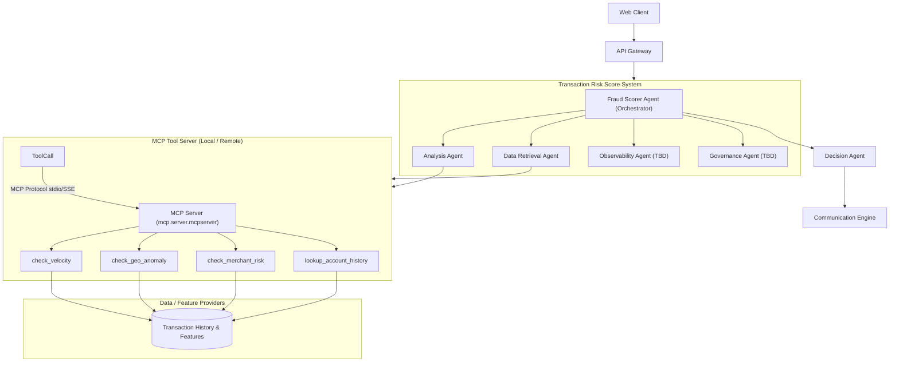

# Transaction Fraud Scorer Agentic AI

An intelligent, autonomous **Transaction Fraud Scoring** platform built with Python, **LangChain**, open-source **Ollama** models, and **Model Context Protocol (MCP)** servers.

---

## 🌟 Key Features

- **Agentic AI with LangChain & Ollama**: Uses open-source local models (`llama3.2:3b`, `mistral`, `qwen2.5`) with native tool/function calling via `ChatOllama` — no expensive commercial APIs required.
- **Google Colab Ready**: Turnkey interactive Jupyter Notebook [`notebooks/colab_setup_and_run.ipynb`](./notebooks/colab_setup_and_run.ipynb) runs directly on Google Colab CPU or free T4 GPU tier.
- **MCP Server Architecture**: Modular risk scoring tools exposed via standard Model Context Protocol over `stdio` and `sse`.
- **Comprehensive Risk Vectors**:
  - ⚡ **Velocity Analysis**: Multi-swipe burst detection and abnormal cumulative spend monitoring.
  - 🌍 **Geolocation Anomaly**: Haversine distance tracking and impossible travel speed detection.
  - 🏬 **Merchant Risk**: High-risk Merchant Category Code (MCC) evaluation (crypto, gaming, wire transfers).
  - 👤 **Account History**: Historical dispute rate, account age, and trust profiling.
- **Production-Ready Packaging**: Managed with [`uv`](https://github.com/astral-sh/uv) and modern `pyproject.toml`.
- **PRD Hub**: Standardized framework and template in [`docs/prds/`](./docs/prds/) for rapid authoring and delivery of new fraud detection features.

---

## 🏗️ Architecture



See [docs/architecture.md](./docs/architecture.md) for full technical documentation.

---

## 🚀 Quickstart

### 1. Python Environment Setup (Step-by-Step)

#### Option A: Using `uv` (Recommended)
```bash
# 1. Install uv (if not already installed)
curl -LsSf https://astral.sh/uv/install.sh | sh

# 2. Clone the repository
git clone -b feature/local_models https://github.com/daknamsubho/TransactionFraudScorerAgenticAI.git
cd TransactionFraudScorerAgenticAI

# 3. Create .venv and install all dependencies (fraud_scorer, api_gateway, web_client)
uv sync

# 4. (Optional) Activate the virtual environment
source .venv/bin/activate
```

#### Option B: Using Standard Python `venv` & `pip`
```bash
# 1. Clone the repository
git clone -b feature/local_models https://github.com/daknamsubho/TransactionFraudScorerAgenticAI.git
cd TransactionFraudScorerAgenticAI

# 2. Create and activate virtual environment
python3 -m venv .venv
source .venv/bin/activate

# 3. Upgrade pip and install the project in editable mode
pip install --upgrade pip
pip install -e .
```

---

### 2. Running the Web Client UI Step-by-Step (`src/web_client`)

See [`docs/web-client-setup.md`](./docs/web-client-setup.md) for the full guide.

1. **Start the API Gateway** (either in Google Colab or locally):
   - **In Google Colab (Remote with Cloudflare Tunnel)**:
     Open [`notebooks/colab_setup_and_run.ipynb`](./notebooks/colab_setup_and_run.ipynb) in Google Colab and run **Steps 1–3**. Copy the generated `https://*.trycloudflare.com` URL.
   - **Or Locally on Port `8000`**:
     ```bash
     uv run fraud-api-gateway --host 127.0.0.1 --port 8000
     ```

2. **Start / Stop the Web Client Server Locally on Port `3000`**:
   ```bash
   # Start in the background via the helper script
   ./src/web_client/webclient.sh start --port 3000

   # Check status or stop the server
   ./src/web_client/webclient.sh status
   ./src/web_client/webclient.sh stop

   # Or run in the foreground via uv
   uv run fraud-web-client --host 127.0.0.1 --port 3000
   ```

3. **Open the Web Client in Your Browser**:
   - Open [`http://127.0.0.1:3000`](http://127.0.0.1:3000).
   - Paste your **API Gateway Base URL** (`https://*.trycloudflare.com` from Colab, or `http://localhost:8000` if running locally) into the **API Gateway Base URL** input at the top.
   - Click **Check Health** to verify connectivity, then click **Connect WebSocket** (status badge turns `CONNECTED`).
   - Click **Load Card Preset** or **Load ACH Preset**, then click **Submit Transaction for Fraud Scoring**.
   - View the immediate REST response on the left and the real-time **WebSocket Event** (`Transaction ID`, `Username`, `Amount`, `Score`, `Status`, and full `score_details`) on the right.
   - Click **Accept** or **Reject** on any transaction row to send a decision to `POST /api/v1/transactions/decision`.

---

### 3. Run the CLI Agent or MCP Server Standalone
```bash
# Run the LangChain + Ollama Fraud Scorer CLI Demo
uv run fraud-scorer-agent --demo

# Run MCP Server over stdio (default) or SSE on port 8000
uv run fraud-mcp-server
uv run fraud-mcp-server --transport sse --port 8000
```

---

## 🧪 Testing & Quality

Run the test suite (includes LangChain tool adapter & orchestrator verification):
```bash
uv run pytest -v
```

Run linter and formatter checks:
```bash
uv run ruff check .
uv run ruff format --check .
uv run mypy src/
```

---

## 📋 Adding New PRDs

To add a new feature or risk vector:
1. Review the lifecycle and registry in [`docs/prds/README.md`](./docs/prds/README.md).
2. Copy the template from [`docs/prds/PRD_TEMPLATE.md`](./docs/prds/PRD_TEMPLATE.md) into `docs/prds/PRD-XXX-<feature-name>.md`.
3. Fill out the MCP tool contracts, scoring heuristics, and test acceptance criteria.

---

## 📄 License
MIT License
