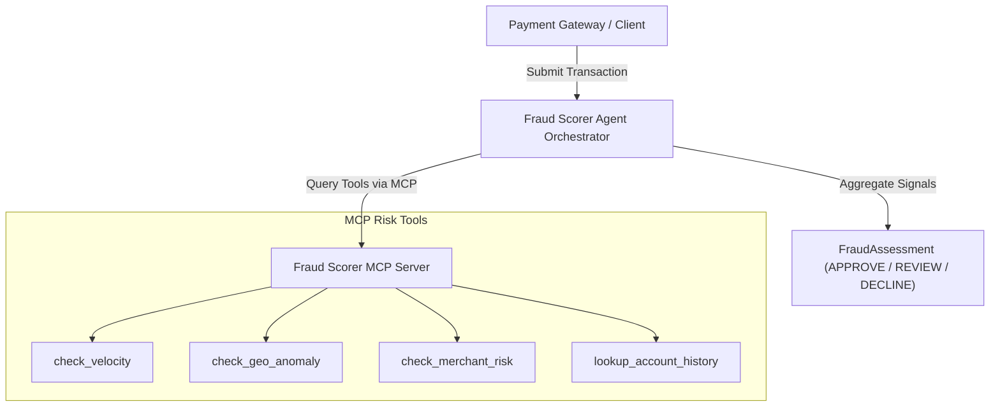

# Transaction Fraud Scorer Agentic AI

An intelligent, autonomous **Transaction Fraud Scoring** platform built with Python, modern **Model Context Protocol (MCP)** servers, and agentic reasoning loops.

---

## 🌟 Key Features

- **Agentic AI Reasoning**: Evaluates financial transactions using multi-step hypothesis testing and tool-assisted investigation.
- **MCP Server Architecture**: Modular risk scoring tools exposed via standard Model Context Protocol over `stdio` and `sse`.
- **Comprehensive Risk Vectors**:
  - ⚡ **Velocity Analysis**: Multi-swipe burst detection and abnormal cumulative spend monitoring.
  - 🌍 **Geolocation Anomaly**: Haversine distance tracking and impossible travel speed detection.
  - 🏬 **Merchant Risk**: High-risk Merchant Category Code (MCC) evaluation (crypto, gaming, wire transfers).
  - 👤 **Account History**: Historical dispute rate, account age, and trust profiling.
- **Production-Ready Packaging**: Managed with [`uv`](https://github.com/astral-sh/uv) and modern `pyproject.toml`.
- **PRD Hub**: Standardized framework and template in [`docs/prds/`](./docs/prds/) for rapid authoring and delivery of new fraud detection features.

---

## 🏗️ Architecture



See [docs/architecture.md](./docs/architecture.md) for full technical documentation.

---

## 🚀 Quickstart

### 1. Prerequisites
- Python 3.11+
- `uv` installed (`brew install uv` or `curl -LsSf https://astral.sh/uv/install.sh | sh`)

### 2. Environment Setup
```bash
# Clone the repository
git clone https://github.com/daknamsubho/TransactionFraudScorerAgenticAI.git
cd TransactionFraudScorerAgenticAI

# Synchronize virtual environment and dependencies
uv sync

# Configure environment variables
cp .env.example .env
```

### 3. Run the Agent Demo
Evaluate sample normal and fraudulent transactions in real-time:
```bash
uv run fraud-scorer-agent --demo
```

### 4. Run the MCP Server Standalone
```bash
# Run over stdio (default)
uv run fraud-mcp-server

# Or run over SSE on port 8000
uv run fraud-mcp-server --transport sse --port 8000
```

---

## 🧪 Testing & Quality

Run the test suite:
```bash
uv run pytest -v
```

Run linter and formatter checks:
```bash
uv run ruff check .
uv run ruff format --check .
```

---

## 📋 Adding New PRDs

To add a new feature or risk vector:
1. Review the lifecycle and registry in [`docs/prds/README.md`](./docs/prds/README.md).
2. Copy the template from [`docs/prds/PRD_TEMPLATE.md`](./docs/prds/PRD_TEMPLATE.md) into `docs/prds/PRD-XXX-<feature-name>.md`.
3. Fill out the MCP tool contracts, scoring heuristics, and test acceptance criteria.

---

## 📄 License
MIT License
