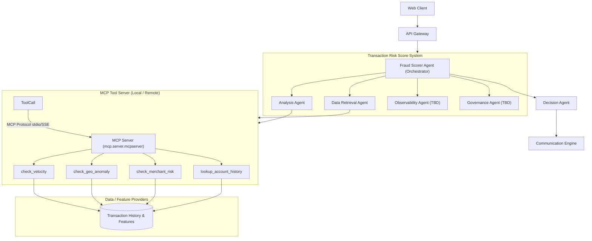

# Transaction Fraud Scorer Agentic AI

An intelligent, autonomous **Transaction Fraud Scoring** platform built with Python, **LangChain**, open-source **Ollama** models, and **Model Context Protocol (MCP)** servers.

---

## 🌟 Key Features

- **Agentic AI with LangChain & Ollama**: Uses open-source local models (`llama3.2:3b`, `mistral`, `qwen2.5`) with native tool/function calling via `ChatOllama` — no expensive commercial APIs required.
- **Google Colab Ready**: Turnkey interactive Jupyter Notebook [`notebooks/colab_setup_and_run.ipynb`](./notebooks/colab_setup_and_run.ipynb) runs directly on Google Colab CPU or free T4 GPU tier.
- **MCP Server Architecture**: Modular risk scoring tools exposed via standard Model Context Protocol over `stdio` and `sse`.
- **Comprehensive Risk Vectors**:
  - ⚡ **Velocity Analysis**: Multi-swipe burst detection and abnormal cumulative spend monitoring.
  - 🌍 **Geolocation Anomaly**: Haversine distance tracking and impossible travel speed detection.
  - 🏬 **Merchant Risk**: High-risk Merchant Category Code (MCC) evaluation (crypto, gaming, wire transfers).
  - 👤 **Account History**: Historical dispute rate, account age, and trust profiling.
- **Production-Ready Packaging**: Managed with [`uv`](https://github.com/astral-sh/uv) and modern `pyproject.toml`.
- **PRD Hub**: Standardized framework and template in [`docs/prds/`](./docs/prds/) for rapid authoring and delivery of new fraud detection features.

---

## 🏗️ Architecture



See [docs/architecture.md](./docs/architecture.md) for full technical documentation.

---

## 🚀 Quickstart

### Option A: Run in Google Colab (One-Click)
Open [`notebooks/colab_setup_and_run.ipynb`](./notebooks/colab_setup_and_run.ipynb) directly in Google Colab:
- Automatically installs Ollama and launches the background daemon.
- Pulls `llama3.2:3b`.
- Runs the LangChain agent and evaluates sample transactions interactively.
- See [`notebooks/README.md`](./notebooks/README.md) for details.

### Option B: Run Locally with `uv`
```bash
# 1. Clone repository
git clone https://github.com/daknamsubho/TransactionFraudScorerAgenticAI.git
cd TransactionFraudScorerAgenticAI

# 2. Sync dependencies
uv sync

# 3. Configure environment
cp .env.example .env

# 4. (Optional) If you have Ollama installed locally:
# ollama serve &
# ollama pull llama3.2:3b

# 5. Run the Agent Demo
uv run fraud-scorer-agent --demo
```

### Option C: Run MCP Server Standalone
```bash
# Run over stdio (default)
uv run fraud-mcp-server

# Or run over SSE on port 8000
uv run fraud-mcp-server --transport sse --port 8000
```

---

## 🧪 Testing & Quality

Run the test suite (includes LangChain tool adapter & orchestrator verification):
```bash
uv run pytest -v
```

Run linter and formatter checks:
```bash
uv run ruff check .
uv run ruff format --check .
uv run mypy src/
```

---

## 📋 Adding New PRDs

To add a new feature or risk vector:
1. Review the lifecycle and registry in [`docs/prds/README.md`](./docs/prds/README.md).
2. Copy the template from [`docs/prds/PRD_TEMPLATE.md`](./docs/prds/PRD_TEMPLATE.md) into `docs/prds/PRD-XXX-<feature-name>.md`.
3. Fill out the MCP tool contracts, scoring heuristics, and test acceptance criteria.

---

## 📄 License
MIT License
