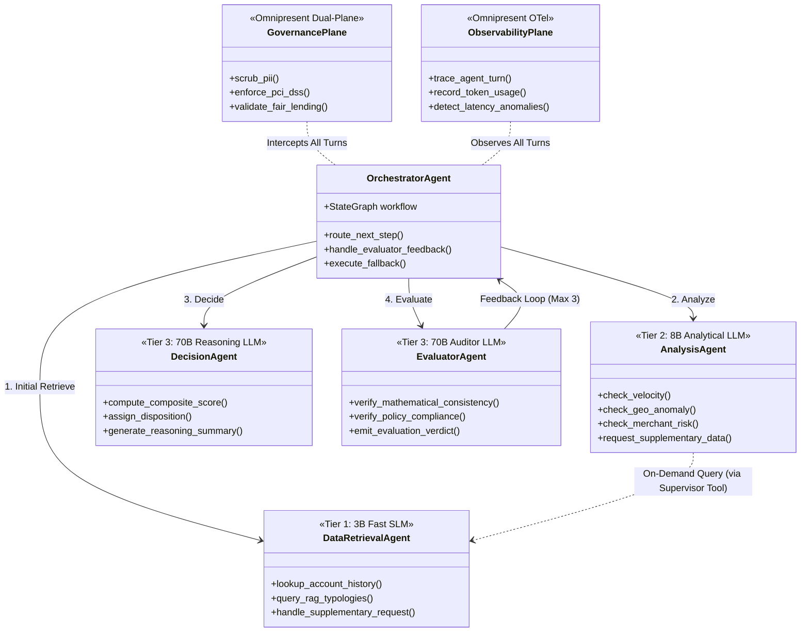
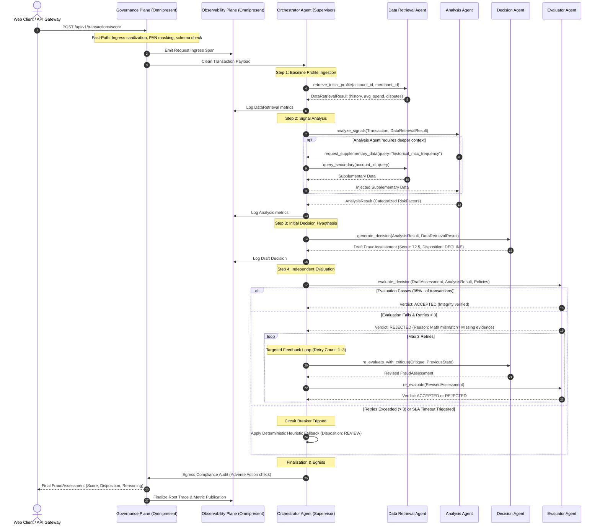
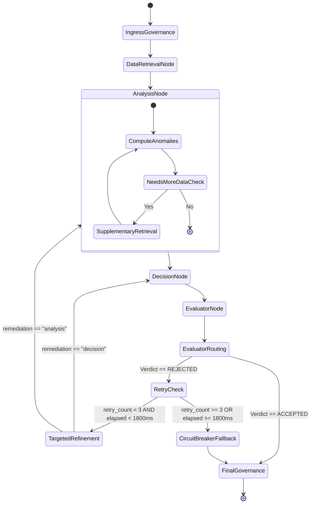

# Agentic Architecture Pattern: Hybrid Supervisor with Actor-Critic Feedback & Omnipresent Governance/Observability

- **PRD Reference**: [docs/prds/13-Architect-Agentic-pattern.md](file:///Users/abhishekbiswas/AppDevelppment/TransactionFraudScorerAgenticAI/docs/prds/13-Architect-Agentic-pattern.md)
- **Status**: Architectural Specification
- **Related Documents**: [docs/architecture.md](file:///Users/abhishekbiswas/AppDevelppment/TransactionFraudScorerAgenticAI/docs/architecture.md), [docs/tot-specification.md](file:///Users/abhishekbiswas/AppDevelppment/TransactionFraudScorerAgenticAI/docs/tot-specification.md), [docs/rag-design.md](file:///Users/abhishekbiswas/AppDevelppment/TransactionFraudScorerAgenticAI/docs/rag-design.md)

---

## 1. Executive Summary & Architectural Pattern

This document formalizes the multi-agent design for the **Transaction Fraud Scorer Agentic AI** system. The architecture implements a **Hybrid Supervisor-Critic Pattern** augmented with an **Omnipresent Cross-Cutting Plane** for Governance and Observability.

```
       +-------------------------------------------------------------+
       |               Omnipresent Cross-Cutting Plane               |
       |  +---------------------------+  +------------------------+  |
       |  |  Governance Interceptor   |  |   Observability Agent  |  |
       |  |  & Guardrail Agent        |  |   & Tracing Bus        |  |
       |  +---------------------------+  +------------------------+  |
       +-------------------------------------------------------------+
                                      ^
                                      | (Hooks & Telemetry on every step)
                                      v
+-------------------------------------------------------------------------+
|                  Supervisor Orchestration Control Plane                 |
|                                                                         |
|                     [ Orchestrator Agent (Supervisor) ]                 |
|                                     |                                   |
|       +-----------------------------+-----------------------------+     |
|       | 1. Initial Profile Fetch    | 2. Risk Signal Synthesis    |     |
|       v                             v                             |     |
| [ Data Retrieval Agent ] <---- [ Analysis Agent ]                 |     |
|                              (On-Demand Deep Query)               |     |
|                                     |                             |     |
|                                     | 3. Evidence Aggregation     |     |
|                                     v                             |     |
|                           [ Decision Agent (Actor) ]              |     |
|                                     |                             |     |
|                                     | 4. Draft Assessment         |     |
|                                     v                             |     |
|                         [ Evaluator Agent (Critic) ]              |     |
|                                     |                             |     |
|             +-----------------------+-----------------------+     |
|             | Pass (Approved)                               |     |
|             v                                               v     |
|     Final Assessment                        Feedback Loop (Max 3) |
|   (to API Gateway & Client)                 (Targeted Refinement) |
+-------------------------------------------------------------------------+
```

### Core Tenets of the Pattern
1. **Centralized Supervision with Decentralized Ingestion**: The `Orchestrator Agent` acts as a pure supervisor, driving state transitions while delegating feature extraction and analysis.
2. **Actor-Critic Separation (Generator-Verifier)**: Decision generation is partitioned between a `Decision Agent` (Actor) and an independent `Evaluator Agent` (Critic) to eliminate confirmation bias and enforce strict policy grounding.
3. **Controlled Feedback Loop**: If an evaluation fails quality or policy checks, a structured critique is fed back to the supervisor for targeted re-execution (capped at **3 retries** with SLA circuit breakers).
4. **Controlled Sub-Delegation**: The `Analysis Agent` can trigger supplementary retrieval queries against the `Data Retrieval Agent` through a supervisor-managed callback tool.
5. **Decoupled Cross-Cutting Omnipresence**: `Governance` and `Observability` operate as ubiquitous architectural layers rather than child nodes under the supervisor, ensuring non-bypassable guardrails and end-to-end tracing across every agent boundary.

---

## 2. Architectural Critique & Trade-Off Analysis

Challenging the architect's proposed design surfaces key operational, performance, and reliability trade-offs that must be mitigated in production.

### Trade-Off 1: Strict Supervisor vs. Direct Peer-to-Peer Sub-Delegation
* **The Proposal**: Orchestrator triggers `Data Retrieval Agent` first, then `Analysis Agent`. However, `Analysis Agent` can also call `Data Retrieval Agent` directly to gather supplementary information.
* **The Architectural Challenge**:
  - *State Bifurcation*: If `Analysis Agent` directly invokes `Data Retrieval Agent` out-of-band, the central `Orchestrator` loses visibility into intermediate state changes, tool token usage, and sub-latencies.
  - *Circular Dependencies*: Unconstrained peer-to-peer delegation can introduce infinite ping-pong loops (e.g., Analysis asks for data -> Retrieval triggers analysis of historical dispute -> Analysis asks for more data).
* **Trade-Off Matrix**:
  | Strategy | Pros | Cons | Recommendation |
  |---|---|---|---|
  | **Pure Hierarchical Supervisor** | Full state visibility, simple tracing, deterministic transitions. | Orchestrator must foresee every data need or manage multi-turn dialogue hops. | Sub-optimal for dynamic fraud scenarios. |
  | **Unconstrained Peer-to-Peer** | Maximum agent autonomy, fast contextual query resolution. | Loss of audit trail, risk of infinite loops, unmanaged latency. | **Rejected** for financial compliance. |
  | **Hybrid Sub-Orchestration (Tool-Proxy)** | Preserves supervisor state graph while granting Analysis Agent dynamic retrieval tools. | Slight orchestration schema overhead. | **ADOPTED**: Analysis Agent invokes a LangChain tool `request_supplementary_data` routed via the Supervisor state graph. |

---

### Trade-Off 2: Evaluator Feedback Loop & Production Latency SLA (Max 3 Retries)
* **The Proposal**: `Evaluator Agent` inspects the `Decision Agent` assessment and can route a feedback loop back to the `Orchestrator` for up to 3 retries.
* **The Architectural Challenge**:
  - *SLA Violation in Payment Checkout*: E-commerce and banking gateways enforce tight p95 latency budgets (typically **300ms to 800ms** for synchronous checkout; **< 2000ms** hard timeout). A single LLM pass across 4 agents takes 1.0–2.5 seconds. Three feedback retries (up to 4 passes = 16 agent invocations) would inflate latency to **8 to 20 seconds**, causing upstream payment gateway timeouts and checkout abandonment.
  - *Hallucinatory Oscillation*: Without precise diff instructions, LLMs often oscillate between inconsistent scores rather than converging.
* **Trade-Off Matrix**:
  | Dimension | Naive 3-Pass Full Loop | Targeted Differential Feedback (Adopted) |
  |---|---|---|
  | **Latency (p95)** | 12,000ms - 20,000ms (Unacceptable) | 1,200ms - 2,200ms |
  | **Token Consumption** | 4x full prompt context per retry | 1.2x context (only diff reasoning exchanged) |
  | **Re-execution Scope** | Full pipeline: Data -> Analysis -> Decision -> Evaluator | Targeted: Only re-invoke failing agent (e.g., Re-score only, or Re-query specific MCC) |
  | **Timeout Behavior** | Gateway drops connection (HTTP 504) | Hard Circuit Breaker: fallback to deterministic rule engine after 1,800ms |

* **Mitigation Rules**:
  1. **Differential Feedback Payload**: The Evaluator must emit structured JSON specifying: `rejection_category` (`ARITHMETIC_ERROR`, `UNGROUNDED_ASSERTION`, `POLICY_CONTRADICTION`, `INSUFFICIENT_EVIDENCE`), `target_agent` (`AnalysisAgent` vs `DecisionAgent`), and `remediation_instruction`.
  2. **Circuit Breaker**: If total elapsed wall-clock time exceeds `MAX_EVALUATION_TIMEOUT_MS = 1800ms`, the retry loop aborts immediately, emitting the current draft with a disposition of `REVIEW` and flag `evaluation_timeout_fallback = true`.

---

### Trade-Off 3: "Omnipresent" Governance & Observability (Synchronous LLMs vs. Dual-Plane Middleware)
* **The Proposal**: Observability and Governance should not be under the Orchestrator, but omnipresent to interact with other agents as guardrails and logging.
* **The Architectural Challenge**:
  - *Latency Multiplication*: If Governance and Observability are implemented as full LLM agents executed synchronously before and after *each* of the 4 core agents, a single transaction results in **2 (ingress/egress) * 4 (agents) = 8 Governance LLM calls** + **8 Observability LLM calls** = **16 auxiliary LLM calls**. This guarantees systemic collapse under load.
  - *Logging Determinism*: Observability (metrics, latency, token tracking, distributed tracing) requires zero-loss, deterministic execution, not probabilistic LLM generation.
* **Architectural Resolution: Dual-Plane Architecture**:
  1. **Synchronous Fast Path (Control Plane Interceptors)**:
     - Implemented as LangChain `CallbackHandlers` and FastAPI middleware.
     - **Governance Interceptor**: Regex & deterministic PII masking (PCI-DSS credit card scrubbing, PAN tokenization), schema validation, and hard risk threshold tripwires (execution time: **< 2ms**).
     - **Observability Tracing**: OpenTelemetry spans emitted asynchronously to logging sinks (execution time: **< 1ms**).
  2. **Asynchronous Deep Path (Agent Plane)**:
     - **Governance Agent**: Autonomous LLM agent triggered asynchronously or upon escalation (e.g., when the Evaluator flags discriminatory bias or novel regulatory ambiguity).
     - **Observability Agent**: Background agent analyzing audit traces, detecting agent drift, hallucination clusters, and tool latency degradation out-of-band.

---

### Trade-Off 4: Decision Agent vs. Evaluator Agent Separation (Actor-Critic Topology)
* **The Proposal**: Separate Decision Agent from Evaluator Agent.
* **Benefits**:
  - Mitigates *sunk-cost confirmation bias* where the scoring LLM defends its own initial flawed reasoning.
  - Enables asymmetric prompting: The Decision Agent uses a domain analyst persona focused on risk signal detection, while the Evaluator uses an adversarial compliance officer persona focused on policy adherence and verification.
* **Risks**:
  - Potential deadlocks if the Evaluator is overly strict or misaligned with Decision Agent scoring weights.
* **Resolution**: Strict evaluation Rubrics encoded via Pydantic schemas with quantitative acceptance thresholds (e.g., risk score must align with mathematical sum of risk factor contributions within +/- 5 points).

---

### Trade-Off 5: Homogeneous Model Deployment vs. Heterogeneous Multi-Model Tiering
* **The Architectural Decision**: Using a different, specialized model for lower-level tasks (e.g., Data Retrieval) versus high-level synthesis (Decision and Evaluation).
* **The Architectural Evaluation**:
  - *Homogeneous Anti-Pattern*: Deploying a single large reasoning model (e.g., 70B parameter LLM) across all agents incurs massive latency and compute waste on mechanical tasks like query parsing, schema formatting, and tool-call parameter extraction. Conversely, using a single small model (e.g., 3B) leads to hallucinated risk scores, faulty policy interpretations, and poor evaluation accuracy.
  - *Heterogeneous Model Tiering (Asymmetric Routing)*: Allocates compute proportional to cognitive task complexity:
    - **Tier 1 (Fast SLM / Tool-Calling Specialist)**: Low-latency, compact models (1B–3B parameters) for Data Retrieval and initial feature extraction. Latency: **50ms–200ms**.
    - **Tier 2 (Balanced Analytical Model)**: Mid-sized models (7B–14B parameters) for signal correlation and anomaly weighting in Analysis. Latency: **300ms–600ms**.
    - **Tier 3 (High-Reasoning & Adversarial Critic)**: Large frontier models (32B–70B+ parameters or Claude Sonnet / Gemini Pro) for Decision risk synthesis and Evaluator policy verification. Latency: **800ms–1500ms**.
* **Trade-Off Matrix**:
  | Dimension | Single Uniform Model (70B) | Heterogeneous Model Tiering (Adopted) |
  |---|---|---|
  | **End-to-End Latency** | 5,000ms - 8,000ms (SLA Breach) | 1,200ms - 2,500ms (60%+ Latency Reduction) |
  | **VRAM / Hardware Footprint** | Requires dedicated dual-A100/H100 or high cloud inference costs | Fits local workstation/edge deployment (small SLM in memory + shared heavy model) |
  | **Token & Cost Efficiency** | 100% tokens billed at expensive frontier rates | 65% of tokens handled by ultra-low-cost SLMs |
  | **Operational Complexity** | Low (single model endpoint) | Moderate (requires per-agent model configuration bindings) |
* **Architectural Resolution**: Adopt **Per-Agent Model Heterogeneity** via LangChain's decoupled `BaseChatModel` abstraction and centralized `AgentModelConfig`.

---

### Trade-Off 6: Single Unified Retrieval Agent with Concurrent I/O vs. Multi-Agent Data Sharding (SQLite & ChromaDB)
* **The Architectural Question**: Given a dual-storage substrate composed of **SQLite** (relational transaction history/features) and **ChromaDB** (vector embeddings for fraud typologies/policies), is a single Data Retrieval Agent sufficient for parallelization and high throughput, or should it be split into dedicated sub-agents (e.g., `SQLRetrievalAgent` and `VectorRAGAgent`)?
* **The Architectural Evaluation**:
  - *The Multi-Agent Sharding Anti-Pattern*:
    - Actual I/O latency: SQLite indexed query: **0.5ms–2ms**; ChromaDB vector search: **15ms–40ms** (including embedding compute).
    - LLM invocation latency: Even a fast 3B SLM requires **100ms–250ms** per prompt-response turn.
    - If data retrieval is split into two autonomous agents (`SQLAgent` and `VectorAgent`), the system must run **two separate LLM inference passes**, consuming **200ms–500ms** of cognitive compute to trigger database calls that finish in under **40ms combined**.
  - *The Single Agent + Concurrent I/O Pattern (Adopted)*:
    - A single Data Retrieval Agent (Tier 1 SLM) generates multiple tool calls in a **single turn** (e.g., `[lookup_account_history, query_fraud_typologies]`).
    - The Python runtime dispatches these tool executions concurrently via `asyncio.gather()`. Total I/O elapsed time equals `max(t_sqlite, t_chromadb) ≈ 20ms - 40ms`.
* **Storage Concurrency & Parallelization Guarantees**:
  - **SQLite Read Concurrency**: When configured with **WAL (Write-Ahead Logging)** mode (`PRAGMA journal_mode=WAL;`), SQLite provides **lock-free, concurrent reads**. Multiple worker threads or processes can read simultaneously without blocking each other or blocking background writers.
  - **ChromaDB Vector Concurrency**: Running ChromaDB in-process via `PersistentClient` utilizes HNSWlib, which supports thread-safe concurrent kNN queries. Local embedding generation is cached via an LRU cache so identical or frequent merchant/corridor embeddings incur zero re-computation.
* **Trade-Off Matrix**:
  | Dimension | Separate Sub-Agents (SQL + Vector) | Single Unified Agent + Concurrent I/O (Adopted) |
  |---|---|---|
  | **Inference Overhead** | 2x LLM generation passes (200ms - 500ms) | 1x LLM generation pass (100ms - 150ms) |
  | **I/O Execution** | Disjoint agent scheduling | Concurrent `asyncio.gather()` (20ms - 40ms) |
  | **State Consolidation** | Requires extra supervisor step to merge contexts | Returns single unified `DataRetrievalResult` |
  | **Storage Bottlenecks** | None resolved (DBs were already non-blocking) | Maximizes throughput on SQLite WAL and ChromaDB |
* **Architectural Verdict**: **One Data Retrieval Agent is both sufficient and optimal**. Scaling is achieved by parallelizing tool I/O under the agent, and scaling worker processes horizontally across CPU cores.

---

## 3. Detailed Agent Role Specifications & Model Tiering

### A. Heterogeneous Model Tiering Matrix

To optimize both inference latency (< 1.5s total SLA) and infrastructure token costs, the architecture enforces **Asymmetric Model Tiering**. High-frequency, deterministic or schema-heavy tasks (such as Data Retrieval) utilize fast, compact Small Language Models (SLMs) or deterministic bindings, while deep reasoning and verification tasks utilize high-capacity frontier models:

| Agent / Component | Cognitive Task Type | Target Model Tier | Recommended Local Models (Ollama) | Recommended Cloud Models | Typical Latency Budget |
|---|---|---|---|---|---|
| **Data Retrieval Agent** | Structured tool calling, SQL parameter extraction, JSON formatting | **Tier 1: Fast SLM (1B - 3B)** | `llama3.2:3b`, `qwen2.5:3b`, `qwen2.5-coder:1.5b` | Gemini 2.0 Flash Lite, Claude 3.5 Haiku | **< 150ms** |
| **Analysis Agent** | Anomaly correlation, statistical synthesis, multi-vector risk factor ranking | **Tier 2: Balanced Analytical (7B - 14B)** | `llama3.1:8b-instruct`, `qwen2.5:7b` / `14b` | Gemini 2.0 Flash, GPT-4o-mini | **< 400ms** |
| **Decision Agent (Actor)** | Multi-factor fraud scoring hypothesis, composite normalization, human-readable explainability | **Tier 3: Deep Reasoning (32B - 70B)** | `llama3.3:70b-instruct`, `qwen2.5:32b` | Gemini 1.5/2.0 Pro, Claude 3.5 Sonnet | **< 800ms** |
| **Evaluator Agent (Critic)** | Adversarial audit, arithmetic consistency check, policy compliance verification | **Tier 3+: Critical Auditor (32B - 70B)** | `llama3.3:70b-instruct`, `qwen2.5:72b` | Claude 3.5 Sonnet, Gemini 2.0 Pro | **< 700ms** |
| **Governance Agent (Deep)** | Regulatory fairness audit, fair-lending adverse action validation | **Tier 2: Compliance Policy (8B)** | `llama3.1:8b` (or deterministic Presidio) | Gemini 2.0 Flash | Async / Out-of-Band |
| **Observability Agent** | Trace ingestion, token counting, anomaly metric aggregation | **Deterministic / No LLM** | Non-LLM OTel / Python runtime | Datadog / OpenTelemetry | **< 2ms** |



### B. Agent Role Specifications

### 1. Orchestrator Agent (Supervisor)
- **Role**: Workflow Coordinator & Finite State Machine Driver.
- **Model / Engine**: Deterministic LangGraph StateGraph (zero LLM inference overhead for pure routing) with fallback to Tier 1 SLM if natural language dispatch is configured.
- **Authority**: Does not calculate fraud scores or determine approvals directly.
- **Responsibilities**:
  - Maintains the global `FraudState`.
  - Dispatches tasks sequentially to `DataRetrievalAgent` -> `AnalysisAgent` -> `DecisionAgent` -> `EvaluatorAgent`.
  - Mediates on-demand data retrieval requests originating from `AnalysisAgent`.
  - Manages the retry counter (`retry_count <= 3`).
  - Triggers deterministic fallback if `retry_count > 3` or if SLA deadline is exceeded.

### 2. Data Retrieval Agent
- **Role**: Data Aggregation & Context Grounding Specialist.
- **Designated Model Tier**: **Tier 1 (Fast SLM, e.g., `llama3.2:3b` or `qwen2.5:3b`)**.
  - *Rationale*: Lower-level data retrieval primarily maps transaction fields to MCP tool arguments (`account_id`, `window_minutes`), converts natural language queries to vector database similarity filters, and serializes database results into clean JSON. A lightweight 3B model excels at tool calling with 4x–8x lower latency and VRAM footprint than a 70B model.
- **Tools**:
  - `lookup_account_history` (SQLite RDBMS / MCP Tool).
  - `VectorStoreRetriever` (ChromaDB / LangChain RAG for historical fraud typologies and merchant risk history).
- **Parallel Tool Execution & Concurrency Architecture**:
  - Rather than executing tool calls serially, the single Data Retrieval Agent dispatches tools concurrently using asynchronous I/O (`asyncio.gather`):
    ```
                 [ Data Retrieval Agent (Tier 1 SLM) ]
                                  |
                  Single Prompt -> Multi-ToolCall Output
                                  |
                +-----------------+-----------------+
                | (async task 1)                    | (async task 2)
                v                                   v
    [ SQLite lookup_account_history ]   [ ChromaDB query_fraud_typologies ]
      - PRAGMA journal_mode = WAL;        - In-process PersistentClient
      - PRAGMA query_only = ON;           - Pre-computed Embedding Cache
      - Latency: ~0.5ms - 2ms             - Latency: ~15ms - 35ms
                |                                   |
                +-----------------+-----------------+
                                  |
                   Consolidated DataRetrievalResult
                                  v
                        [ Orchestrator State ]
    ```
- **Storage Concurrency Guidelines for SQLite & ChromaDB**:
  - **SQLite Connection Pooling**: Enable WAL mode at database initialization:
    `PRAGMA journal_mode=WAL; PRAGMA synchronous=NORMAL; PRAGMA cache_size=-64000;`. Maintain a dedicated read-only connection pool with `check_same_thread=False` to ensure zero reader contention.
  - **ChromaDB Thread Safety**: Initialize a singleton `chromadb.PersistentClient()`. Use batch query endpoints and cache query embeddings in an LRU memory cache (`functools.lru_cache`) to avoid redundant embedding passes for recurring merchant categories and regional corridors.
- **Responsibilities**:
  - Ingests incoming `Transaction` and fetches baseline profile (account age, disputes, spend patterns).
  - Responds to targeted secondary queries from `AnalysisAgent` (e.g., "Fetch prior transactions for this account in MCC 5816 within the last 90 days").

### 3. Analysis Agent
- **Role**: Anomaly Detection & Signal Computation Engine.
- **Designated Model Tier**: **Tier 2 (Balanced Analytical LLM, e.g., `llama3.1:8b` or `qwen2.5:7b/14b`)**.
  - *Rationale*: Requires sufficient reasoning capacity to synthesize multi-vector numerical outputs (velocity burst, haversine speed, merchant reputation) and formulate categorized `RiskFactor` objects with severity rankings.
- **Tools**:
  - `check_velocity`, `check_geo_anomaly`, `check_merchant_risk`, `calculate_amount_anomaly`.
  - `request_supplementary_data` (Supervisor callback proxy).
- **Responsibilities**:
  - Executes multi-vector anomaly calculations.
  - Dynamically detects when initial profile data is insufficient (e.g., sudden foreign IP requiring historical geo-location verification) and triggers a supplementary retrieval.
  - Formulates structured `RiskFactor` records categorized with severity (`LOW`, `MEDIUM`, `HIGH`, `CRITICAL`) and numeric weight contributions.

### 4. Decision Agent (Actor)
- **Role**: Hypothesis Formulator & Risk Scorer.
- **Designated Model Tier**: **Tier 3 (Deep Reasoning LLM, e.g., `llama3.3:70b`, `qwen2.5:32b`, or Gemini Pro)**.
  - *Rationale*: Must weigh conflicting signals (e.g., high velocity but trusted VIP customer at familiar merchant), calculate non-linear composite risk scores, and write compliant, defensible reasoning summaries.
- **Tools**:
  - `RiskScoringDecisionSkill`.
  - `ChatOllama` / LLM reasoning chain.
- **Responsibilities**:
  - Aggregates `DataRetrievalResult` and `AnalysisResult`.
  - Synthesizes risk factors into a normalized score (`0.0 - 100.0`).
  - Recommends disposition (`APPROVE`, `REVIEW`, `DECLINE`).
  - Formulates a draft `reasoning_summary` citing evidence and policy rules.

### 5. Evaluator Agent (Critic)
- **Role**: Quality Assurance, Explainability & Compliance Auditor.
- **Designated Model Tier**: **Tier 3+ (Critical Auditor LLM, e.g., `llama3.3:70b`, `qwen2.5:72b`, or Claude 3.5 Sonnet)**.
  - *Rationale*: Must possess equal or superior reasoning capability to the Decision Agent to detect subtle hallucinations, mathematical inconsistencies, or policy transgressions.
- **Responsibilities**:
  - **Mathematical Audit**: Verifies that individual `RiskFactor` weights logically add up to the final composite score without hallucinated math.
  - **Policy Conformance**: Verifies disposition against organizational policy (e.g., "Any transaction with `impossible_travel = true` MUST be `DECLINE` or `REVIEW`, never `APPROVE`").
  - **Explainability Check**: Asserts that every cited risk factor in `reasoning_summary` is backed by concrete data in the state graph.
  - **Verdict Output**: Returns `ACCEPTED` (proceed to client) or `REJECTED` (with targeted remediation instructions and target agent routing).

### 6. Governance Agent & Interceptor Plane (Omnipresent)
- **Role**: Real-Time Guardrails, Privacy & Regulatory Compliance.
- **Designated Model Tier**: Dual-plane: Deterministic regex/tokenization engine for fast inline checks (< 1ms); Tier 2 (8B) model for asynchronous compliance audits.
- **Responsibilities**:
  - **PII / PCI-DSS Scrubbing**: Redacts 16-digit PANs, CVVs, and sensitive customer identifiers before payloads reach LLM context windows.
  - **Adverse Action Alignment**: Ensures explanations comply with fair lending (ECOA / FCRA) regulations (no discriminatory proxy features like zip-code redlining).
  - **Kill-Switch Enforcement**: Blocks any agent execution path that attempts unauthorized external network egress or unsanctioned tool invocation.

### 7. Observability Agent & Telemetry Plane (Omnipresent)
- **Role**: Distributed Tracing, Audit Trail & Health Telemetry.
- **Designated Model Tier**: Non-LLM deterministic telemetry pipeline (OpenTelemetry + structured logging).
- **Responsibilities**:
  - Attaches `trace_id` and `span_id` across all inter-agent hops.
  - Logs per-agent model identifier, model tier, input/output tokens, and execution latencies.
  - Detects evaluation retry loops and alerts when retry rates exceed 5% of traffic.
  - Emits structured audit events to external SIEM / Elasticsearch / Datadog endpoints.

---

## 4. End-to-End System Execution Sequence Diagram



---

## 5. LangGraph State Machine Specification

The architecture maps directly to a **LangGraph StateGraph** maintaining an explicit immutable state schema:

```python
from typing import Annotated, List, Optional, Dict, Any
from pydantic import BaseModel, Field

class FraudEvaluationState(BaseModel):
    # Ingress Data
    transaction_id: str
    transaction: Dict[str, Any]
    
    # Enrichment State
    retrieval_data: Optional[Dict[str, Any]] = None
    supplementary_retrievals: List[Dict[str, Any]] = Field(default_factory=list)
    
    # Analysis State
    risk_factors: List[Dict[str, Any]] = Field(default_factory=list)
    analysis_completed: bool = False
    
    # Decision State
    draft_score: Optional[float] = None
    draft_disposition: Optional[str] = None
    draft_reasoning: Optional[str] = None
    
    # Evaluator State
    evaluator_verdict: Optional[str] = None  # "ACCEPTED" | "REJECTED"
    evaluator_feedback: Optional[str] = None
    remediation_target: Optional[str] = None  # "analysis" | "decision"
    
    # Loop Controls
    retry_count: int = 0
    max_retries: int = 3
    is_fallback: bool = False
    execution_start_time: float

class AgentModelConfig(BaseModel):
    """Configuration mapping distinct model tiers to specific agent roles."""
    # Tier 1: Fast Small Language Models (Tool-calling & JSON schema formatting)
    data_retrieval_model: str = Field(default="llama3.2:3b", description="Ollama or cloud model for Data Retrieval Agent")
    
    # Tier 2: Mid-sized Analytical Models (Numerical correlation & signal weighting)
    analysis_model: str = Field(default="llama3.1:8b", description="Model for Analysis Agent")
    governance_model: str = Field(default="llama3.1:8b", description="Asynchronous compliance model")
    
    # Tier 3: High-Capacity Frontier Models (Complex synthesis & adversarial auditing)
    decision_model: str = Field(default="llama3.3:70b", description="Reasoning model for Decision Agent")
    evaluator_model: str = Field(default="llama3.3:70b", description="Auditing model for Evaluator Agent")
```

### State Transition Graph



---

## 6. Failure Modes, Edge Cases & Resilience Matrix

| Failure Mode | Root Cause | Impact | Architectural Mitigation |
|---|---|---|---|
| **Evaluator-Decision Ping-Pong** | Decision and Evaluator LLMs disagree indefinitely on borderline edge cases (e.g., score 69.5 vs 70.1). | SLA breach, excessive token burn. | **Hard Cap & Fallback**: Loop terminates unconditionally when `retry_count == 3`. If unaligned, system forces `disposition = REVIEW` and queues transaction for human analyst. |
| **Data Retrieval Timeout** | SQLite locked or MCP Server slow to respond. | Pipeline stalls at Step 1. | **Asynchronous Timeout & Partial Grace**: 400ms timeout on tool calls. If timed out, `DataRetrievalResult` marks `degraded_mode = True`, prompting downstream agents to rely on stateless transaction heuristics. |
| **Analysis Loop Runaway** | `Analysis Agent` requests supplementary data repeatedly. | Memory inflation and latency spike. | **Sub-query Limit**: Allow maximum of **1** supplementary retrieval turn per transaction. |
| **PII Data Leakage** | Free-form transaction payload contains unmasked credit card or SSN numbers. | PCI-DSS / GDPR regulatory violation. | **Pre-Ingress Governance Interceptor**: Non-bypassable regex and tokenization hook cleans payload before reaching any LLM prompt template. |
| **LLM Provider Outage** | Local Ollama or remote LLM service crashes or becomes unresponsive. | Total scoring paralysis. | **Deterministic Skill Fallback**: Orchestrator immediately switches to pure algorithmic Python rule engine (`src/fraud_scorer/skills/`), delivering scored assessment without LLM synthesis. |

---

## 7. Comparison: Standard Linear Pipeline vs. Hybrid Agentic Pattern

| Capability | Current Linear Pipeline | PRD-013 Hybrid Agentic Pattern |
|---|---|---|
| **Orchestration Model** | Static procedural python script | Dynamic LangGraph Supervisor with conditional state routing |
| **Quality Control** | Single-pass decisioning (unverified) | Actor-Critic verification with Evaluator Agent |
| **Error Correction** | None (first output is final) | Targeted feedback loop with up to 3 retries |
| **Retrieval Flexibility** | Static single-query before analysis | Initial baseline + dynamic on-demand deep querying |
| **Governance & Safety** | Implicit / optional roadmap | Omnipresent non-bypassable pre/post interceptor plane |
| **Observability** | Standard log prints | Omnipresent distributed tracing, token accounting, and drift detection |
| **Resilience & SLA** | Single failure halts pipeline | Layered fallbacks: targeted retry -> heuristic rule engine -> human review queue |

---

## 8. Summary & Next Steps for Roadmap

1. **Phase 1 (Specification)**: *Completed in this document and approved under PRD-013*.
2. **Phase 2 (Evaluator & Governance Contracts)**: Define Pydantic models for `EvaluatorCritique`, `GovernanceGuardrailResult`, and `FraudEvaluationState`.
3. **Phase 3 (LangGraph StateGraph Implementation)**: Build the stateful supervisor workflow in `src/fraud_scorer/graph/` incorporating the conditional feedback edges and circuit breaker.
4. **Phase 4 (Omnipresent Interceptors)**: Implement FastAPI / LangChain callback interceptors for zero-latency PII scrubbing and OpenTelemetry distributed tracing.
