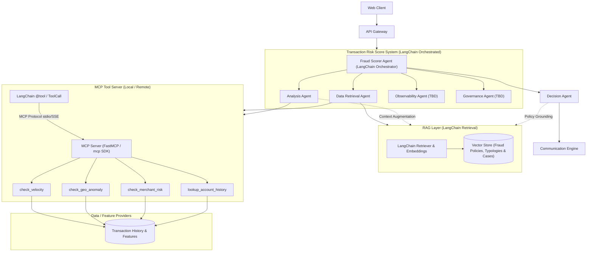

# Architecture Overview: Transaction Fraud Scorer Agentic AI

## 1. System Architecture

The **Transaction Fraud Scorer Agentic AI** decomposes fraud evaluation into a **LangChain-Orchestrated Multi-Agent Reasoning Layer**, a **RAG (Retrieval-Augmented Generation) Knowledge Layer**, and a modular **MCP (Model Context Protocol) Tool Layer**.

---

## 2. Core Components

### A. Ingress & Client Layer
- **Web Client**: External consumer interface (e.g., checkout portal, mobile banking app, e-commerce payment gateway) submitting transaction scoring requests.
  - **Manual Test Transaction Loaders (`src/web_client/`, PRD-012)**: The Submit page (`index.html`) offers *Import Random transaction from test_transaction_dataset*, *Generate Good Transaction*, and *Generate Fraud Transaction* buttons plus a *Test Transaction Details* section. The dataset (`docs/dataset/test_transactions_dataset.json`) is served by the WebClient's own server (`/dataset/test_transactions_dataset.json`) and good/fraud transactions are synthesized client-side in `app.js`. The API Gateway and everything behind it stay **headless** — they have no knowledge of test datasets and only receive the standard `POST /api/v1/transactions/score` request.
- **API Gateway**: Edge ingress point responsible for:
  - Client authentication and API key validation.
  - Rate limiting and request throttling.
  - Ingress payload sanitization and schema validation against domain models.
  - Routing transaction payloads to the `Transaction Risk Score System`.

### B. Transaction Risk Score System (Multi-Agent Ecosystem & Modular Skills)
An autonomous, coordinated multi-agent workflow built on **LangChain** (`langchain`, `langchain-core`, `langchain-ollama`) managing the end-to-end evaluation lifecycle. Every agent can be toggled on or off via `AgentFeatureFlags` (`src/fraud_scorer/config.py`):

1. **Orchestrator Agent** (`src/fraud_scorer/agents/orchestrator_agent.py`):
   - Pure manager/coordinator agent (`enable_orchestrator_agent`). Does **not** perform any scoring or approval decisioning itself.
   - Coordinates enabled sub-agents (`DataRetrieverAgent`, `AnalysisAgent`) and passes all gathered profile context and risk factor evidence to the `DecisionAgent`, returning the final `FraudAssessment` to the `API Gateway` (`src/api_gateway/app.py`) to send back to the `Web Client`.

2. **Data Retrieval Agent** (`src/fraud_scorer/agents/data_retriever_agent.py`):
   - Controlled by `enable_data_retriever_agent`.
   - Interfaces with the **MCP Tool Server** / SQLite RDBMS via the **Account History Skill** (`src/fraud_scorer/skills/account_history_skill.py`) and **RAG Layer** (roadmap).
   - Invokes `lookup_account_history` to retrieve account age, prior chargeback records, historical average spend, and trust tiers.
   - Supplies enriched `DataRetrievalResult` profile context to downstream agents.

3. **Analysis Agent** (`src/fraud_scorer/agents/analysis_agent.py`):
   - Controlled by `enable_analysis_agent`.
   - Specialized in multi-vector fraud signal computation and anomaly detection using modular skill files (`src/fraud_scorer/skills/`):
     - `VelocityAnalysisSkill` (`src/fraud_scorer/skills/velocity_analysis_skill.py`) -> wraps `check_velocity`: Measures transaction burst frequencies and rapid volume spikes.
     - `GeoAnomalySkill` (`src/fraud_scorer/skills/geo_anomaly_skill.py`) -> wraps `check_geo_anomaly`: Calculates haversine distances and flags impossible travel speeds.
     - `MerchantRiskSkill` (`src/fraud_scorer/skills/merchant_risk_skill.py`) -> wraps `check_merchant_risk`: Evaluates high-risk Merchant Category Codes (MCCs) and merchant reputation.
     - `AmountAnomalySkill` (`src/fraud_scorer/skills/amount_anomaly_skill.py`): Evaluates spend spikes relative to the customer's historical average spend and card-present status.
   - Produces an `AnalysisResult` containing categorized `RiskFactor` evidence blocks with severity rankings.

4. **Decision Agent** (`src/fraud_scorer/agents/decision_agent.py`):
   - Controlled by `enable_decision_agent`.
   - Ingests the enriched profile data (`DataRetrievalResult`) and `RiskFactor` evidence (`AnalysisResult`) passed by the Orchestrator Agent.
   - Uses `RiskScoringDecisionSkill` (`src/fraud_scorer/skills/risk_scoring_decision_skill.py`) and optional LangChain `ChatOllama` reasoning to compute the composite normalized risk score (`0.0` to `100.0`) and final disposition (`APPROVE`, `REVIEW`, `DECLINE`).
   - Returns the completed `FraudAssessment` to the Orchestrator Agent -> `API Gateway` -> `Web Client`.

5. **Observability Agent (TBD)**:
   - *Roadmap component*: Real-time monitoring, LangChain callback tracing, telemetry emission, and latency tracking.
   - Tracks agent execution latencies, MCP tool invocation counts, RAG retrieval relevance scores, model token usage, and evaluation accuracy.
   - Emits structured audit logs for compliance and operational health dashboards.

6. **Governance Agent (TBD)**:
   - *Roadmap component*: Policy enforcement, safety guardrails, and regulatory compliance.
   - Ensures zero leakage of unmasked PII or sensitive payment data (e.g., PCI-DSS compliance).
   - Uses RAG-backed regulatory rulebooks to audit decision rationales against anti-bias, fair lending, and consumer protection guidelines.

### C. RAG Layer (LangChain Retrieval & Vector Store)
- **LangChain Retriever & Embeddings**: Generates dense vector embeddings (e.g., via `OllamaEmbeddings`) for incoming transaction narratives and agent queries.
- **Vector Store**: Stores and indexes high-dimensional embeddings of unstructured fraud intelligence, organizational policies, and historical incident reports (using lightweight local stores such as ChromaDB.

### D. Egress & Communication Engine
- **Communication Engine**: Asynchronous notification and dispatch layer that:
  - Delivers the final `FraudAssessment` back to the payment gateway or calling service.
  - Triggers real-time alerts (webhooks, event bus, Slack/email notifications) for transactions flagged for `REVIEW` or `DECLINE`.
  - Dispatches high-risk incidents into analyst review queues and ticketing systems.

### E. MCP Tool Server & Risk Tools (`src/fraud_scorer/mcp/`)
- Implements the open **Model Context Protocol (MCP)** using `mcp.server.mcpserver.MCPServer`.
- Exposes standardized tool endpoints (`check_velocity`, `check_geo_anomaly`, `check_merchant_risk`, `lookup_account_history`).
- Operates over both `stdio` (in-process child execution) and `sse` (standalone HTTP/SSE microservice).
- Provides tool introspection (`tools/list`) and dynamic execution (`tools/call`).

### F. Data & Feature Providers
- Data storage and feature store abstractions backing the MCP tools.
- Maintains customer account baselines, historical transaction logs, geographical coordinates, and merchant MCC risk registries.
- Uses an in-memory/mock repository (`MockDB`) for local development and CI testing, with interfaces ready for production data stores (Redis, DynamoDB, PostgreSQL, Snowflake/BigQuery).

### G. Domain Models & Contracts (`src/fraud_scorer/models/`)
- Strict Pydantic v2 domain schemas validating:
  - `Transaction`, `GeoLocation`, `PaymentMethod`, `MerchantInfo`.
  - `RiskFactor` with category, severity, contribution score, and evidence details.
  - `FraudAssessment` containing assessment ID, overall risk score, decision disposition, and auditable reasoning summary.

---

## 3. How LangChain is Applied in the Architecture

**LangChain** serves as the cognitive backbone and orchestration framework across the `Transaction Risk Score System`:

1. **LLM Abstraction & Local/Cloud Model Portability**:
   - The `FraudScorerOrchestrator` uses `ChatOllama` (`langchain-ollama`) to run tool-capable local models (such as `llama3.2:3b`, `mistral`, or `qwen2.5`) with zero external API data exposure.
   - Because agents are built on `langchain-core` interfaces (`BaseChatModel`, `Runnable`), swapping between local Ollama models and cloud providers (Gemini, Anthropic Claude) requires only a configuration change.

2. **MCP-to-LangChain Tool Binding (`src/fraud_scorer/agents/tools.py`)**:
   - Domain risk tools exposed by the `MCP Server` are wrapped with LangChain's `@tool` decorator (`BaseTool`), automatically generating JSON Schema definitions from Python type annotations and docstrings.
   - The `Analysis Agent` and `Data Retrieval Agent` bind these tools directly to the model via `llm.bind_tools(tools)`, enabling autonomous multi-step `ToolCall` selection and parallel tool execution.

3. **Prompt Engineering & Conversation State Management (`src/fraud_scorer/agents/prompts.py`)**:
   - Standardized prompt templates (`FRAUD_ANALYST_SYSTEM_PROMPT`, `TRANSACTION_EVALUATION_TEMPLATE`) construct structured sequences of `SystemMessage`, `HumanMessage`, `AIMessage`, and `ToolMessage` objects.
   - During the iterative reasoning loop, tool outputs are serialized into `ToolMessage` payloads correlated by `tool_call_id` so the LLM can synthesize multi-tool evidence before handing off to the `Decision Agent`.

4. **Structured Output Enforcement & Resilient Fallbacks**:
   - LangChain integrates directly with our Pydantic v2 schemas (`FraudAssessment`, `RiskFactor`) to validate agent outputs and prevent malformed responses.
   - Built-in fallback execution ensures high availability: if the Ollama LLM service times out or is unreachable, the orchestrator transparently falls back to a deterministic LangChain tool-invocation pipeline so transaction scoring never blocks payment checkout.

---

## 4. How RAG (Retrieval-Augmented Generation) is Applied

While **MCP Tools** query *structured, real-time operational features* (e.g., exact transaction counts in the last 60 minutes, haversine distance in km), **RAG** equips the agents with *unstructured, semantic domain knowledge* and *historical precedent*.

### A. Knowledge Indexed in the Vector Store
1. **Historical Fraud Cases & Typologies**:
   - Past confirmed fraud incidents, chargeback dispute narratives, and synthetic fraud ring signatures (e.g., *"card-testing micro-transactions followed by high-value digital goods MCC 5816/7995 purchases"*).
2. **Dynamic Risk Policies & Playbooks**:
   - Internal underwriting guidelines, regional step-up authentication rules, MCC-specific scrutiny policies, and seasonal travel/holiday exception rules.
3. **Regulatory & Compliance Guardrails**:
   - PCI-DSS handling rules, regional consumer protection guidelines, and explainability requirements for adverse action notices.

### B. End-to-End RAG Execution Flow Across Agents
1. **Contextual Query Formulation (`Data Retrieval Agent`)**:
   - When a `Transaction` arrives from the `API Gateway`, the `Data Retrieval Agent` converts key transaction attributes (merchant MCC, country corridor, payment method, amount tier, and initial anomaly indicators) into a semantic query.
   - Using the **LangChain Retriever** (`VectorStoreRetriever`), it performs similarity search (`k` nearest neighbors) against the `Vector Store` alongside its MCP `lookup_account_history` call.
2. **Pattern Matching & Context Augmentation (`Analysis Agent`)**:
   - The `Analysis Agent` combines deterministic metrics from MCP tools (`check_velocity`, `check_geo_anomaly`, `check_merchant_risk`) with the retrieved RAG documents.
   - *Example*: Even if a transaction's velocity is just below a hard static cutoff, RAG retrieval can surface a matching *emerging fraud typology* for that specific merchant category and geo corridor, allowing the `Analysis Agent` to elevate the `RiskFactor` severity appropriately.
3. **Policy-Grounded Decisioning & Explainability (`Decision Agent`)**:
   - The `Decision Agent` receives the aggregated `RiskFactor` list plus retrieved policy snippets from the `RAG Layer`.
   - Grounding the LLM prompt in retrieved policy documents eliminates threshold hallucination, ensures alignment with the latest risk playbooks without retraining the model, and produces an audit-ready `reasoning_summary` that cites both quantitative MCP tool outputs and relevant policy/precedent context.
4. **Continuous Feedback Loop**:
   - Confirmed fraud dispositions and analyst review outcomes emitted through the `Communication Engine` can be periodically embedded and indexed back into the `Vector Store`, allowing the system to adapt to new fraud patterns in near real-time.

---

## 5. Risk Scoring & Decision Taxonomy

Every assessment generates an overall risk score normalized between **0.0** and **100.0**:

| Score Range | Decision | Action Taken |
|---|---|---|
| **0.0 - 29.9** | `APPROVE` | Transaction processed immediately with low risk signals. |
| **30.0 - 69.9** | `REVIEW` | Flagged for manual analyst queue or Step-up / 3DS authentication. |
| **70.0 - 100.0** | `DECLINE` | Transaction blocked due to critical risk factors or velocity abuse. |

---

## 6. MCP Tool Contracts

| Tool Name | Key Inputs | Primary Outputs |
|---|---|---|
| `check_velocity` | `account_id`, `window_minutes` | `count_transactions`, `sum_amount`, `velocity_score`, `is_burst` |
| `check_geo_anomaly` | `account_id`, `current_lat`, `current_lon`, `timestamp` | `distance_km`, `elapsed_hours`, `speed_kmh`, `impossible_travel` |
| `check_merchant_risk` | `merchant_id`, `mcc` | `risk_tier`, `high_risk_category`, `merchant_reputation` |
| `lookup_account_history` | `account_id` | `account_age_days`, `prior_disputes`, `avg_transaction_amount` |

---

## 7. Multi-Path & Tree-of-Thoughts (ToT) Architecture (Extension)

To evaluate, compare, and benchmark diverse tool subsets and agent combinations, the system supports a **LangGraph StateGraph Tree-of-Thoughts (ToT)** execution mode alongside the standard linear pipeline.

- Comprehensive formal specification, search mechanics, role-to-tool mappings, and mitigations are documented in:
  **[`docs/tot-specification.md`](file:///Users/abhishekbiswas/AppDevelppment/TransactionFraudScorerAgenticAI/docs/tot-specification.md)**.
- Architectural design, state schemas, and branch execution models are documented in:
  **[`docs/tree-of-thoughts-architecture.md`](file:///Users/abhishekbiswas/AppDevelppment/TransactionFraudScorerAgenticAI/docs/tree-of-thoughts-architecture.md)**.
- Operates in a **Hybrid Mode** selectable per request (`mode: "standard" | "tree_of_thoughts"`).
- Enables simultaneous **Tool & Agent Ablation** and **Semantic Fraud Hypothesis Testing** with automated confidence-based branch pruning and marginal tool attribution.

