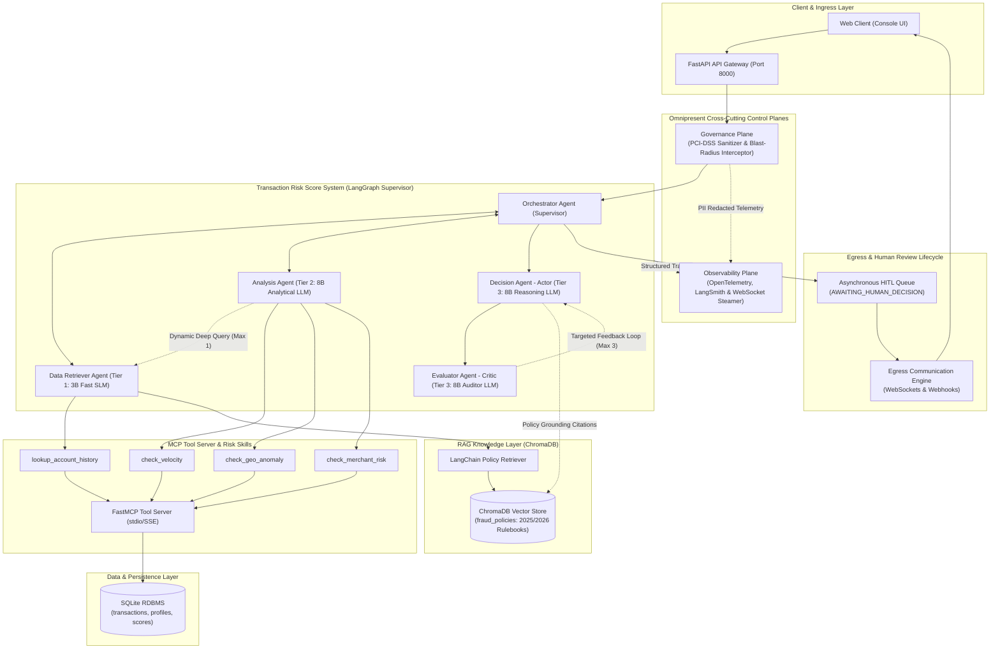
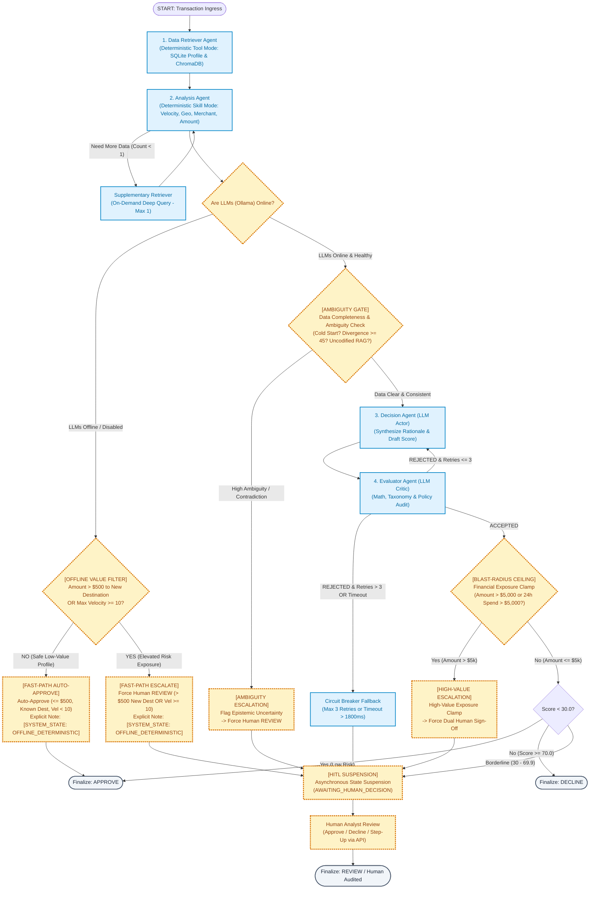

# Architecture Specification: Transaction Fraud Scorer Agentic AI

- **Document Identifier**: `DOC-ARCH-SPEC-2026-V2`
- **Last Updated**: November 15, 2026
- **Status**: Active / Aligned with Guardrail & Audit Specifications (`DOC-AUDIT-REC-11152026` & `DOC-GUARD-RISK-2026-V1`)
- **System Location**: `src/fraud_scorer/`, `src/api_gateway/`, `src/chromadb/`, `src/sqllite/`

---

## 1. System Architecture Overview

The **Transaction Fraud Scorer Agentic AI** decomposes real-time financial transaction scoring into a **Hybrid Supervisor with Actor-Critic Feedback**, a **ChromaDB RAG Policy Layer**, a modular **FastMCP Tool Layer**, and a **Dual-Plane Governance & Observability Plane**.



---

## 2. Core Architectural Components

### A. Ingress & Client Layer
* **Web Client (`src/web_client/`)**: Operational single-page application providing real-time evaluation timelines, transaction queues, and analyst decision consoles.
* **API Gateway (`src/api_gateway/app.py`)**: High-throughput FastAPI edge service enforcing:
  * Ingress schema validation using Pydantic v2 domain models ([transaction.py](../src/fraud_scorer/models/transaction.py)).
  * Dual-plane WebSocket broadcasting (`/ws/events`) streaming agent execution steps (`AgentStepEvent`) directly to analyst dashboards.
  * Analyst decision resolution endpoints (`POST /api/v1/transactions/{id}/decision`).

### B. Cognitive Agent Plane (LangGraph Supervisor & Actor-Critic)
Every agent in the fleet can be individually controlled via `AgentFeatureFlags` ([config.py](../src/fraud_scorer/config.py)):

1. **Orchestrator Agent (Supervisor)** ([orchestrator_agent.py](../src/fraud_scorer/agents/orchestrator_agent.py)):
   * Central state machine driver. Performs **zero** scoring or decisioning logic itself.
   * Compiles and executes the LangGraph `StateGraph`, maintaining immutable state transitions, SLA timeouts, and loop bounds.
2. **Data Retriever Agent** ([data_retriever_agent.py](../src/fraud_scorer/agents/data_retriever_agent.py)):
   * Designated Model: **Tier 1 Fast SLM** (`llama3.2:3b`).
   * Queries customer baseline profiles from SQLite via `lookup_account_history` and semantic policies from ChromaDB. Operates in deterministic tool mode when LLMs are offline.
3. **Analysis Agent** ([analysis_agent.py](../src/fraud_scorer/agents/analysis_agent.py)):
   * Designated Model: **Tier 2 Analytical Model** (`llama3.1:8b`).
   * Executes concurrent risk assessment skills via `asyncio.gather`:
     * `VelocityAnalysisSkill`: 60-min transaction frequency and volume bursts.
     * `GeoAnomalySkill`: Haversine great-circle calculation detecting rapid geographic hops and impossible travel speeds.
     * `MerchantRiskSkill`: MCC classification and merchant dispute rate scrutiny.
     * `AmountAnomalySkill`: Spend spikes relative to account baseline and card-present status.
   * Can trigger supervised supplementary data queries (`request_supplementary_data`) capped at 1 round-trip.
4. **Decision Agent (Actor)** ([decision_agent.py](../src/fraud_scorer/agents/decision_agent.py)):
   * Designated Model: **Tier 3 Reasoning Model** (`llama3.1:8b`).
   * Synthesizes quantitative signals, policy clauses, and prior critique feedback into a composite normalized score ($0.0 – 100.0$), disposition (`APPROVE`, `REVIEW`, `DECLINE`), and grounded rationale.
5. **Evaluator Agent (Critic)** ([evaluator_agent.py](../src/fraud_scorer/agents/evaluator_agent.py)):
   * Designated Model: **Tier 3 Critical Auditor Model** (`llama3.1:8b`).
   * Independently audits the Decision Agent's draft assessment across mathematical consistency, decision taxonomy bounds, impossible travel safety floors, and evidence grounding.

### C. Omnipresent Governance Plane
Operating as cross-cutting interceptors across every inter-agent hop:
* **Zero-Leakage Sanitizer** ([sanitizer.py](../src/fraud_scorer/observability/sanitizer.py)): Redacts PANs (`****-****-****-1234`), credentials (`***REDACTED***`), PII (`***REDACTED_PII***`), and masks IP octets before data reaches LLMs, logs, or external tracers.
* **Financial Blast-Radius Interceptor**: Enforces monetary ceilings ($> \$5,000$ strictly human sign-off) and impossible travel floors ($\ge 75.0$).

### D. Omnipresent Observability & Distributed Tracing
* **Distributed Tracing Engine** ([tracer.py](../src/fraud_scorer/observability/tracer.py)): Injects `trace_id` and OpenTelemetry spans across all agent invocations, synchronizing with LangSmith for token accounting, latency analysis, and feedback logging.
* **Real-Time Step Streaming**: Broadcasts `AgentStepEvent` payloads over WebSockets so analysts can observe node-by-node execution live.

### E. Persistence & MCP Tool Architecture
* **FastMCP Server (`src/fraud_scorer/mcp/`)**: Standardized tool interface exposing `check_velocity`, `check_geo_anomaly`, `check_merchant_risk`, and `lookup_account_history` over `stdio` and `sse`.
* **SQLite RDBMS (`src/sqllite/`)**: Relational database storing customer profiles, transaction histories, risk factor records, and analyst review states.

---

## 3. LangGraph State Machine & Pattern 2 Gating Architecture

The workflow is governed by a compiled LangGraph state machine adopting **Pattern 2 (Post-Feature Pre-LLM Value Gating)**. Feature extraction executes deterministically first, allowing the system to determine velocity and geographic hops even when LLMs are offline, before gating execution to the cognitive plane.



---

## 4. State Schema Contract (`FraudEvaluationState`)

The state machine maintains an explicit, immutable state model across all nodes ([workflow.py](../src/fraud_scorer/agents/workflow.py)):

```python
class FraudEvaluationState(BaseModel):
    """Explicit state schema maintained across the LangGraph Supervisor workflow."""

    # Ingress Data & Tracing
    transaction_id: str
    transaction: dict[str, Any]
    policy_year: str = "2026"
    db_path: Optional[str] = None
    use_llm: bool = False
    trace_id: Optional[str] = None
    system_state: str = "ONLINE_NORMAL"  # "ONLINE_NORMAL" | "OFFLINE_DETERMINISTIC_FAST_PATH"

    # Enrichment & Feature Extraction State
    retrieval_data: Optional[dict[str, Any]] = None
    supplementary_retrievals: list[dict[str, Any]] = Field(default_factory=list)
    supplementary_count: int = 0
    analysis_data: Optional[dict[str, Any]] = None
    risk_factors: list[dict[str, Any]] = Field(default_factory=list)
    analysis_completed: bool = False

    # Ambiguity & Data Quality Flags
    completeness_score: float = 1.0       # Ratio of available profile telemetry
    signal_divergence: float = 0.0        # Max - min variance across risk vectors
    is_ambiguous: bool = False            # True if signals conflict or profile is cold
    human_escalation_reason: Optional[str] = None

    # Decision State (Actor)
    draft_assessment: Optional[dict[str, Any]] = None
    draft_score: Optional[float] = None
    draft_disposition: Optional[str] = None
    draft_reasoning: Optional[str] = None

    # Evaluator State (Critic)
    evaluator_verdict: Optional[str] = None  # "ACCEPTED" | "REJECTED"
    evaluator_feedback: Optional[str] = None
    rejection_category: Optional[str] = None
    remediation_target: Optional[str] = None  # "analysis" | "decision"
    evaluator_audit_notes: Optional[str] = None

    # SLA & Circuit Breaker Controls
    retry_count: int = 0
    max_retries: int = 3
    max_timeout_ms: float = 1800.0
    is_fallback: bool = False
    execution_start_time: float = Field(default_factory=time.monotonic)
```

---

## 5. Resilient Fallbacks & Value-Based Offline Gating

The architectural philosophy prioritizes **Zero-Blind-Approvals** while eliminating checkout bottlenecks during outages:

### A. Pattern 2 Deterministic Offline Fast-Path
If Ollama or external LLMs are unreachable, or if scoring agents are disabled:
1. Feature extraction continues via SQLite (`check_velocity`, `check_geo_anomaly`, `lookup_account_history`) in $< 15\text{ ms}$.
2. The gate evaluates extracted velocity and destination features:
   * **Human Review Escalation (`REVIEW`)**:
     * Amount $> \$500.00$ to an unverified or new destination.
     * **OR** max-velocity $\ge 10$ transactions in 60 minutes.
     * Cites reason: `[SYSTEM_STATE: OFFLINE_DETERMINISTIC_FAST_PATH] High-value/burst exposure clamp.`
   * **Fast-Path Automated Approval (`APPROVE`)**:
     * Amount $\le \$500.00$, verified destination, and velocity $< 10$.
     * Cites reason: `[SYSTEM_STATE: OFFLINE_DETERMINISTIC_FAST_PATH] Low-risk straight-through checkout.`

### B. SLA Timeout Circuit Breaker
If wall-clock execution exceeds $1,800\text{ ms}$ or retries exceed $3$, execution trips to `circuit_breaker_fallback_node`:
* Scores $\ge 70.0 \rightarrow$ `DECLINE`.
* All ambiguous or borderline cases $\rightarrow$ `REVIEW` (human queue).

---

## 6. How RAG (Retrieval-Augmented Generation) is Applied

While **MCP Tools** query *structured, real-time operational features*, **RAG** equips agents with *unstructured, semantic regulatory intelligence*:

1. **Policy Corpus**: Indexed in ChromaDB collection `fraud_policies` ([fraud-risk-policy-2026.md](policy-docs/fraud-risk-policy-2026.md)).
2. **Contextual Retrieval**: `DataRetrieverAgent` generates embeddings over transaction MCC, payment rails, and geographic corridor to retrieve applicable clauses (`POL-2026-VEL-01`, `POL-2026-MCC-6051`, `POL-2026-GEO-01`).
3. **Adverse Action Citations**: The Decision Agent binds reasons to retrieved clauses, ensuring compliance with ECOA / FCRA adverse action transparency.
4. **Epistemic Ambiguity Tripwire**: If cosine distance exceeds $0.65$ (meaning no codified policy governs the scenario), the model is prohibited from hallucinating policy and must route to human compliance officers.

---

## 7. Decision Taxonomy & Financial Blast-Radius Overlay

Every transaction receives a composite score ($0.0 – 100.0$) evaluated against the **Financial Blast-Radius Matrix**:

| Score Range | Base Disposition | Amount $\le \$1,000$ | Amount $\$1,000.01 – \$5,000$ | Amount $> \$5,000.00$ |
|---|---|---|---|---|
| **0.0 – 29.9** | `APPROVE` | Autonomous `APPROVE` | Step-Up 3DS / Passkey Required | Mandatory Human `REVIEW` |
| **30.0 – 69.9** | `REVIEW` | Asynchronous Human `REVIEW` | Asynchronous Human `REVIEW` | Asynchronous Human `REVIEW` |
| **70.0 – 100.0** | `DECLINE` | Automated `DECLINE` | Automated `DECLINE` | Automated `DECLINE` |

* **Mandatory Impossible Travel Floor**: If Haversine transit speed exceeds $800\text{ km/h}$, score is hard-floored to $\ge 75.0$ and disposition is locked to `DECLINE`.

---

## 8. Multi-Tier Guardrail Specification

| Guardrail Layer | Enforcement Mechanism | Purpose | Reference |
|---|---|---|---|
| **Ingress Validation** | Pydantic v2 schemas (`amount > 0`, ISO codes, lat/lon bounds) | Eliminates malformed payloads at gateway edge | [transaction.py](../src/fraud_scorer/models/transaction.py) |
| **Data Privacy** | Regex PAN masking (`****-****-****-1234`), PII redaction | Guarantees zero plaintext cardholder data enters LLMs/logs | [sanitizer.py](../src/fraud_scorer/observability/sanitizer.py) |
| **Least Privilege Tools** | Read-only SQL queries (`SELECT`), zero fund-moving permissions | Prevents autonomous agents from modifying customer state | [tools.py](../src/fraud_scorer/agents/tools.py) |
| **Actor-Critic Audit** | Evaluator Critic mathematical audit ($\Delta \le 5.0$) & citation check | Eliminates confirmation bias and threshold hallucinations | [evaluator_agent.py](../src/fraud_scorer/agents/evaluator_agent.py) |
| **Ambiguity Gate** | Cold start ($< 14$ days), signal contradiction ($\Delta \ge 45$) | Halts autonomous guessing under epistemic uncertainty | [workflow.py](../src/fraud_scorer/agents/workflow.py) |
| **Offline Gating** | Pattern 2 Value-Based Gating ($\le \$500$ auto-approve; $> \$500$ review) | Prevents manual review queue chokepoint during outages | [orchestrator_agent.py](../src/fraud_scorer/agents/orchestrator_agent.py) |
| **Blast Radius Cap** | Absolute monetary ceiling ($> \$5,000 \rightarrow$ `REVIEW`) | Constrains total financial risk exposure | [risk_scoring_decision_skill.py](../src/fraud_scorer/skills/risk_scoring_decision_skill.py) |
| **Macro Circuit Breaker** | Fleet-wide decline rate anomaly monitor ($3\times$ baseline tripwire) | Halts systemic false-positive waves during model drift | [store.py](../src/api_gateway/store.py) |

---

## 9. Asynchronous Human-in-the-Loop (HITL) Lifecycle

When an evaluation outputs `REVIEW`:
1. **State Suspension**: The transaction state is persisted in SQLite with status `AWAITING_HUMAN_DECISION`.
2. **Analyst Presentation**: The Web Client displays the dossier, listing triggered risk factors, mathematical evidence, and RAG policy citations.
3. **Analyst Resolution**: The human operator submits a decision via `POST /api/v1/transactions/{id}/decision`:
   * `ACCEPTED`: Finalizes transaction authorization.
   * `REJECTED`: Finalizes permanent decline.
4. **Audit Flywheel**: The human decision delta is logged to LangSmith, providing ground-truth labels for prompt fine-tuning and model calibration.

---

## 10. Multi-Path & Tree-of-Thoughts (ToT) Architecture (Extension)

To evaluate, benchmark, and search across alternative agent reasoning paths, the system supports a **LangGraph Tree-of-Thoughts (ToT)** execution mode alongside the standard linear pipeline:
* Detailed specifications, search mechanics, and role-to-tool mappings: **[`docs/tot-specification.md`](tot-specification.md)**.
* State schemas and branch pruning models: **[`docs/tree-of-thoughts-architecture.md`](tree-of-thoughts-architecture.md)**.
* Enables dynamic **Ablation Testing** and **Semantic Fraud Hypothesis Search** across competing risk vectors.

---

*This specification governs the core architectural design of the Transaction Fraud Scorer Agentic AI.*
