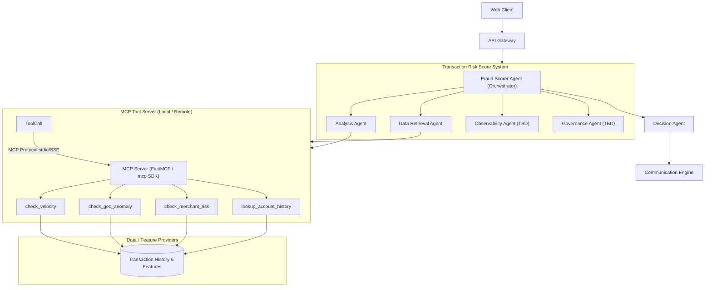

# Architecture Overview: Transaction Fraud Scorer Agentic AI

## 1. System Architecture

The **Transaction Fraud Scorer Agentic AI** decomposes fraud evaluation into an **Agentic Reasoning Layer** and a modular **MCP (Model Context Protocol) Tool Layer**.

---

## 2. Core Components

### A. Ingress & Client Layer
- **Web Client**: External consumer interface (e.g., checkout portal, mobile banking app, e-commerce payment gateway) submitting transaction scoring requests.
- **API Gateway**: Edge ingress point responsible for:
  - Client authentication and API key validation.
  - Rate limiting and request throttling.
  - Ingress payload sanitization and schema validation against domain models.
  - Routing transaction payloads to the `Transaction Risk Score System`.

### B. Transaction Risk Score System (Multi-Agent Ecosystem)
An autonomous, coordinated multi-agent workflow managing the end-to-end evaluation lifecycle:

1. **Fraud Scorer Agent (Orchestrator)**:
   - Central coordinator and workflow manager.
   - Decomposes the transaction evaluation plan and delegates tasks to specialized sub-agents.
   - Manages state, execution dependencies, error handling, and timeout budgets across the agent graph.

2. **Data Retrieval Agent**:
   - Interfaces with the MCP Tool Server to fetch contextual account and behavioral data.
   - Invokes tools such as `lookup_account_history` to retrieve account age, prior chargeback records, historical average spend, and trust tiers.
   - Supplies enriched profile context to downstream evaluation agents.

3. **Analysis Agent**:
   - Specialized in multi-vector fraud signal computation and anomaly detection.
   - Invokes analytical MCP tools:
     - `check_velocity`: Measures transaction burst frequencies and rapid volume spikes.
     - `check_geo_anomaly`: Calculates haversine distances and flags impossible travel speeds.
     - `check_merchant_risk`: Evaluates high-risk Merchant Category Codes (MCCs) and merchant reputation.
   - Synthesizes quantitative findings into categorized `RiskFactor` evidence blocks with severity rankings.

4. **Decision Agent**:
   - Ingests the enriched data and risk factors from the Analysis and Data Retrieval agents.
   - Computes the composite normalized risk score (0.0 to 100.0).
   - Maps scores against policy thresholds to resolve the final disposition (`APPROVE`, `REVIEW`, `DECLINE`).
   - Produces an explainable, auditable rationale summarizing why the decision was made.
   - Forwards the completed assessment to the `Communication Engine`.

5. **Observability Agent (TBD)**:
   - *Roadmap component*: Real-time monitoring, telemetry emission, and tracing.
   - Tracks agent execution latencies, MCP tool invocation counts, model token usage, and evaluation accuracy.
   - Emits structured audit logs for compliance and operational health dashboards.

6. **Governance Agent (TBD)**:
   - *Roadmap component*: Policy enforcement, safety guardrails, and regulatory compliance.
   - Ensures zero leakage of unmasked PII or sensitive payment data (e.g., PCI-DSS compliance).
   - Audits decision rationales against anti-bias, fair lending, and consumer protection guidelines.

### C. Egress & Communication Engine
- **Communication Engine**: Asynchronous notification and dispatch layer that:
  - Delivers the final `FraudAssessment` back to the payment gateway or calling service.
  - Triggers real-time alerts (webhooks, event bus, Slack/email notifications) for transactions flagged for `REVIEW` or `DECLINE`.
  - Dispatches high-risk incidents into analyst review queues and ticketing systems.

### D. MCP Tool Server & Risk Tools (`src/fraud_scorer/mcp/`)
- Implements the open **Model Context Protocol (MCP)** using `mcp.server.mcpserver.MCPServer`.
- Exposes standardized tool endpoints (`check_velocity`, `check_geo_anomaly`, `check_merchant_risk`, `lookup_account_history`).
- Operates over both `stdio` (in-process child execution) and `sse` (standalone HTTP/SSE microservice).
- Provides tool introspection (`tools/list`) and dynamic execution (`tools/call`).

### E. Data & Feature Providers
- Data storage and feature store abstractions backing the MCP tools.
- Maintains customer account baselines, historical transaction logs, geographical coordinates, and merchant MCC risk registries.
- Uses an in-memory/mock repository (`MockDB`) for local development and CI testing, with interfaces ready for production data stores (Redis, DynamoDB, PostgreSQL, Snowflake/BigQuery).

### F. Domain Models & Contracts (`src/fraud_scorer/models/`)
- Strict Pydantic v2 domain schemas validating:
  - `Transaction`, `GeoLocation`, `PaymentMethod`, `MerchantInfo`.
  - `RiskFactor` with category, severity, contribution score, and evidence details.
  - `FraudAssessment` containing assessment ID, overall risk score, decision disposition, and auditable reasoning summary.

---

## 3. Risk Scoring & Decision Taxonomy

Every assessment generates an overall risk score normalized between **0.0** and **100.0**:

| Score Range | Decision | Action Taken |
|---|---|---|
| **0.0 - 29.9** | `APPROVE` | Transaction processed immediately with low risk signals. |
| **30.0 - 69.9** | `REVIEW` | Flagged for manual analyst queue or Step-up / 3DS authentication. |
| **70.0 - 100.0** | `DECLINE` | Transaction blocked due to critical risk factors or velocity abuse. |

---

## 4. MCP Tool Contracts

| Tool Name | Key Inputs | Primary Outputs |
|---|---|---|
| `check_velocity` | `account_id`, `window_minutes` | `count_transactions`, `sum_amount`, `velocity_score`, `is_burst` |
| `check_geo_anomaly` | `account_id`, `current_lat`, `current_lon`, `timestamp` | `distance_km`, `elapsed_hours`, `speed_kmh`, `impossible_travel` |
| `check_merchant_risk` | `merchant_id`, `mcc` | `risk_tier`, `high_risk_category`, `merchant_reputation` |
| `lookup_account_history` | `account_id` | `account_age_days`, `prior_disputes`, `avg_transaction_amount` |
