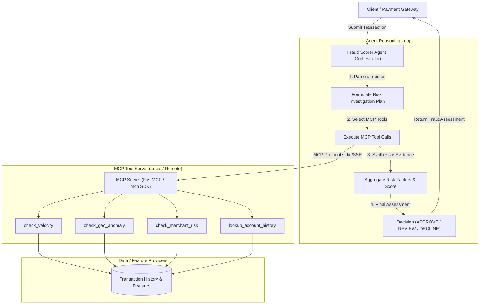

# Architecture Overview: Transaction Fraud Scorer Agentic AI

## 1. System Architecture

The **Transaction Fraud Scorer Agentic AI** decomposes fraud evaluation into an **Agentic Reasoning Layer** and a modular **MCP (Model Context Protocol) Tool Layer**.

---

## 2. Core Components

### A. Domain Models (`src/fraud_scorer/models/`)
- Strict Pydantic v2 schemas validating incoming transactions, risk factor items, velocity records, and final fraud assessments.
- Immutable, typed definitions that maintain data integrity across boundaries.

### B. MCP Server & Risk Tools (`src/fraud_scorer/mcp/`)
- Implements the open standard **Model Context Protocol (MCP)**.
- Can run locally via `stdio` (launched automatically as a child process by the orchestrator) or over HTTP via `sse` (for network isolation / shared microservices).
- Tools are stateless or backed by repository abstractions, making them easy to unit test and mock.

### C. Agentic AI Orchestrator (`src/fraud_scorer/agent/`)
- Connects to the MCP server, queries available tools (`tools/list`), and invokes tools dynamically (`tools/call`).
- System prompts configure the LLM to think like a fraud prevention specialist.
- Features an offline heuristic rule engine mode (`MockProvider`) so developers can test workflows and run CI without needing paid cloud API keys.

---

## 3. Risk Scoring & Decision Taxonomy

Every assessment generates an overall risk score normalized between **0.0** and **100.0**:

| Score Range | Decision | Action Taken |
|---|---|---|
| **0.0 - 29.9** | `APPROVE` | Transaction processed immediately with low risk signals. |
| **30.0 - 69.9** | `REVIEW` | Flagged for manual analyst queue or Step-up / 3DS authentication. |
| **70.0 - 100.0** | `DECLINE` | Transaction blocked due to critical risk factors or velocity abuse. |

---

## 4. MCP Tool Contracts

| Tool Name | Key Inputs | Primary Outputs |
|---|---|---|
| `check_velocity` | `account_id`, `window_minutes` | `count_transactions`, `sum_amount`, `velocity_score`, `is_burst` |
| `check_geo_anomaly` | `account_id`, `current_lat`, `current_lon`, `timestamp` | `distance_km`, `elapsed_hours`, `speed_kmh`, `impossible_travel` |
| `check_merchant_risk` | `merchant_id`, `mcc` | `risk_tier`, `high_risk_category`, `merchant_reputation` |
| `lookup_account_history` | `account_id` | `account_age_days`, `prior_disputes`, `avg_transaction_amount` |
