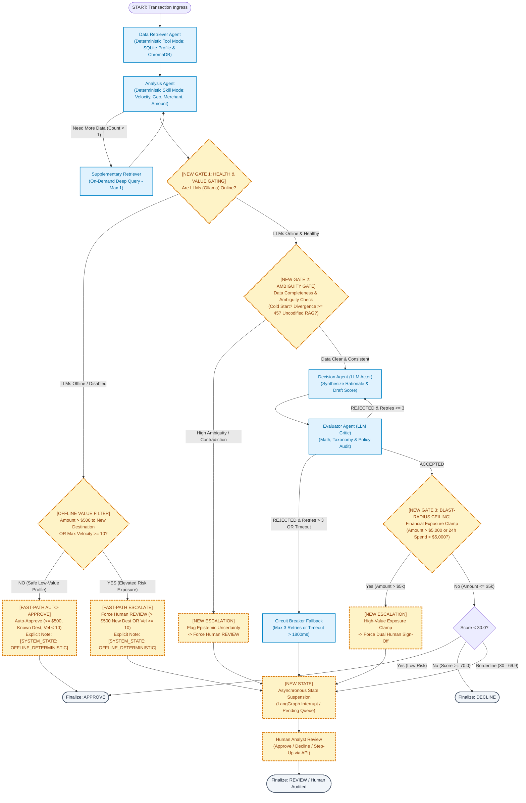

# Architecture Audit & Agent Operational Boundaries Report

- **Document Identifier**: `DOC-AUDIT-REC-11152026`
- **Date**: November 15, 2026
- **Status**: Approved Specifications / Pending Architecture & Code Implementation
- **Target System**: Transaction Fraud Scorer Multi-Agent System (`src/fraud_scorer/`, `src/api_gateway/`, `src/chromadb/`, `src/sqllite/`)
- **Focus Area**: Real-Time Safety Guardrails, Risk Controls, Epistemic Ambiguity Handling, Offline Value-Based Gating (Pattern 2 Selected), and System Architecture Evolution

---

## 1. Executive Summary

As enterprise fraud detection transitions to autonomous multi-agent systems ("company of agents"), architectural boundaries must guarantee that agents **never take unilateral, ungrounded actions when data is ambiguous, missing, or contradictory**. Furthermore, when infrastructure degrades (such as when LLMs are offline), routing 100% of transactions to manual review creates a crippling operational bottleneck that paralyzes checkout.

To solve this, the architecture introduces **Value-Based Deterministic Gating**:
1. When LLMs are offline, the system continues to extract deterministic features (velocity counts, Haversine geo distance, merchant dispute rates) via SQL tools in $< 15\text{ ms}$.
2. Only transactions exceeding **$\$500.00$ to a new destination** or reaching **max-velocity $\ge 10$** are escalated to human analysts.
3. All other transactions ($\le \$500$, verified destinations, velocity $< 10$) are **automatically approved** to keep payment flows moving.
4. Every response explicitly states the **system operational state** (`OFFLINE_DETERMINISTIC_FAST_PATH`) and provides an auditable justification for why the decision was made.

---

## 2. Current State Audit: Existing Guardrails & Safety Checks

### A. Deterministic Safety Floors & Policy Overrides
* **Critical Geo-Anomaly Floor**:
  * If a transaction exhibits impossible travel (Haversine transit speed $> 800\text{ km/h}$ or distance $> 5,000\text{ km}$), the system enforces a hard floor: the composite risk score is bumped to at least **75.0 / 100.0**, forcing disposition to `DECLINE`.
  * The Evaluator Agent strictly rejects any draft assessment attempting to mark an impossible travel scenario as `APPROVE` ([risk_scoring_decision_skill.py](file:///Users/abhishekbiswas/AppDevelppment/TransactionFraudScorerAgenticAI/src/fraud_scorer/skills/risk_scoring_decision_skill.py#L33-L39), [evaluator_agent.py](file:///Users/abhishekbiswas/AppDevelppment/TransactionFraudScorerAgenticAI/src/fraud_scorer/agents/evaluator_agent.py#L105-L117)).
* **Decision Taxonomy Alignment**:
  * `0.0 – 29.9` $\rightarrow$ `APPROVE`
  * `30.0 – 69.9` $\rightarrow$ `REVIEW`
  * `70.0 – 100.0` $\rightarrow$ `DECLINE`
  * The Evaluator validates that the final disposition matches this taxonomy, preventing threshold hallucinations ([evaluator_agent.py](file:///Users/abhishekbiswas/AppDevelppment/TransactionFraudScorerAgenticAI/src/fraud_scorer/agents/evaluator_agent.py#L134-L157)).

### B. Actor-Critic Auditing Rubrics (Evaluator Agent)
The system separates draft generation (`DecisionAgent` — Actor) from compliance audit (`EvaluatorAgent` — Critic) using three deterministic checks:
1. **Mathematical Consistency**: Sum of `RiskFactor.contribution_score` values must equal `overall_risk_score` within $\pm 5.0$ points. Deviations trigger an `ARITHMETIC_ERROR` rejection ([evaluator_agent.py](file:///Users/abhishekbiswas/AppDevelppment/TransactionFraudScorerAgenticAI/src/fraud_scorer/agents/evaluator_agent.py#L120-L133)).
2. **Explainability & Grounding**: The `reasoning_summary` must be non-empty, $\ge 10$ characters, and explicitly cite the detected risk categories (`VELOCITY`, `GEO_ANOMALY`, `MERCHANT_RISK`, `AMOUNT_ANOMALY`, `ACCOUNT_HISTORY`). Missing citations trigger an `UNGROUNDED_ASSERTION` rejection ([evaluator_agent.py](file:///Users/abhishekbiswas/AppDevelppment/TransactionFraudScorerAgenticAI/src/fraud_scorer/agents/evaluator_agent.py#L159-L185)).
3. **Targeted Remediation Feedback**: Instead of blind restarts, the Evaluator issues actionable feedback targeting the `decision` or `analysis` agent ([evaluator_agent.py](file:///Users/abhishekbiswas/AppDevelppment/TransactionFraudScorerAgenticAI/src/fraud_scorer/agents/evaluator_agent.py#L37-L61)).

### C. Workflow SLA, Circuit Breaker & Fallback Guardrails
* **Loop Circuit Breaker**: Evaluator feedback loops are strictly capped at `max_evaluation_retries = 3` ([config.py](file:///Users/abhishekbiswas/AppDevelppment/TransactionFraudScorerAgenticAI/src/fraud_scorer/config.py#L140-L141), [workflow.py](file:///Users/abhishekbiswas/AppDevelppment/TransactionFraudScorerAgenticAI/src/fraud_scorer/agents/workflow.py#L90-L92)).
* **SLA Timeout Protection**: Hard budget of `max_timeout_ms = 1800.0` (1.8s) stops latency explosion during synchronous checkout ([workflow.py](file:///Users/abhishekbiswas/AppDevelppment/TransactionFraudScorerAgenticAI/src/fraud_scorer/agents/workflow.py#L652-L658)).
* **Circuit Breaker Fallback Node**: If retries or timeout limits are exceeded, execution transitions to `circuit_breaker_fallback_node`. Scores $\ge 70.0$ default to `DECLINE`; all others default safely to `REVIEW` ([workflow.py](file:///Users/abhishekbiswas/AppDevelppment/TransactionFraudScorerAgenticAI/src/fraud_scorer/agents/workflow.py#L564-L635)).
* **Sub-Delegation Query Throttling**: Supplementary policy queries from Analysis Agent to Data Retriever are hard-capped at **1 request** per evaluation (`supplementary_count < 1`) ([workflow.py](file:///Users/abhishekbiswas/AppDevelppment/TransactionFraudScorerAgenticAI/src/fraud_scorer/agents/workflow.py#L637-L646)).

### D. Data Privacy, PII & PCI-DSS Scrubbing
* **Payload Sanitizer** ([sanitizer.py](file:///Users/abhishekbiswas/AppDevelppment/TransactionFraudScorerAgenticAI/src/fraud_scorer/observability/sanitizer.py)):
  * Primary Account Numbers (13–19 digits) are masked to `****-****-****-1234`.
  * Sensitive keys (`pan`, `card_number`, `cvv`, `pin`, `ssn`, `iban`, `api_key`, `secret`) are replaced with `***REDACTED***`.
  * Personal Identifiable Information (`full_name`, `billing_address`, `email`, `phone`) is replaced with `***REDACTED_PII***`.
  * IP addresses mask the final segment (e.g. `192.168.1.***`).
* **Telemetry Egress Filter**: LangSmith and OpenTelemetry trace interceptors pass all logged payloads through `process_inputs=sanitize_transaction_payload` when `langsmith_mask_pii=True` ([tracer.py](file:///Users/abhishekbiswas/AppDevelppment/TransactionFraudScorerAgenticAI/src/fraud_scorer/observability/tracer.py#L111-L144)).

---

## 3. Analysis: Implementation Changes vs. Architectural Changes

A common pitfall is treating safety and governance as minor code tweaks. The table below delineates what constitutes an implementation change versus what requires fundamental architectural redesign:

| Capability | Implementation-Only Change | Architectural Redesign Required |
|---|---|---|
| **Value-Based Offline Gating** | Code the conditional checks (`amount > 500` to new destination, `velocity >= 10`). | **Pre-Cognitive Feature Gating (Pattern 2)**: Structure the LangGraph state machine so deterministic data extraction executes first, gating traffic *before* calling the LLM reasoning plane (Decision & Evaluator agents). |
| **Data Ambiguity Handling** | Add a variance check helper function inside individual skills. | **State Machine Topology Revision**: Add an explicit `AmbiguityTriageNode` and conditional routing edges in the LangGraph graph *before* invoking reasoning LLMs. |
| **Human-in-the-Loop (HITL)** | Return `decision="REVIEW"` in the JSON payload response. | **Asynchronous State Suspension & Resume**: LangGraph workflow suspension (`interrupt`), transactional event queues, and callback webhooks to hold payment state until a human analyst resolves the queue. |
| **Financial Blast-Radius Limits** | Hardcode `if amount > 5000: return REVIEW` in the skill. | **Tiered Policy Interceptor**: Decouple financial authority checks from the LLM agent prompt so models cannot bypass limits via prompt injection. |
| **Fleet-Wide Macro Kill-Switch** | N/A (cannot be solved inside a single transaction evaluation). | **Cross-Cutting Fleet Metrics Aggregator**: Shared sliding-window store monitoring aggregate decline/review rates across all worker agents to trip a macro circuit breaker. |

---

## 4. Architectural Patterns for Determining Velocity Without LLMs

A key question arises: **If LLMs are offline, how does the system know the persona's velocity and destination history?**

Velocity and destination history **never require an LLM**. Velocity is an objective, deterministic relational query executed on the SQLite database:
```sql
SELECT COUNT(*) AS tx_count, COALESCE(SUM(amount), 0.0) AS tx_volume 
FROM transactions 
WHERE account_id = :account_id 
  AND timestamp >= datetime('now', '-60 minutes');
```
The agents are merely cognitive coordinators. When LLMs are offline, the underlying tools and database are 100% operational. There are two distinct architectural patterns to leverage this:

### Pattern 1: Gateway-Level Direct SQL Pre-Flight Interceptor
* **Concept**: The API Gateway executes `check_velocity()` and `get_last_transaction_location()` directly in middleware ($< 2\text{ ms}$) *before* initializing the LangGraph agent state machine.
* **Pros**: Sub-millisecond execution, zero LangGraph allocation during outages.
* **Cons**: Duplicates feature extraction logic at the gateway layer; bypasses WebSocket event streams.

### Pattern 2: Post-Feature Pre-LLM Gating / Hybrid Pipeline (SELECTED RECOMMENDATION)
* **Concept**: The transaction enters the LangGraph graph. `DataRetrieverNode` and `AnalysisNode` run in **Deterministic Tool Mode** (`use_llm=False`), executing SQLite queries to retrieve historical profile baselines, calculate exact 60-minute velocity bursts, and compute Haversine distances. 
* The **Value-Based Offline Gate** sits **immediately before the cognitive reasoning plane (Decision Agent & Evaluator Agent)**.
  * If LLMs are **Offline**: The gate evaluates the extracted velocity and destination features:
    * `amount > $500` to new destination OR `velocity >= 10` $\rightarrow$ Escalate to Human `REVIEW`.
    * Otherwise $\rightarrow$ Fast-Path Auto `APPROVE`.
  * If LLMs are **Online**: Passes extracted features to `Decision Agent (Actor)` and `Evaluator Agent (Critic)` for multi-agent synthesis.
* **Why Pattern 2 is Selected**:
  1. Reuses existing modular skills ([velocity_analysis_skill.py](file:///Users/abhishekbiswas/AppDevelppment/TransactionFraudScorerAgenticAI/src/fraud_scorer/skills/velocity_analysis_skill.py), [geo_anomaly_skill.py](file:///Users/abhishekbiswas/AppDevelppment/TransactionFraudScorerAgenticAI/src/fraud_scorer/skills/geo_anomaly_skill.py), [account_history_skill.py](file:///Users/abhishekbiswas/AppDevelppment/TransactionFraudScorerAgenticAI/src/fraud_scorer/skills/account_history_skill.py)) without duplicate gateway code.
  2. Preserves full telemetry and WebSocket `AgentStepEvent` streaming even in degraded offline mode.
  3. Provides seamless graceful degradation: feature calculation is always guaranteed; only the LLM reasoning layer is bypassed.

---

## 5. Architectural Design: Proposed State Machine (Pattern 2 Implementation)

The diagram below depicts the **complete system state graph adopting Pattern 2**.
* **Solid Blue Nodes (`:::existingNode`)**: Existing baseline components implemented in [workflow.py](file:///Users/abhishekbiswas/AppDevelppment/TransactionFraudScorerAgenticAI/src/fraud_scorer/agents/workflow.py).
* **Dashed Gold Nodes (`:::newChange`)**: **NEW architectural gates, value-based offline routing, and asynchronous human suspension mechanisms**.



---

## 6. Detailed Specifications of the Architectural Gates

### Gate 1: Post-Feature Offline Value-Based Gate (Pattern 2)
* **Location in Pipeline**: Evaluated after `analysis_node` and preceding `decision_node`.
* **Health Check**: Pings Ollama `/api/tags` with a 1.5s timeout and checks `agent_flags`.
* **Routing Logic When LLMs are Offline**:
  Rather than routing 100% of transactions to manual review (which creates a massive queue bottleneck during outages), evaluate the extracted deterministic features:
  
  1. **Condition for Human Review (`REVIEW`)**:
     * Transaction `amount > $500.00` to a **new destination** (destination country/city not in the customer's historical profile, or merchant is unverified).
     * **OR** transaction reaches **max-velocity $\ge 10$ transactions in 60 minutes**, even for new personas/accounts with amount constraints.
     * *Disposition*: `REVIEW`.
     * *System State Field*: `system_state = "OFFLINE_DETERMINISTIC_FAST_PATH"`.
     * *Reasoning Summary*: 
       > `"[SYSTEM_STATE: OFFLINE_DETERMINISTIC_FAST_PATH] LLM service offline. Transaction escalated to human review due to value-based gating: amount ($750.00) exceeds $500.00 threshold to unverified destination 'London, GB' [Trigger: OFFLINE_NEW_DEST_HIGH_VALUE]."`
  
  2. **Condition for Automated Approval (`APPROVE`)**:
     * Transaction `amount <= $500.00`, destination matches customer history, and velocity $< 10$.
     * *Disposition*: `APPROVE` (overall risk score defaulted to `15.0`).
     * *System State Field*: `system_state = "OFFLINE_DETERMINISTIC_FAST_PATH"`.
     * *Reasoning Summary*:
       > `"[SYSTEM_STATE: OFFLINE_DETERMINISTIC_FAST_PATH] LLM service offline. Transaction auto-approved under offline value-based gating: amount ($42.50) is <= $500.00 threshold, velocity (1 tx/hr) < 10, and destination is verified. Straight-through authorization granted to prevent checkout bottleneck [Trigger: OFFLINE_LOW_RISK_AUTO_APPROVE]."`

### Gate 2: Data Completeness & Ambiguity Triage Gate (When LLMs are Online)
* **Location in Pipeline**: Evaluated immediately preceding `decision_node` when LLMs are online.
* **Trigger Conditions**:
  1. **Cold-Start Account**: Profile tenure $< 14$ days or account transaction count $< 3$. If transaction amount $> \$100.00$, automated `APPROVE` is barred.
  2. **Signal Divergence / Contradiction**: The variance between the maximum individual risk factor and minimum risk factor exceeds $45.0$ points (e.g. Velocity $= 90$, Merchant $= 5$).
  3. **RAG Policy Distance Divergence**: Semantic retrieval distance between transaction characteristics and ChromaDB policy clauses $> 0.65$ (no codified policy matches this transaction).
  4. **Degraded Critical Telemetry**: IP address, device ID, or geolocation is absent on transactions $> \$500.00$.
* **Architectural Action**: Bypasses the Decision Agent's autonomous disposition logic. Emits structured state flag `is_ambiguous=True`, records `human_escalation_reason`, and routes directly to the human analyst queue.

### Gate 3: Financial Blast-Radius & Exposure Ceiling
* **Location in Pipeline**: Post-evaluation governance interceptor evaluated after `evaluator_node` emits `ACCEPTED`.
* **Trigger Conditions**:
  1. Single transaction amount $> \$5,000.00\text{ USD}$.
  2. Cumulative 24-hour account volume $> \$5,000.00\text{ USD}$ ([POL-2026-VEL-02](file:///Users/abhishekbiswas/AppDevelppment/TransactionFraudScorerAgenticAI/docs/policy-docs/fraud-risk-policy-2026.md#L42-L45)).
* **Architectural Action**: Hard override. Even if the Decision Agent and Evaluator Agent agreed on a low composite score (e.g. $15.0 / \text{APPROVE}$), this gate revokes autonomous approval authority and forces disposition to `REVIEW` requiring human sign-off.

### Gate 4: Asynchronous Human-in-the-Loop State Suspension
* **Location in Pipeline**: Egress and persistence lifecycle.
* **Mechanism**:
  * Instead of completing synchronously at `END`, transactions routed to `REVIEW` enter a suspended state `AWAITING_HUMAN_DECISION` recorded in the SQLite database.
  * When an analyst reviews the dossier in the Web Client and posts a decision via `POST /api/v1/transactions/{id}/decision`, the system resumes or marks the assessment finalized, capturing analyst ID, timestamp, and decision delta for model fine-tuning and calibration.

---

## 7. Required Design Updates in Current Architecture Documents

When updating the architecture documents in future tasks, the following specific sections must be revised:

### Updates Required in `docs/architecture.md`:
1. **Section 3.4 (Line 150) — Fallback Philosophy**:
   * *Current*: Asserts that fallback ensures transaction scoring *"never blocks payment checkout"* (availability / fail-open bias).
   * *Update*: Replace with **Pattern 2 Deterministic Gating**: Extract deterministic profile and velocity features first; if LLMs are offline, apply value-based filtering ($\le \$500$, verified destination, velocity $< 10 \rightarrow$ auto-approve; $> \$500$ new destination OR velocity $\ge 10 \rightarrow$ human review).
2. **Section 5 (Line 185) — Decision Taxonomy**:
   * *Current*: Unconditional approval for scores $0.0 – 29.9$.
   * *Update*: Add the **Financial Blast-Radius Overlay**:
     * Score $< 30$ AND Amount $\le \$1,000 \rightarrow$ Autonomous `APPROVE`.
     * Score $< 30$ AND Amount $\$1,000 – \$5,000 \rightarrow$ Step-up 3DS challenge.
     * Amount $> \$5,000 \rightarrow$ Mandatory Human `REVIEW`.

### Updates Required in `docs/agentic-architecture-pattern.md`:
1. **Section 1 & Section 4 (Lines 25–70, 370–405) — Sequence Diagram & Flowchart**:
   * *Current*: Linear sequence: `START -> DataRetriever -> Analysis -> Decision -> Evaluator -> END`.
   * *Update*: Incorporate **Pattern 2 Post-Feature Pre-LLM Gating** and **Data Ambiguity Gate** as detailed in Section 5 of this document.
2. **Section 5 (Lines 418–444) — State Schema Contract (`FraudEvaluationState`)**:
   * *Current*: State schema only tracks raw retries, factors, and drafts.
   * *Update*: Add the formal safety and operational state fields:
     ```python
     system_state: str = "ONLINE_NORMAL"       # "ONLINE_NORMAL" | "OFFLINE_DETERMINISTIC_FAST_PATH"
     completeness_score: float = 1.0          # Ratio of available profile telemetry
     signal_divergence: float = 0.0           # Max - min variance across risk vectors
     is_ambiguous: bool = False               # True if signals conflict or profile is cold
     human_escalation_reason: Optional[str]   # Explicit reason routed to analyst
     ```
3. **Section 6 (Lines 362–380) — Governance Agent Role**:
   * *Current*: Focuses only on regex PII scrubbing and adverse action logging.
   * *Update*: Expand Governance to include **Autonomous Action Ring-Fencing** (read-only enforcement, monetary caps, and cold-start account constraints).

---

## 8. Implementation Roadmap

```
[ Phase A: Implementation Baseline (Pattern 2 Offline Gating) ]
  1. Implement Post-Feature Offline Gating in workflow.py:
     - Run DataRetrieverNode & AnalysisNode in deterministic mode.
     - Check LLM health immediately before DecisionNode.
     - Amount > $500 to new destination OR velocity >= 10 -> REVIEW.
     - Amount <= $500, known destination, velocity < 10 -> APPROVE.
     - Include explicit [SYSTEM_STATE: OFFLINE_DETERMINISTIC_FAST_PATH] and trigger reason.
  2. Add $5,000 financial ceiling in risk_scoring_decision_skill.py.
  3. Update existing unit test assertions to match the new value-based offline gating.

[ Phase B: State Machine & Ambiguity Gates ]
  1. Extend FraudEvaluationState schema with system_state, ambiguity, and divergence attributes.
  2. Implement AmbiguityCheckNode before DecisionNode in workflow.py.
  3. Wire conditional edges in build_fraud_evaluation_graph().

[ Phase C: Architectural Document Alignment ]
  1. Update docs/architecture.md (Section 3.4 & Section 5).
  2. Update docs/agentic-architecture-pattern.md (Sequence Diagram & Schema Contracts).

[ Phase D: Asynchronous HITL Persistence ]
  1. Integrate LangGraph state suspension / interrupt for pending REVIEW queues.
  2. Connect analyst review decisions in api_gateway/app.py to audit tracing.
```

*This document serves as the approved audit record and architectural design specification for risk safety and agent boundaries in the Transaction Fraud Scorer Agentic AI system.*
