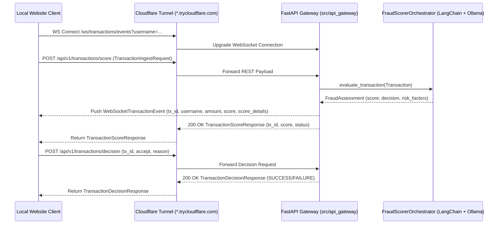

# Implementation Plan: PRD-001 — Expose FastAPI Gateway via Cloudflare Tunneling

## Goal Description

Implement the FastAPI API Gateway specified in [01-Expose-API-Gateway-Cloudflare.md](file:///Users/abhishekbiswas/AppDevelppment/TransactionFraudScorerAgenticAI/docs/prds/01-Expose-API-Gateway-Cloudflare.md) and conforming to [openapi.yaml](file:///Users/abhishekbiswas/AppDevelppment/TransactionFraudScorerAgenticAI/docs/openapi-spec/openapi.yaml). This allows a local web client to ingest transactions, receive real-time WebSocket score events, and submit accept/reject decisions against the Fraud Scorer Agent running on a remote GPU in Google Colab exposed via a Cloudflare Quick Tunnel (`cloudflared`).



---

## User Review Required

> [!IMPORTANT]
> **Package Structure (`src/api_gateway`)**:
> Per PRD-001 ("Create a folder under `src` as `api_gateway` to store any code required to the Fast API gateway here"), we will create `src/api_gateway/` and configure `pyproject.toml` (`[tool.hatch.build.targets.wheel] packages = ["src/fraud_scorer", "src/api_gateway"]`) so both `fraud_scorer` and `api_gateway` are importable top-level packages.

> [!NOTE]
> **Cloudflare Quick Tunnel (`trycloudflare.com`)**:
> We will support zero-configuration Cloudflare Quick Tunnels (`cloudflared tunnel --url http://127.0.0.1:8000`) out of the box so no Cloudflare account or token is required in Colab, while also supporting an optional tunnel token if desired. Additionally, we will fix the `zstd` dependency issue in Step 2 of `notebooks/colab_setup_and_run.ipynb` so Ollama installs cleanly in Colab.

---

## Proposed Changes

### 1. Dependencies & Build Configuration

#### [MODIFY] [pyproject.toml](file:///Users/abhishekbiswas/AppDevelppment/TransactionFraudScorerAgenticAI/pyproject.toml)
- Add `fastapi>=0.115.0`, `uvicorn[standard]>=0.30.0`, and `websockets>=12.0` to `dependencies`.
- Add CLI script entrypoint `fraud-api-gateway = "api_gateway.main:main"`.
- Configure Hatchling wheel targets to package both `src/fraud_scorer` and `src/api_gateway`:
  ```toml
  [tool.hatch.build.targets.wheel]
  packages = ["src/fraud_scorer", "src/api_gateway"]
  ```

#### [MODIFY] [config.py](file:///Users/abhishekbiswas/AppDevelppment/TransactionFraudScorerAgenticAI/src/fraud_scorer/config.py)
- Add API Gateway settings (`api_gateway_host: str = "0.0.0.0"`, `api_gateway_port: int = 8000`, `enable_cloudflare_tunnel: bool = False`).

---

### 2. FastAPI Gateway Package (`src/api_gateway/`)

#### [NEW] [__init__.py](file:///Users/abhishekbiswas/AppDevelppment/TransactionFraudScorerAgenticAI/src/api_gateway/__init__.py)
- Package initialization exposing the FastAPI `app`.

#### [NEW] [schemas.py](file:///Users/abhishekbiswas/AppDevelppment/TransactionFraudScorerAgenticAI/src/api_gateway/schemas.py)
- Pydantic v2 models matching every schema in [openapi.yaml](file:///Users/abhishekbiswas/AppDevelppment/TransactionFraudScorerAgenticAI/docs/openapi-spec/openapi.yaml):
  - `GeoLocationSchema`, `MerchantInfoSchema`, `ACHTransactionDetails`, `CardTransactionDetails`, `TransactionDetails` (validating that `ach_details` is provided when `transaction_type == "ACH"` and `card_details` when `transaction_type == "CARD"`).
  - `TransactionIngestRequest` (`username`, `datetime`, `ip`, `device_id`, `location`, `transaction_details`).
  - `TransactionStatus` (`Literal["APPROVE", "REVIEW", "DECLINE", "ACCEPTED", "REJECTED"]`).
  - `TransactionScoreResponse` (`transaction_id`, `score`, `status`, `evaluated_at`).
  - `ScoreDetails` and `WebSocketTransactionEvent` (`event_type`, `transaction_id`, `username`, `amount`, `currency`, `score`, `score_details`).
  - `TransactionDecisionRequest` (`transaction_id`, `accept`, `reason`) and `TransactionDecisionResponse` (`status`, `success`, `transaction_id`, `decision_applied`, `message`, `processed_at`).
- Helper converter `to_domain_transaction(req: TransactionIngestRequest) -> Transaction` that maps `ACH` (`bank_transfer`) and `CARD` (`debit_card` if `DEBIT` else `credit_card`) into the domain [`Transaction`](file:///Users/abhishekbiswas/AppDevelppment/TransactionFraudScorerAgenticAI/src/fraud_scorer/models/transaction.py#L38-L54) model.

#### [NEW] [websocket_manager.py](file:///Users/abhishekbiswas/AppDevelppment/TransactionFraudScorerAgenticAI/src/api_gateway/websocket_manager.py)
- `ConnectionManager` class managing active WebSocket connections and optional `username` subscription filters.
- `connect(websocket: WebSocket, username: str | None = None)`
- `disconnect(websocket: WebSocket)`
- `broadcast_event(event: WebSocketTransactionEvent)`: Pushes JSON event payloads to all connected WebSocket clients (and any filtered by matching `username`).

#### [NEW] [store.py](file:///Users/abhishekbiswas/AppDevelppment/TransactionFraudScorerAgenticAI/src/api_gateway/store.py)
- In-memory state store `TransactionStore` keeping track of scored transactions, their `FraudAssessment`, current status (`APPROVE`, `REVIEW`, `DECLINE`, `ACCEPTED`, `REJECTED`), and decision history so `POST /api/v1/transactions/decision` can validate `transaction_id` existence and record accept/reject decisions.

#### [NEW] [tunnel.py](file:///Users/abhishekbiswas/AppDevelppment/TransactionFraudScorerAgenticAI/src/api_gateway/tunnel.py)
- Helper module to install/locate `cloudflared` and start a background Cloudflare Quick Tunnel (`cloudflared tunnel --url http://127.0.0.1:<port>`), parsing stdout/stderr to extract and return the public `https://<subdomain>.trycloudflare.com` URL (and corresponding `wss://<subdomain>.trycloudflare.com/ws/transactions/events` URL).

#### [NEW] [app.py](file:///Users/abhishekbiswas/AppDevelppment/TransactionFraudScorerAgenticAI/src/api_gateway/app.py)
- FastAPI application configured with:
  - OpenAPI metadata aligned with `docs/openapi-spec/openapi.yaml`.
  - `CORSMiddleware` (allowing all origins `*` so local web frontends can call the Cloudflare Tunnel URL and connect via WebSocket without CORS errors).
  - `POST /api/v1/transactions/score`:
    1. Converts `TransactionIngestRequest` into domain `Transaction`.
    2. Calls `orchestrator.evaluate_transaction(tx)`.
    3. Saves transaction & assessment in `TransactionStore`.
    4. Broadcasts `WebSocketTransactionEvent` (including `username`, `transaction_id`, `amount`, `score`, `score_details`) over `/ws/transactions/events`.
    5. Returns `TransactionScoreResponse`.
  - `GET /ws/transactions/events` (WebSocket route `@app.websocket("/ws/transactions/events")`):
    1. Accepts WebSocket handshake with optional `?username=` query filter.
    2. Keeps connection alive and streams `WebSocketTransactionEvent` frames as transactions are scored.
  - `POST /api/v1/transactions/decision`:
    1. Looks up `transaction_id` in `TransactionStore`.
    2. If not found, returns HTTP `404` with `TransactionDecisionResponse(status="FAILURE", success=False, ...)`.
    3. Applies `ACCEPTED` (`accept=True`) or `REJECTED` (`accept=False`) along with `reason`, returning `200 OK` with `TransactionDecisionResponse(status="SUCCESS", success=True, ...)`.
  - `GET /health`: Healthcheck endpoint returning server & Ollama status.

#### [NEW] [main.py](file:///Users/abhishekbiswas/AppDevelppment/TransactionFraudScorerAgenticAI/src/api_gateway/main.py)
- CLI entrypoint (`fraud-api-gateway`) with `--host`, `--port`, and `--tunnel` flags to launch Uvicorn and optionally start the Cloudflare tunnel.

---

### 3. Google Colab Notebook Update

#### [MODIFY] [colab_setup_and_run.ipynb](file:///Users/abhishekbiswas/AppDevelppment/TransactionFraudScorerAgenticAI/notebooks/colab_setup_and_run.ipynb)
- **Step 2 Fix**: Install `zstd` (`!apt-get update && apt-get install -y zstd`) before running the Ollama install script so Ollama installs without failing in Colab.
- **Step 4 Update**: Include `fastapi`, `uvicorn[standard]`, and `websockets` in the pip install step.
- **New Step 10: Start FastAPI Gateway & Expose via Cloudflare Tunnel (`cloudflared`)**:
  - Install the `cloudflared` binary in Colab.
  - Launch the FastAPI server (`api_gateway.app:app`) in a background thread/process on port `8000`.
  - Start the Cloudflare Tunnel (`start_cloudflare_tunnel(port=8000)`) and display the public REST & WebSocket URLs:
    - Base URL / Swagger UI: `https://<tunnel>.trycloudflare.com/docs`
    - Score Endpoint: `POST https://<tunnel>.trycloudflare.com/api/v1/transactions/score`
    - Decision Endpoint: `POST https://<tunnel>.trycloudflare.com/api/v1/transactions/decision`
    - WebSocket Stream: `wss://<tunnel>.trycloudflare.com/ws/transactions/events`
- **New Step 11: End-to-End Verification (REST + WebSocket + Decision)**:
  - Code cell that tests the running FastAPI gateway (scoring a Card and ACH transaction, receiving the WebSocket event with `username`, and submitting an Accept/Reject decision).

---

### 4. Automated Unit & Integration Tests

#### [NEW] [test_api_gateway.py](file:///Users/abhishekbiswas/AppDevelppment/TransactionFraudScorerAgenticAI/tests/test_api_gateway.py)
- Using FastAPI `TestClient`:
  - `test_ingest_card_transaction_score`: Verifies `POST /api/v1/transactions/score` with a `CARD` payload returns `200`, `transaction_id`, `score`, and `status`.
  - `test_ingest_ach_transaction_score`: Verifies `POST /api/v1/transactions/score` with an `ACH` payload returns `200`, `transaction_id`, `score`, and `status`.
  - `test_ingest_validation_error`: Verifies `CARD` without `card_details` or `ACH` without `ach_details` returns `422`.
  - `test_websocket_receives_scored_transaction_event`: Connects to `/ws/transactions/events`, posts a transaction to `/api/v1/transactions/score`, and asserts that the WebSocket receives `WebSocketTransactionEvent` containing `transaction_id`, `username`, `amount`, `score`, and `score_details`.
  - `test_decision_accept_and_reject`: Verifies `POST /api/v1/transactions/decision` returns `status="SUCCESS"`, `decision_applied="ACCEPTED"` / `"REJECTED"`, and returns `404` with `status="FAILURE"` for an unknown `transaction_id`.

---

## Verification Plan

### Automated Tests
```bash
uv run pytest -v
uv run ruff check src tests
uv run mypy src tests
```

### Manual Verification
1. Run `uv run fraud-api-gateway --port 8000` locally and open `http://localhost:8000/docs` to inspect the interactive Swagger UI.
2. In Google Colab, run `notebooks/colab_setup_and_run.ipynb` through Step 11 to obtain the live `https://*.trycloudflare.com` tunnel URL and connect your local website to it.
