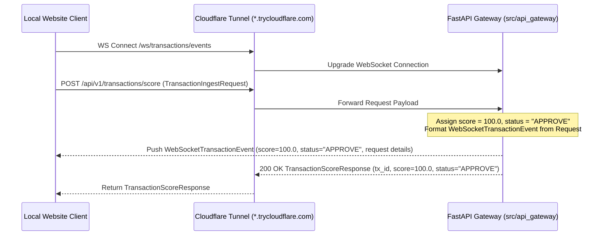

# Implementation Plan: PRD-002 — Update API Gateway to Return Score Request via WebSocket

## Goal Description

Implement [02-Update-API-Gateway-Return.md](file:///Users/abhishekbiswas/AppDevelppment/TransactionFraudScorerAgenticAI/docs/prds/02-Update-API-Gateway-Return.md) so the API Gateway can immediately echo/return the incoming transaction score request back to connected WebSocket clients (`GET /ws/transactions/events`) and the HTTP caller (`POST /api/v1/transactions/score`) without waiting on the Fraud Scorer LLM/MCP pipeline:
- **Score**: Fixed at `100.0` for now.
- **Status**: All transactions succeed (`APPROVE`).
- **WebSocket Event Payload**: Immediately broadcasts the `WebSocketTransactionEvent` formatted from the incoming `TransactionIngestRequest` (including `transaction_id`, `username`, `amount`, `currency`, `score=100.0`, and `score_details` containing `status="APPROVE"` and the echoed request details) to all connected WebSocket clients.



---

## User Review Required

> [!IMPORTANT]
> **Direct Request-to-WebSocket Echo Mode (`score=100.0`, `status="APPROVE"`)**:
> Per PRD-002 ("Before implementing the Fraud scorer system, I want to test if the request is going to API Gateway correctly and data is coming back via Websocket... Score can be 100 for now. All Transactions are successfull."), `POST /api/v1/transactions/score` will bypass the `FraudScorerOrchestrator` evaluation and directly construct the `FraudAssessment`, `TransactionScoreResponse`, and `WebSocketTransactionEvent` with `score = 100.0` and `status = "APPROVE"`. We will also include the echoed request payload inside `score_details` so the Web UI can inspect the exact request data that arrived at the API Gateway.

---

## Proposed Changes

### 1. FastAPI Gateway (`src/api_gateway/`)

#### [MODIFY] [schemas.py](file:///Users/abhishekbiswas/AppDevelppment/TransactionFraudScorerAgenticAI/src/api_gateway/schemas.py)
- Add an optional `request_payload: dict[str, Any] | None = None` field to [`ScoreDetails`](file:///Users/abhishekbiswas/AppDevelppment/TransactionFraudScorerAgenticAI/src/api_gateway/schemas.py#L227-L254) (while preserving all existing OpenAPI fields: `assessment_id`, `status`, `reasoning_summary`, `risk_factors`, `tools_invoked`, `evaluated_at`) so the WebSocket message carries both standard `ScoreDetails` and the echoed incoming request fields.

#### [MODIFY] [app.py](file:///Users/abhishekbiswas/AppDevelppment/TransactionFraudScorerAgenticAI/src/api_gateway/app.py)
- Update `POST /api/v1/transactions/score` (`ingest_and_score_transaction`):
  - Convert the incoming [`TransactionIngestRequest`](file:///Users/abhishekbiswas/AppDevelppment/TransactionFraudScorerAgenticAI/src/api_gateway/schemas.py#L173-L202) to `domain_tx` via `to_domain_transaction(payload)`.
  - Build a static `FraudAssessment` with:
    - `overall_risk_score = 100.0`
    - `decision = "APPROVE"`
    - `reasoning_summary = f"Request received for user '{payload.username}' ({payload.transaction_details.transaction_type} ${domain_tx.amount:,.2f} {domain_tx.currency}). All transactions are successful (mock score=100.0)."`
    - `risk_factors = []`, `tools_invoked = []`
  - Save the record in `tx_store` so `POST /api/v1/transactions/decision` continues to work seamlessly for any `transaction_id`.
  - Construct and broadcast [`WebSocketTransactionEvent`](file:///Users/abhishekbiswas/AppDevelppment/TransactionFraudScorerAgenticAI/src/api_gateway/schemas.py#L256-L291) with `score=100.0`, `status="APPROVE"`, `username=payload.username`, `amount=domain_tx.amount`, and `score_details` (including `request_payload=payload.model_dump(mode="json")`).
  - Return [`TransactionScoreResponse`](file:///Users/abhishekbiswas/AppDevelppment/TransactionFraudScorerAgenticAI/src/api_gateway/schemas.py#L204-L225) with `transaction_id`, `score=100.0`, and `status="APPROVE"`.

---

### 2. Google Colab Notebook (`notebooks/colab_setup_and_run.ipynb`)

#### [MODIFY] [colab_setup_and_run.ipynb](file:///Users/abhishekbiswas/AppDevelppment/TransactionFraudScorerAgenticAI/notebooks/colab_setup_and_run.ipynb)
- Place **Step 4: Test API Gateway & WebSocket Echo (`score=100.0`, `status="APPROVE"`)** immediately after **Step 3 (Start FastAPI Gateway & Expose via Cloudflare Tunnel)** so you can test the REST ingestion and WebSocket return in Colab *without* needing to run the Ollama installation steps first.
- Keep the optional Ollama & LangChain steps afterward for when you are ready to test the LLM agent.

---

### 3. Automated Tests (`tests/test_api_gateway.py`)

#### [MODIFY] [test_api_gateway.py](file:///Users/abhishekbiswas/AppDevelppment/TransactionFraudScorerAgenticAI/tests/test_api_gateway.py)
- Update `test_ingest_card_transaction_score`, `test_ingest_ach_transaction_score`, and `test_websocket_receives_scored_transaction_event` to assert:
  - `score == 100.0`
  - `status == "APPROVE"`
  - The WebSocket event on `/ws/transactions/events` returns `score == 100.0`, `score_details.status == "APPROVE"`, `username`, `amount`, and `score_details.request_payload` matching the ingested request.

---

## Verification Plan

### Automated Tests
```bash
uv run pytest -v
uv run ruff check src tests
uv run mypy src tests
```

### Manual Verification
1. Run Step 1–4 in `notebooks/colab_setup_and_run.ipynb` in Google Colab.
2. Verify that `POST /api/v1/transactions/score` returns `score: 100.0` and `status: "APPROVE"`, and that `/ws/transactions/events` pushes the `WebSocketTransactionEvent` with the request data, `score: 100.0`, and `status: "APPROVE"`.
