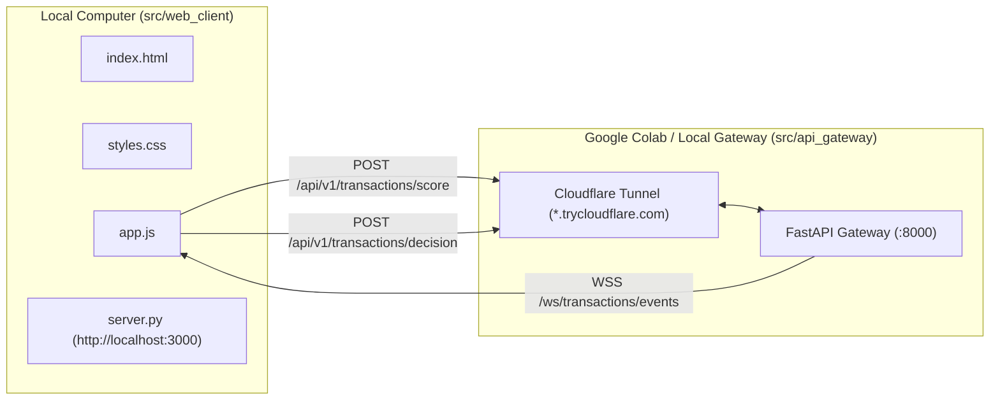

# Implementation Plan: PRD-003 — Implement WebUI (`src/web_client`)

## Goal Description

Implement the WebUI specified in [03-Implement-WebUI.md](file:///Users/abhishekbiswas/AppDevelppment/TransactionFraudScorerAgenticAI/docs/prds/03-Implement-WebUI.md) under `src/web_client/` so a user can:
1. **Configure the API Gateway URL** dynamically via the UI (e.g., `http://localhost:8000` or a Cloudflare Tunnel URL `https://<subdomain>.trycloudflare.com`), automatically deriving the WebSocket URL (`ws://` or `wss://.../ws/transactions/events`) and persisting it in `localStorage`.
2. **Connect/Disconnect to the WebSocket Stream (`GET /ws/transactions/events`)** with an optional username filter, displaying live connection status and streaming incoming `WebSocketTransactionEvent` payloads in real time.
3. **Send Transactions via REST API (`POST /api/v1/transactions/score`)**:
   - Supports both **CARD** and **ACH** payment rails (switching form sections dynamically via CSS `:has()` and JS).
   - Includes one-click sample presets (*Sample Card Transaction* and *Sample ACH Transaction*) to test quickly.
4. **Submit Analyst Accept/Reject Decisions (`POST /api/v1/transactions/decision`)** directly from any received WebSocket event row/card or via the decision form.
5. **Separated HTML, CSS, and JS files** with zero external JS frameworks:
   - `src/web_client/static/index.html`
   - `src/web_client/static/styles.css`
   - `src/web_client/static/app.js`
   - `src/web_client/server.py` (lightweight local HTTP static server + CLI entrypoint `fraud-web-client` so the WebUI can be run locally on your machine with `uv run fraud-web-client` or opened directly).



---

## User Review Required

> [!IMPORTANT]
> **Separated Vanilla HTML, CSS, and JS in `src/web_client/`**:
> Per PRD-003 ("HTML, CSS and JS/TS files should be seperated", "API Gateway URL should be configurable via UI", "Out-of-scope: Fancy JS Frameworks"), we will build the UI using clean, semantic HTML5, modern CSS (`:user-invalid`, `@container` responsive tables), and vanilla ES6+ JavaScript in separate files (`index.html`, `styles.css`, `app.js`), plus a lightweight Python static server (`src/web_client/server.py`) so you can launch the local website with `uv run fraud-web-client --port 3000` (and optionally also serve `/ui` from the FastAPI gateway for convenience).

---

## Proposed Changes

### 1. Project & Build Configuration

#### [MODIFY] [pyproject.toml](file:///Users/abhishekbiswas/AppDevelppment/TransactionFraudScorerAgenticAI/pyproject.toml)
- Add `src/web_client` to `[tool.hatch.build.targets.wheel] packages = ["src/fraud_scorer", "src/api_gateway", "src/web_client"]`.
- Add CLI script entrypoint `fraud-web-client = "web_client.server:main"`.

---

### 2. Web Client Package (`src/web_client/`)

#### [NEW] [__init__.py](file:///Users/abhishekbiswas/AppDevelppment/TransactionFraudScorerAgenticAI/src/web_client/__init__.py)
- Package initialization for `web_client`.

#### [NEW] [index.html](file:///Users/abhishekbiswas/AppDevelppment/TransactionFraudScorerAgenticAI/src/web_client/static/index.html)
- Semantic HTML5 layout divided into 3 clear panels:
  1. **Gateway Configuration & Connection Bar**:
     - Input for **API Gateway Base URL** (default `http://localhost:8000`, accepts any `https://*.trycloudflare.com` URL).
     - Optional **Username Filter** for WebSocket subscription.
     - **Connect / Reconnect WebSocket** button, **Check Health (`/health`)** button, and live status badge (`Connected`, `Disconnected`, `Connecting`).
  2. **Send Transaction Form (`POST /api/v1/transactions/score`)**:
     - Quick-fill buttons: **Load Card Preset**, **Load ACH Preset**.
     - User & Context fields: `username`, `datetime`, `ip`, `device_id`, `latitude`, `longitude`, `city`, `state`, `country`, `postal_code`.
     - Transaction & Merchant fields: `transaction_type` (`CARD` / `ACH`), `amount`, `currency`, `merchant_id`, `merchant_name`, `mcc`, `merchant_country`.
     - **CARD Details section**: `card_type`, `card_network`, `card_last_four`, `is_card_present`, `cvv_verified`, `avs_result`.
     - **ACH Details section**: `routing_number`, `account_last_four`, `account_type`, `sec_code`, `direction`, `bank_name`.
     - Displays the immediate HTTP response (`TransactionScoreResponse`).
  3. **Live WebSocket Event Stream & Decision Panel (`/ws/transactions/events` & `/api/v1/transactions/decision`)**:
     - Accessible scrollable responsive table (`role="region"`, `tabindex="0"`) displaying live incoming WebSocket events (`TransactionId`, `Username`, `Amount`, `Score`, `Status`, `Details of Score`, and quick **Accept / Reject** actions).
     - Expandable JSON inspector showing the full `score_details` (including `request_payload`).
     - Inline **Accept / Reject Decision Modal or Bar** allowing the user to enter a `reason` and invoke `POST /api/v1/transactions/decision`.

#### [NEW] [styles.css](file:///Users/abhishekbiswas/AppDevelppment/TransactionFraudScorerAgenticAI/src/web_client/static/styles.css)
- Clean, modern responsive CSS layout using CSS Grid/Flexbox, custom properties, sticky table headers (`position: sticky`), container queries (`@container (width < 600px)`) for responsive stacked tables, and `:user-invalid` / `:user-valid` post-interaction form validation styling.

#### [NEW] [app.js](file:///Users/abhishekbiswas/AppDevelppment/TransactionFraudScorerAgenticAI/src/web_client/static/app.js)
- Vanilla JavaScript controller handling:
  - **Gateway URL Resolution**: Normalizes the user-configured HTTP(S) base URL and derives the WebSocket URL (`http://` -> `ws://`, `https://` -> `wss://` + `/ws/transactions/events`).
  - **WebSocket Client**: Connects to `/ws/transactions/events`, parses incoming `WebSocketTransactionEvent` frames, prepends rows to the live event table, and updates the detail inspector.
  - **REST Score Submission**: Serializes form fields into `TransactionIngestRequest` and sends `fetch("${baseUrl}/api/v1/transactions/score", { method: "POST", ... })`.
  - **REST Decision Submission**: Sends `fetch("${baseUrl}/api/v1/transactions/decision", { method: "POST", ... })` with `{ transaction_id, accept, reason }` and updates the transaction row status badge (`ACCEPTED` / `REJECTED`).
  - **ARIA & `:user-invalid` Sync**: Keeps `aria-invalid` synchronized on blur/input and provides the `WeakMap` fallback for `:user-invalid`.

#### [NEW] [server.py](file:///Users/abhishekbiswas/AppDevelppment/TransactionFraudScorerAgenticAI/src/web_client/server.py)
- Lightweight local web server (`http.server` / FastAPI static mount) with CLI entrypoint `fraud-web-client` (`--host 127.0.0.1 --port 3000`) to serve `src/web_client/static/` locally on the user's computer.

---

### 3. Google Colab Notebook Update (`notebooks/colab_setup_and_run.ipynb`)

#### [MODIFY] [colab_setup_and_run.ipynb](file:///Users/abhishekbiswas/AppDevelppment/TransactionFraudScorerAgenticAI/notebooks/colab_setup_and_run.ipynb)
- Update **Step 3** output instructions to show how to paste the `https://*.trycloudflare.com` URL into the local WebUI (`uv run fraud-web-client --port 3000` -> `http://localhost:3000`).

---

### 4. Automated Tests (`tests/test_web_client.py`)

#### [NEW] [test_web_client.py](file:///Users/abhishekbiswas/AppDevelppment/TransactionFraudScorerAgenticAI/tests/test_web_client.py)
- Verifies that `index.html`, `styles.css`, and `app.js` exist under `src/web_client/static/`, are properly linked (`<link rel="stylesheet" href="styles.css">`, `<script src="app.js"`), and contain the configurable Gateway URL input, REST score/decision endpoints, and WebSocket event handler.
- Verifies the static file serving helper in `src/web_client/server.py`.

---

## Verification Plan

### Automated Tests
```bash
uv run pytest -v
uv run ruff check src tests
uv run mypy src tests
```

### Manual Verification
1. Start the local WebUI server on your computer:
   ```bash
   uv run fraud-web-client --port 3000
   ```
2. Open `http://localhost:3000` in your browser.
3. Paste the Cloudflare Tunnel URL from Colab (or `http://localhost:8000` if running the gateway locally) into the **API Gateway URL** input and click **Connect WebSocket**.
4. Click **Send Transaction** and verify the transaction appears in real time in the **WebSocket Event Stream** table with `Score: 100` and `Status: APPROVE`, and test **Accept / Reject**.
