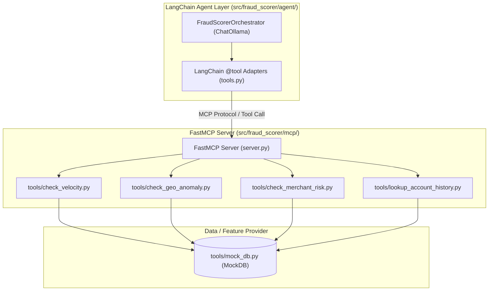

# Implementation Plan: PRD-004 — Generate the FastMCP Server and Modular Tools

## Goal Description

Implement [04-MCP-Server-Tools-Generate.md](file:///Users/abhishekbiswas/AppDevelppment/TransactionFraudScorerAgenticAI/docs/prds/04-MCP-Server-Tools-Generate.md) based on the system architecture in [architecture.md](file:///Users/abhishekbiswas/AppDevelppment/TransactionFraudScorerAgenticAI/docs/architecture.md):
1. **Create all 4 MCP Tools in separate files** under `src/fraud_scorer/mcp/tools/`:
   - `check_velocity.py` (`check_velocity`)
   - `check_geo_anomaly.py` (`check_geo_anomaly` & `haversine_distance`)
   - `check_merchant_risk.py` (`check_merchant_risk`)
   - `lookup_account_history.py` (`lookup_account_history`)
   - `mock_db.py` (`MockDB` — Transaction History & Features provider from the architecture diagram)
2. **FastMCP Server (`src/fraud_scorer/mcp/server.py`)**:
   - Configure the server using `FastMCP` (`mcp.server.fastmcp.FastMCP` / `mcp.server.mcpserver.MCPServer as FastMCP`), registering each tool from its dedicated module and supporting both `stdio` and `sse` transports.
3. **LangChain Configuration (`src/fraud_scorer/agent/tools.py`)**:
   - Provide LangChain `@tool` (`BaseTool`) adapters for each modular MCP tool file and a helper `configure_langchain_mcp_tools(llm, server=...)` / `get_langchain_fraud_tools()` so any LangChain chat model (`ChatOllama`, etc.) can bind and invoke the FastMCP tools directly.
4. **Update Google Colab Notebook (`notebooks/colab_setup_and_run.ipynb`)**:
   - Update the MCP Server & Tools step in `notebooks/colab_setup_and_run.ipynb` to showcase the FastMCP server initialization, tool introspection (`await server.list_tools()`), direct FastMCP tool execution (`await server.call_tool(...)`), and LangChain tool binding (`llm.bind_tools(...)`).



---

## User Review Required

> [!IMPORTANT]
> **One File Per Tool under `src/fraud_scorer/mcp/tools/`**:
> Each tool in the architecture diagram (`check_velocity`, `check_geo_anomaly`, `check_merchant_risk`, `lookup_account_history`) will live in its own module under `src/fraud_scorer/mcp/tools/`. We will also keep `src/fraud_scorer/mcp/tools/__init__.py` and `src/fraud_scorer/mcp/tools/risk_tools.py` re-exporting the functions so all existing imports remain backwards-compatible.

---

## Proposed Changes

### 1. Modular MCP Tools (`src/fraud_scorer/mcp/tools/`)

#### [NEW] [mock_db.py](file:///Users/abhishekbiswas/AppDevelppment/TransactionFraudScorerAgenticAI/src/fraud_scorer/mcp/tools/mock_db.py)
- Implements the `MockDB` ("Transaction History & Features" provider from `docs/architecture.md`), containing `HIGH_RISK_MCCS`, `MOCK_ACCOUNT_DATA`, and helper lookup functions.

#### [NEW] [check_velocity.py](file:///Users/abhishekbiswas/AppDevelppment/TransactionFraudScorerAgenticAI/src/fraud_scorer/mcp/tools/check_velocity.py)
- Implements `check_velocity(account_id: str, window_minutes: int = 60) -> dict[str, Any]`.
- Returns both the architecture contract keys (`count_transactions`, `sum_amount`, `velocity_score`, `is_burst`) and existing orchestrator keys (`transaction_count`, `cumulative_volume`, `velocity_risk_score`, `reasoning`).

#### [NEW] [check_geo_anomaly.py](file:///Users/abhishekbiswas/AppDevelppment/TransactionFraudScorerAgenticAI/src/fraud_scorer/mcp/tools/check_geo_anomaly.py)
- Implements `haversine_distance(lat1, lon1, lat2, lon2)` and `check_geo_anomaly(account_id: str, current_lat: float, current_lon: float, current_timestamp_iso: str | None = None, timestamp: str | None = None) -> dict[str, Any]`.
- Returns `distance_km`, `elapsed_hours`, `speed_kmh`, `impossible_travel`, `geo_risk_score`, and `reasoning`.

#### [NEW] [check_merchant_risk.py](file:///Users/abhishekbiswas/AppDevelppment/TransactionFraudScorerAgenticAI/src/fraud_scorer/mcp/tools/check_merchant_risk.py)
- Implements `check_merchant_risk(merchant_id: str, mcc: str) -> dict[str, Any]`.
- Returns both the architecture contract keys (`risk_tier`, `high_risk_category`, `merchant_reputation`) and existing orchestrator keys (`category_name`, `is_high_risk_mcc`, `merchant_risk_score`, `reasoning`).

#### [NEW] [lookup_account_history.py](file:///Users/abhishekbiswas/AppDevelppment/TransactionFraudScorerAgenticAI/src/fraud_scorer/mcp/tools/lookup_account_history.py)
- Implements `lookup_account_history(account_id: str) -> dict[str, Any]`.
- Returns both the architecture contract keys (`account_age_days`, `prior_disputes`, `avg_transaction_amount`) and existing orchestrator keys (`chargeback_count`, `trust_tier`, `account_risk_score`, `reasoning`).

#### [MODIFY] [__init__.py](file:///Users/abhishekbiswas/AppDevelppment/TransactionFraudScorerAgenticAI/src/fraud_scorer/mcp/tools/__init__.py) & [risk_tools.py](file:///Users/abhishekbiswas/AppDevelppment/TransactionFraudScorerAgenticAI/src/fraud_scorer/mcp/tools/risk_tools.py)
- Export `check_velocity`, `check_geo_anomaly`, `check_merchant_risk`, `lookup_account_history`, and `haversine_distance` from their dedicated modules.

---

### 2. FastMCP Server & LangChain Configuration

#### [MODIFY] [server.py](file:///Users/abhishekbiswas/AppDevelppment/TransactionFraudScorerAgenticAI/src/fraud_scorer/mcp/server.py)
- Import `FastMCP` (supporting both `mcp.server.fastmcp.FastMCP` and `mcp.server.mcpserver.MCPServer as FastMCP`).
- Import each tool from its own module (`fraud_scorer.mcp.tools.check_velocity`, `check_geo_anomaly`, `check_merchant_risk`, `lookup_account_history`) and register them on the `FastMCP` server (`mcp_server = FastMCP(name="TransactionFraudScorerMCP", ...)`).

#### [MODIFY] [tools.py](file:///Users/abhishekbiswas/AppDevelppment/TransactionFraudScorerAgenticAI/src/fraud_scorer/agent/tools.py)
- Import each tool from its dedicated module in `fraud_scorer.mcp.tools.*`.
- Provide `get_langchain_fraud_tools() -> list[BaseTool]` and `bind_mcp_tools_to_llm(llm: BaseChatModel) -> Runnable` so LangChain models can easily bind all FastMCP tools.

---

### 3. Google Colab Notebook Update

#### [MODIFY] [colab_setup_and_run.ipynb](file:///Users/abhishekbiswas/AppDevelppment/TransactionFraudScorerAgenticAI/notebooks/colab_setup_and_run.ipynb)
- Update **Step 7 (Test FastMCP Server, Modular Risk Tools & LangChain Tool Binding)** to demonstrate:
  1. Inspecting the individual tool modules (`check_velocity`, `check_geo_anomaly`, `check_merchant_risk`, `lookup_account_history`).
  2. Initializing the `FastMCP` server (`create_server()`), listing registered MCP tools via `await server.list_tools()`, and calling a tool via `await server.call_tool(...)`.
  3. Configuring and invoking the tools with LangChain (`get_langchain_fraud_tools()`).

---

### 4. Automated Tests (`tests/test_mcp_server.py`)

#### [MODIFY] [test_mcp_server.py](file:///Users/abhishekbiswas/AppDevelppment/TransactionFraudScorerAgenticAI/tests/test_mcp_server.py)
- Add tests verifying:
  - Each tool is importable from its own dedicated module (`fraud_scorer.mcp.tools.check_velocity`, `check_geo_anomaly`, `check_merchant_risk`, `lookup_account_history`).
  - Each tool output includes all fields specified in the architecture contract table (`docs/architecture.md`).
  - `FastMCP` server registration (`list_tools()`) and tool execution (`call_tool()`).
  - LangChain tool configuration (`get_langchain_fraud_tools()`).

---

## Verification Plan

### Automated Tests
```bash
uv run pytest -v
uv run ruff check src tests
uv run mypy src tests
```

### Manual Verification
1. Run `uv run fraud-mcp-server --help` or test the FastMCP server tools in `notebooks/colab_setup_and_run.ipynb`.
2. Run `uv run fraud-scorer-agent --demo` to verify LangChain + FastMCP tool execution end to end.
