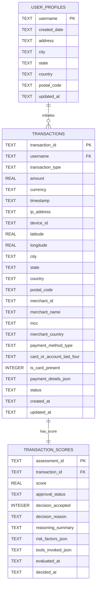

# Implementation Plan: PRD-005 — Setup Persistence RDBMS Database (SQLite)

## Goal Description

Implement [05-Setup-RDBMS.md](file:///Users/abhishekbiswas/AppDevelppment/TransactionFraudScorerAgenticAI/docs/prds/05-Setup-RDBMS.md) to create a lightweight SQLite RDBMS persistence layer for historical and ongoing transactions, transaction scores/dispositions, and user profiles:
1. **Relational Database Schemas (`docs/rdbms-model-schema/`)**:
   - Author the SQLite DDL schema (`schema.sql`) and ER diagram documentation (`README.md`) under `docs/rdbms-model-schema/` based on [openapi.yaml](file:///Users/abhishekbiswas/AppDevelppment/TransactionFraudScorerAgenticAI/docs/openapi-spec/openapi.yaml) and [transaction.py](file:///Users/abhishekbiswas/AppDevelppment/TransactionFraudScorerAgenticAI/src/fraud_scorer/models/transaction.py).
   - Define three normalized tables:
     - `user_profiles`: `username` (PK), `created_date`, `address`, `city`, `state`, `country`, `postal_code`, `updated_at`.
       - **Note**: `trust_tier`, `prior_disputes`, and `avg_transaction_amount` are **excluded** from `user_profiles` per PRD-005; those metrics are calculated dynamically by the MCP tool from `user_profiles` (`created_date`) and historical `transactions` / `transaction_scores`.
     - `transactions`: `transaction_id` (PK), `username` (FK -> `user_profiles.username`), `transaction_type` (`CARD` / `ACH`), `amount`, `currency`, `timestamp`, `ip_address`, `device_id`, location columns (`latitude`, `longitude`, `city`, `state`, `country`, `postal_code`), merchant columns (`merchant_id`, `merchant_name`, `mcc`, `merchant_country`), payment rail columns (`payment_method_type`, `card_or_account_last_four`, `is_card_present`, `payment_details_json`), `status`, `created_at`, `updated_at`.
     - `transaction_scores`: `assessment_id` (PK), `transaction_id` (UNIQUE FK -> `transactions.transaction_id` ON DELETE CASCADE), `score`, `approval_status`, `decision_accepted`, `decision_reason`, `reasoning_summary`, `risk_factors_json`, `tools_invoked_json`, `evaluated_at`, `decided_at`.
2. **SQLite Installation, Database File & CRUD Queries (`src/sqllite/`)**:
   - Save the SQLite installation/setup script and default database file (`src/sqllite/fraud_scorer.db`) directly under `src/sqllite/` (`install_sqlite.py` / `database.py`), so `notebooks/colab_setup_and_run.ipynb` reads directly from `src/sqllite` to install and initialize SQLite.
   - Implement parameterized `SELECT`, `INSERT`, `UPDATE`, and `DELETE` SQL queries (`src/sqllite/queries.py` & `src/sqllite/crud.py`) for all 3 tables.
   - Update `lookup_account_history.py` so that when an account exists in SQLite (`src/sqllite/fraud_scorer.db`), it dynamically calculates `account_age_days`, `prior_disputes`, `avg_transaction_amount`, and `trust_tier` from the RDBMS records (falling back to `mock_db` if the DB has not been populated yet).
3. **Google Colab Notebook (`notebooks/colab_setup_and_run.ipynb`)**:
   - Update `notebooks/colab_setup_and_run.ipynb` to run the SQLite installation & schema initialization from `src/sqllite` and verify `INSERT`, `SELECT`, `UPDATE`, and `DELETE` operations.



---

## User Review Required

> [!IMPORTANT]
> **1. Lean `user_profiles` Schema (`docs/rdbms-model-schema/schema.sql`)**:
> Per the updated PRD-005 ("In user profile no need to add `trust_tier`, `prior_disputes`, `avg_transaction_amount`. Those data need to be calculated in the tool"), `user_profiles` only stores `username`, `created_date`, `address` (plus optional location fields `city`, `state`, `country`, `postal_code`, `updated_at`). The MCP tool calculates `account_age_days` (from `created_date`), `prior_disputes` (count of rejected/declined transactions), `avg_transaction_amount` (`AVG(amount)` from `transactions`), and `trust_tier`.
>
> **2. SQLite Installation Saved under `src/sqllite/`**:
> Both the SQLite installation script (`src/sqllite/install_sqlite.py` & `src/sqllite/install_sqlite.sh`) and the default SQLite database (`src/sqllite/fraud_scorer.db`) live under `src/sqllite/`, and `notebooks/colab_setup_and_run.ipynb` reads directly from `src/sqllite` to install SQLite and initialize the database.

---

## Proposed Changes

### 1. Relational Database Schema (`docs/rdbms-model-schema/`)

#### [NEW] [schema.sql](file:///Users/abhishekbiswas/AppDevelppment/TransactionFraudScorerAgenticAI/docs/rdbms-model-schema/schema.sql)
- SQLite DDL creating:
  - `user_profiles` (`username`, `created_date`, `address`, `city`, `state`, `country`, `postal_code`, `updated_at`)
  - `transactions` (with `status` and full transaction/location/merchant/payment fields)
  - `transaction_scores` (mapped to `transaction_id` with `score`, `approval_status`, `decision_accepted`, `decision_reason`, `reasoning_summary`, `risk_factors_json`, `tools_invoked_json`, `evaluated_at`, `decided_at`)
  - Indexes on `transactions(username, timestamp)`, `transactions(status)`, and `transaction_scores(transaction_id)`.

#### [NEW] [README.md](file:///Users/abhishekbiswas/AppDevelppment/TransactionFraudScorerAgenticAI/docs/rdbms-model-schema/README.md)
- ER diagram and schema documentation explaining the 3 tables and how `trust_tier`, `prior_disputes`, and `avg_transaction_amount` are calculated dynamically by the tool rather than stored on `user_profiles`.

---

### 2. Project & Build Configuration

#### [MODIFY] [pyproject.toml](file:///Users/abhishekbiswas/AppDevelppment/TransactionFraudScorerAgenticAI/pyproject.toml)
- Add `src/sqllite` to `[tool.hatch.build.targets.wheel] packages = ["src/fraud_scorer", "src/api_gateway", "src/web_client", "src/sqllite"]`.

#### [MODIFY] [config.py](file:///Users/abhishekbiswas/AppDevelppment/TransactionFraudScorerAgenticAI/src/fraud_scorer/config.py)
- Add `sqlite_db_path: str = "src/sqllite/fraud_scorer.db"` setting.

---

### 3. SQLite Installation, Database & CRUD Queries (`src/sqllite/`)

#### [NEW] [install_sqlite.sh](file:///Users/abhishekbiswas/AppDevelppment/TransactionFraudScorerAgenticAI/src/sqllite/install_sqlite.sh) & [install_sqlite.py](file:///Users/abhishekbiswas/AppDevelppment/TransactionFraudScorerAgenticAI/src/sqllite/install_sqlite.py)
- Saved directly under `src/sqllite/` so `colab_setup_and_run.ipynb` can read/execute from `src/sqllite`:
  - Ensures the `sqlite3` CLI / runtime is installed in Linux/Colab (`apt-get install -y sqlite3 libsqlite3-dev` if needed).
  - Initializes the SQLite database file at `src/sqllite/fraud_scorer.db` using `docs/rdbms-model-schema/schema.sql`.
  - Verifies the created tables (`user_profiles`, `transactions`, `transaction_scores`).

#### [NEW] [database.py](file:///Users/abhishekbiswas/AppDevelppment/TransactionFraudScorerAgenticAI/src/sqllite/database.py)
- Defines `DEFAULT_DB_PATH = Path(__file__).resolve().parent / "fraud_scorer.db"` (`src/sqllite/fraud_scorer.db`).
- `get_connection(db_path: str | Path = DEFAULT_DB_PATH) -> sqlite3.Connection` (configured with `sqlite3.Row` and `PRAGMA foreign_keys = ON`).
- `init_db(db_path: str | Path = DEFAULT_DB_PATH) -> Path`: Reads and executes `docs/rdbms-model-schema/schema.sql` to create all tables and indexes idempotently.

#### [NEW] [queries.py](file:///Users/abhishekbiswas/AppDevelppment/TransactionFraudScorerAgenticAI/src/sqllite/queries.py)
- Parameterized `SELECT`, `INSERT`, `UPDATE`, and `DELETE` SQL query definitions for all three tables:
  - **UserProfile Queries** (`username`, `created_date`, `address`, `city`, `state`, `country`, `postal_code`, `updated_at`):
    - `INSERT_USER_PROFILE_SQL`
    - `SELECT_USER_PROFILE_BY_USERNAME_SQL`
    - `SELECT_ALL_USER_PROFILES_SQL`
    - `UPDATE_USER_PROFILE_SQL`
    - `DELETE_USER_PROFILE_SQL`
  - **Transaction Queries**:
    - `INSERT_TRANSACTION_SQL`
    - `SELECT_TRANSACTION_BY_ID_SQL`
    - `SELECT_TRANSACTIONS_BY_USERNAME_SQL`
    - `SELECT_TRANSACTIONS_BY_STATUS_SQL`
    - `UPDATE_TRANSACTION_STATUS_SQL`
    - `DELETE_TRANSACTION_SQL`
  - **TransactionScore Queries**:
    - `INSERT_TRANSACTION_SCORE_SQL`
    - `SELECT_TRANSACTION_SCORE_BY_TX_ID_SQL`
    - `SELECT_TRANSACTION_WITH_SCORE_JOIN_SQL`
    - `UPDATE_TRANSACTION_SCORE_SQL`
    - `UPDATE_TRANSACTION_DECISION_SQL`
    - `DELETE_TRANSACTION_SCORE_SQL`
  - **Aggregation Query for Tool Calculation**:
    - `SELECT_USER_TRANSACTION_STATS_SQL` (calculates `avg_transaction_amount`, `total_transactions`, and `prior_disputes` from `transactions` and `transaction_scores` for a given `username`).

#### [NEW] [crud.py](file:///Users/abhishekbiswas/AppDevelppment/TransactionFraudScorerAgenticAI/src/sqllite/crud.py)
- Python functions executing the `SELECT`, `INSERT`, `UPDATE`, and `DELETE` queries in `queries.py` for `user_profiles`, `transactions`, and `transaction_scores`, plus `calculate_user_profile_metrics(username, db_path)` for tool consumption.

#### [NEW] [__init__.py](file:///Users/abhishekbiswas/AppDevelppment/TransactionFraudScorerAgenticAI/src/sqllite/__init__.py)
- Exports `DEFAULT_DB_PATH`, `get_connection`, `init_db`, `install_and_setup_sqlite`, SQL query constants, and all CRUD functions.

---

### 4. Google Colab Notebook Update (`notebooks/colab_setup_and_run.ipynb`)

#### [MODIFY] [colab_setup_and_run.ipynb](file:///Users/abhishekbiswas/AppDevelppment/TransactionFraudScorerAgenticAI/notebooks/colab_setup_and_run.ipynb)
- Add a step that reads and executes the SQLite installation & database setup from `src/sqllite` (`install_and_setup_sqlite()` / `bash src/sqllite/install_sqlite.sh`) and verifies `INSERT`, `SELECT`, `UPDATE`, and `DELETE` across `user_profiles`, `transactions`, and `transaction_scores`.

---

### 5. Automated Unit Tests (`tests/test_sqllite.py`)

#### [NEW] [test_sqllite.py](file:///Users/abhishekbiswas/AppDevelppment/TransactionFraudScorerAgenticAI/tests/test_sqllite.py)
- Verifies `docs/rdbms-model-schema/schema.sql` and `src/sqllite/install_sqlite.py` / `src/sqllite/install_sqlite.sh`.
- Verifies `user_profiles` has `username`, `created_date`, `address` and does **not** store `trust_tier`, `prior_disputes`, or `avg_transaction_amount` columns.
- Verifies `INSERT`, `SELECT`, `UPDATE`, and `DELETE` operations across `user_profiles`, `transactions`, and `transaction_scores`, and verifies dynamic calculation of `prior_disputes`, `avg_transaction_amount`, and `trust_tier`.

---

## Verification Plan

### Automated Tests
```bash
uv run pytest -v
uv run ruff check src tests
uv run mypy src tests
```

### Manual Verification
1. Run `uv run python -m sqllite.install_sqlite` (or run the SQLite setup step in `notebooks/colab_setup_and_run.ipynb`) to verify `src/sqllite/fraud_scorer.db` is created and all CRUD operations succeed.
