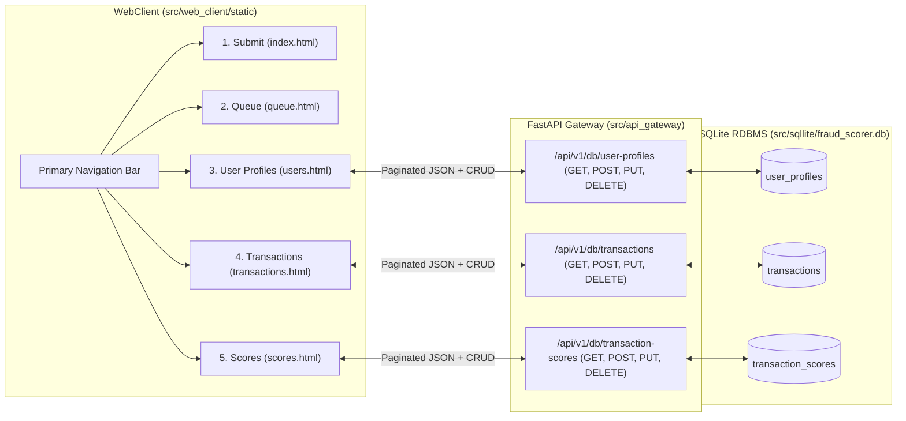

# Implementation Plan: PRD-006 — WebClient to View RDBMS Data (Paginated Table Pages & OpenAPI CRUD Endpoints)

## Goal Description
Implement [PRD-006](file:///Users/abhishekbiswas/AppDevelppment/TransactionFraudScorerAgenticAI/docs/prds/06-WebClient-Get-RDBMS-data.md) to expose full `GET`, `POST`, `PUT`, and `DELETE` REST API endpoints for the three SQLite RDBMS tables (`user_profiles`, `transactions`, `transaction_scores`), document them in [openapi.yaml](file:///Users/abhishekbiswas/AppDevelppment/TransactionFraudScorerAgenticAI/docs/openapi-spec/openapi.yaml), implement them in the FastAPI Gateway (`src/api_gateway/`), add dedicated paginated WebClient pages for each table (`users.html`, `transactions.html`, `scores.html`), and update [colab_setup_and_run.ipynb](file:///Users/abhishekbiswas/AppDevelppment/TransactionFraudScorerAgenticAI/notebooks/colab_setup_and_run.ipynb).

---

## Architecture & Data Flow



---

## Proposed Changes

### 1. OpenAPI v3 Specification (`docs/openapi-spec/openapi.yaml`)
#### [MODIFY] [openapi.yaml](file:///Users/abhishekbiswas/AppDevelppment/TransactionFraudScorerAgenticAI/docs/openapi-spec/openapi.yaml)
- Add a `Database` tag and `GET`, `POST`, `PUT`, `DELETE` paths for all three RDBMS tables:
  1. **User Profiles (`user_profiles`)**:
     - `GET /api/v1/db/user-profiles` (`page`, `page_size` query params -> `PaginatedUserProfilesResponse`)
     - `POST /api/v1/db/user-profiles` (`UserProfileUpsertRequest` -> `UserProfileRecord`)
     - `GET /api/v1/db/user-profiles/{username}` (`UserProfileRecord`)
     - `PUT /api/v1/db/user-profiles/{username}` (`UserProfileUpdateRequest` -> `UserProfileRecord`)
     - `DELETE /api/v1/db/user-profiles/{username}` (`DeleteRecordResponse`)
  2. **Transactions (`transactions`)**:
     - `GET /api/v1/db/transactions` (`page`, `page_size`, optional `username`, `status` query params -> `PaginatedTransactionsResponse`)
     - `POST /api/v1/db/transactions` (`TransactionCreateRequest` -> `TransactionRecord`)
     - `GET /api/v1/db/transactions/{transaction_id}` (`TransactionRecord`)
     - `PUT /api/v1/db/transactions/{transaction_id}` (`TransactionUpdateRequest` -> `TransactionRecord`)
     - `DELETE /api/v1/db/transactions/{transaction_id}` (`DeleteRecordResponse`)
  3. **Transaction Scores (`transaction_scores`)**:
     - `GET /api/v1/db/transaction-scores` (`page`, `page_size` query params -> `PaginatedTransactionScoresResponse`)
     - `POST /api/v1/db/transaction-scores` (`TransactionScoreCreateRequest` -> `TransactionScoreRecord`)
     - `GET /api/v1/db/transaction-scores/{transaction_id}` (`TransactionScoreRecord`)
     - `PUT /api/v1/db/transaction-scores/{transaction_id}` (`TransactionScoreUpdateRequest` -> `TransactionScoreRecord`)
     - `DELETE /api/v1/db/transaction-scores/{transaction_id}` (`DeleteRecordResponse`)

---

### 2. SQLite Pagination & Update Queries (`src/sqllite/`)
#### [MODIFY] [queries.py](file:///Users/abhishekbiswas/AppDevelppment/TransactionFraudScorerAgenticAI/src/sqllite/queries.py)
- Add `COUNT(*)` and paginated `LIMIT :limit OFFSET :offset` queries for `user_profiles`, `transactions`, and `transaction_scores`.
- Add `UPDATE_TRANSACTION_RECORD_SQL` to support full `PUT /api/v1/db/transactions/{transaction_id}` updates (amount, status, city, state, country, merchant_name, etc.).

#### [MODIFY] [crud.py](file:///Users/abhishekbiswas/AppDevelppment/TransactionFraudScorerAgenticAI/src/sqllite/crud.py)
- Add paginated query functions returning `dict[str, Any]` with `items`, `total`, `page`, `page_size`, and `total_pages`:
  - `select_user_profiles_paginated(page: int = 1, page_size: int = 10, db_path: str | Path = DEFAULT_DB_PATH)`
  - `select_transactions_paginated(page: int = 1, page_size: int = 10, username: str | None = None, status: str | None = None, db_path: str | Path = DEFAULT_DB_PATH)`
  - `select_transaction_scores_paginated(page: int = 1, page_size: int = 10, db_path: str | Path = DEFAULT_DB_PATH)`
- Add `update_transaction_record(...)` to update fields on an existing transaction row.

#### [MODIFY] [__init__.py](file:///Users/abhishekbiswas/AppDevelppment/TransactionFraudScorerAgenticAI/src/sqllite/__init__.py)
- Export the new paginated `select_*_paginated` and `update_transaction_record` functions.

---

### 3. FastAPI Gateway RDBMS Endpoints & Automatic Persistence (`src/api_gateway/`)
#### [MODIFY] [schemas.py](file:///Users/abhishekbiswas/AppDevelppment/TransactionFraudScorerAgenticAI/src/api_gateway/schemas.py)
- Add Pydantic models for the RDBMS CRUD endpoints (`UserProfileRecord`, `UserProfileCreateRequest`, `UserProfileUpdateRequest`, `PaginatedUserProfilesResponse`, `TransactionRecord`, `TransactionCreateRequest`, `TransactionUpdateRequest`, `PaginatedTransactionsResponse`, `TransactionScoreRecord`, `TransactionScoreCreateRequest`, `TransactionScoreUpdateRequest`, `PaginatedTransactionScoresResponse`, `DeleteRecordResponse`).

#### [MODIFY] [app.py](file:///Users/abhishekbiswas/AppDevelppment/TransactionFraudScorerAgenticAI/src/api_gateway/app.py)
- Persist incoming scored transactions (`POST /api/v1/transactions/score`) and analyst decisions (`POST /api/v1/transactions/decision`) into SQLite (`db_path` configurable on `create_app`, defaulting to `DEFAULT_DB_PATH`) so all scored and decided transactions automatically appear in the RDBMS tables.
- Implement the 15 RDBMS endpoints (`GET` paginated list, `GET` by ID, `POST`, `PUT`, `DELETE`) across `/api/v1/db/user-profiles`, `/api/v1/db/transactions`, and `/api/v1/db/transaction-scores`.

---

### 4. WebClient Paginated Table Pages (`src/web_client/`)
> [!NOTE]
> Per `modern-web-guidance`:
> - **`responsive-table`**: Wrap each table in `<div tabindex="0" role="region" aria-labelledby="..." class="table-wrapper">` with sticky column headers (`thead`), sticky row headers (`tbody th`), and `@container (width < 600px)` stacked mobile layout with `--label-*` CSS variables.
> - **`interactions-in-complex-layouts`**: Apply `content-visibility: auto` and `contain-intrinsic-size: auto 300px auto 500px` (with `@supports not (content-visibility: auto)` fallback `contain: layout style paint`) to `.panel` containers to isolate rendering/layout recalculations during table pagination and row mutations.

#### [MODIFY] [index.html](file:///Users/abhishekbiswas/AppDevelppment/TransactionFraudScorerAgenticAI/src/web_client/static/index.html) & [queue.html](file:///Users/abhishekbiswas/AppDevelppment/TransactionFraudScorerAgenticAI/src/web_client/static/queue.html)
- Update the top navigation bar (`.app-nav`) on all pages to link all 5 pages:
  1. `index.html` — `1. Submit Transaction`
  2. `queue.html` — `2. Decision Queue (WebSocket)`
  3. `users.html` — `3. User Profiles (RDBMS)`
  4. `transactions.html` — `4. Transactions (RDBMS)`
  5. `scores.html` — `5. Transaction Scores (RDBMS)`

#### [NEW] [users.html](file:///Users/abhishekbiswas/AppDevelppment/TransactionFraudScorerAgenticAI/src/web_client/static/users.html)
- Dedicated page for viewing and managing the `user_profiles` RDBMS table:
  - Paginated data table (`Username`, `Created Date`, `Address`, `City`, `State`, `Country`, `Postal Code`, `Updated At`, `Actions`).
  - Pagination toolbar (`Previous`, `Next`, `Page X of Y (Total: N)`, and `Page Size` select `5 / 10 / 25 / 50`).
  - Form to Create (`POST`) or Update (`PUT`) a `UserProfile` and row buttons to Edit or Delete (`DELETE`).

#### [NEW] [transactions.html](file:///Users/abhishekbiswas/AppDevelppment/TransactionFraudScorerAgenticAI/src/web_client/static/transactions.html)
- Dedicated page for viewing and managing the `transactions` RDBMS table:
  - Paginated data table (`Transaction ID`, `Username`, `Type`, `Amount`, `Merchant`, `Location`, `Status`, `Timestamp`, `Actions`).
  - Pagination toolbar (`Previous`, `Next`, `Page X of Y (Total: N)`, `Page Size` select, plus optional `Status` and `Username` filters).
  - Form to Create (`POST`) or Update (`PUT`) a `Transaction` and row buttons to Edit or Delete (`DELETE`).

#### [NEW] [scores.html](file:///Users/abhishekbiswas/AppDevelppment/TransactionFraudScorerAgenticAI/src/web_client/static/scores.html)
- Dedicated page for viewing and managing the `transaction_scores` RDBMS table:
  - Paginated data table (`Transaction ID`, `Assessment ID`, `Score`, `Approval Status`, `Decision Accepted`, `Decision Reason`, `Evaluated At`, `Actions`).
  - Pagination toolbar (`Previous`, `Next`, `Page X of Y (Total: N)`, and `Page Size` select).
  - Form to Create (`POST`) or Update (`PUT`) a `TransactionScore` and row buttons to Edit or Delete (`DELETE`).

#### [MODIFY] [styles.css](file:///Users/abhishekbiswas/AppDevelppment/TransactionFraudScorerAgenticAI/src/web_client/static/styles.css)
- Add `.pagination-bar`, `.pagination-controls`, `.pagination-info`, per-table `@container (width < 600px)` `--label-*` mappings, and `content-visibility: auto` containment rules with `@supports not (content-visibility: auto)` fallback.

#### [MODIFY] [app.js](file:///Users/abhishekbiswas/AppDevelppment/TransactionFraudScorerAgenticAI/src/web_client/static/app.js)
- Add controller logic for `users.html`, `transactions.html`, and `scores.html` supporting paginated `GET` fetching, `POST` creation, `PUT` updating, `DELETE` removal, and pagination state navigation.

---

### 5. Google Colab Notebook (`notebooks/colab_setup_and_run.ipynb`)
#### [MODIFY] [colab_setup_and_run.ipynb](file:///Users/abhishekbiswas/AppDevelppment/TransactionFraudScorerAgenticAI/notebooks/colab_setup_and_run.ipynb)
- Add a step after Step 4 verifying the API Gateway's RDBMS CRUD and paginated `GET` endpoints (`/api/v1/db/user-profiles`, `/api/v1/db/transactions`, `/api/v1/db/transaction-scores`) and printing the WebClient URLs (`users.html`, `transactions.html`, `scores.html`).

---

## Verification Plan

### Automated Tests
- Update [test_api_gateway.py](file:///Users/abhishekbiswas/AppDevelppment/TransactionFraudScorerAgenticAI/tests/test_api_gateway.py) to test `POST`, `GET` (paginated & single), `PUT`, and `DELETE` across `/api/v1/db/user-profiles`, `/api/v1/db/transactions`, and `/api/v1/db/transaction-scores`.
- Update [test_web_client.py](file:///Users/abhishekbiswas/AppDevelppment/TransactionFraudScorerAgenticAI/tests/test_web_client.py) to verify `users.html`, `transactions.html`, and `scores.html` exist, contain accessible `.table-wrapper` tables and pagination controls, and link across all 5 pages.
- Run:
  ```bash
  uv run pytest -v
  uv run ruff check src tests
  uv run mypy src tests
  ```
