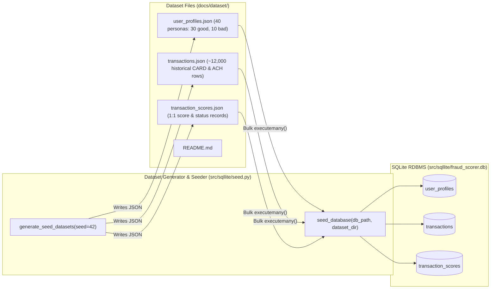

# Implementation Plan: PRD-007 — Seed the SQLite RDBMS Database & Generate Datasets (`docs/dataset`)

## Goal Description
Implement [07-Seed-the-database.md](file:///Users/abhishekbiswas/AppDevelppment/TransactionFraudScorerAgenticAI/docs/prds/07-Seed-the-database.md) to generate deterministic, schema-compliant mock datasets under `docs/dataset/` and seed the SQLite RDBMS (`src/sqllite/fraud_scorer.db`) with:
1. **30 Good Personas** (`good_persona_01` to `good_persona_30`) created within the last **1 year** (`created_date` distributed between 7 and 12 months ago so they exist throughout the 7-month transaction window).
2. **10 Bad Personas** (`bad_persona_01` to `bad_persona_10`) created within the last **5 months**.
3. **20 Good Personas** (`good_persona_01` to `good_persona_20`) having **10–30 good transactions each week for the last 7 months** (30 weeks), with `status = 'APPROVE'` and corresponding low-risk `transaction_scores` records.
4. **5 Bad Personas** (`bad_persona_01` to `bad_persona_05`) having **2–5 good transactions in the last 2 weeks**, with `status = 'APPROVE'` and corresponding `transaction_scores` records.
5. Dataset files saved under `docs/dataset/` (`user_profiles.json`, `transactions.json`, `transaction_scores.json`, and `README.md`) and fast bulk-insertion into SQLite (`src/sqllite/seed.py`), plus an execution step in [colab_setup_and_run.ipynb](file:///Users/abhishekbiswas/AppDevelppment/TransactionFraudScorerAgenticAI/notebooks/colab_setup_and_run.ipynb).

---

## Architecture & Seeding Pipeline



---

## Proposed Changes

### 1. Dataset Generation & Bulk Seeder (`src/sqllite/`)
#### [NEW] [seed.py](file:///Users/abhishekbiswas/AppDevelppment/TransactionFraudScorerAgenticAI/src/sqllite/seed.py)
- Implement deterministic dataset generation (`random.Random(42)`) relative to a reference UTC timestamp (`reference_time: datetime | None = None`):
  - **Personas (`user_profiles`)**:
    - `good_persona_01` .. `good_persona_30`: `created_date` within the last 1 year (specifically 215–360 days before `reference_time` so all 20 active good personas already existed 7 months ago). Realistic US addresses, cities, states, and postal codes.
    - `bad_persona_01` .. `bad_persona_10`: `created_date` within the last 5 months (15–150 days before `reference_time`).
  - **Transactions (`transactions`) & Scores (`transaction_scores`)**:
    - For `good_persona_01` .. `good_persona_20`: Loop over each of the last **30 weeks (~7 months)** and generate `rng.randint(10, 30)` good transactions (`CARD` and `ACH`, `status = 'APPROVE'`, `score` between `2.0` and `25.0`).
    - For `bad_persona_01` .. `bad_persona_05`: Generate `rng.randint(2, 5)` good transactions (`status = 'APPROVE'`, `score` between `10.0` and `28.0`) with timestamps within the last **2 weeks (14 days)**.
- Implement `write_datasets_to_disk(dataset_dir: str | Path = DEFAULT_DATASET_DIR)` to write `docs/dataset/user_profiles.json`, `docs/dataset/transactions.json`, and `docs/dataset/transaction_scores.json`.
- Implement `seed_database(db_path: str | Path = DEFAULT_DB_PATH, dataset_dir: str | Path = DEFAULT_DATASET_DIR, regenerate: bool = False) -> dict[str, Any]` which reads the dataset files from `docs/dataset/` (generating them if missing or `regenerate=True`) and performs a single transactional `conn.executemany(...)` bulk upsert/insert into `user_profiles`, `transactions`, and `transaction_scores`.
- Provide a CLI entrypoint `python -m sqllite.seed` (or `uv run python src/sqllite/seed.py`).

#### [MODIFY] [__init__.py](file:///Users/abhishekbiswas/AppDevelppment/TransactionFraudScorerAgenticAI/src/sqllite/__init__.py)
- Export `DEFAULT_DATASET_DIR`, `generate_seed_datasets`, `write_datasets_to_disk`, and `seed_database`.

---

### 2. Generated Dataset Files (`docs/dataset/`)
#### [NEW] [README.md](file:///Users/abhishekbiswas/AppDevelppment/TransactionFraudScorerAgenticAI/docs/dataset/README.md)
- Document the cohort distributions (30 good personas in last 1 year, 10 bad personas in last 5 months, 20 good personas with 10–30 weekly good transactions over 7 months, 5 bad personas with 2–5 good transactions in last 2 weeks), schema alignment, and CLI usage.

#### [NEW] `docs/dataset/user_profiles.json`, `docs/dataset/transactions.json`, `docs/dataset/transaction_scores.json`
- Generated by running `uv run python src/sqllite/seed.py` and loaded into `src/sqllite/fraud_scorer.db`.

---

### 3. Google Colab Notebook (`notebooks/colab_setup_and_run.ipynb`)
#### [MODIFY] [colab_setup_and_run.ipynb](file:///Users/abhishekbiswas/AppDevelppment/TransactionFraudScorerAgenticAI/notebooks/colab_setup_and_run.ipynb)
- Update **Step 2.5** (or add **Step 2.6: Seed the SQLite RDBMS from `docs/dataset`**) to run `seed_database()`, display the seeded row counts (`user_profiles`, `transactions`, `transaction_scores`), and verify dynamic profile metrics on `good_persona_01` and `bad_persona_01`.

---

## Verification Plan

### Automated Tests
- Add unit tests in [test_sqllite.py](file:///Users/abhishekbiswas/AppDevelppment/TransactionFraudScorerAgenticAI/tests/test_sqllite.py):
  - `test_generate_and_seed_database_cohorts`: Verify:
    - Exactly 30 good personas created within the last 1 year and 10 bad personas created within the last 5 months.
    - 20 good personas have 10–30 transactions per week across each of the 30 weeks (~7 months), and the remaining 10 good personas have 0 transactions.
    - 5 bad personas have 2–5 good transactions within the last 2 weeks, and the remaining 5 bad personas have 0 transactions.
    - `docs/dataset/user_profiles.json`, `docs/dataset/transactions.json`, and `docs/dataset/transaction_scores.json` exist and load cleanly into SQLite via `seed_database()`.
- Run:
  ```bash
  uv run python src/sqllite/seed.py
  uv run pytest -v
  uv run ruff check src tests
  uv run mypy src tests
  ```
