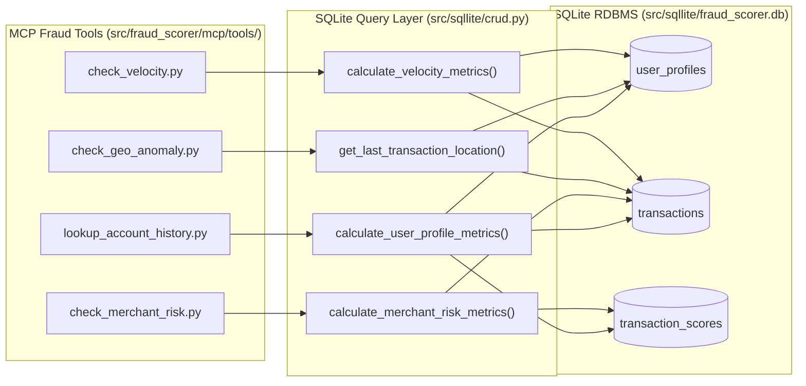

# Implementation Plan: PRD-008 — Update MCP Tools to Query SQLite RDBMS for Historical Data

## Goal Description
Implement [08-Update-tools-for-DB.md](file:///Users/abhishekbiswas/AppDevelppment/TransactionFraudScorerAgenticAI/docs/prds/08-Update-tools-for-DB.md) so that all four MCP fraud-scoring tools (`check_velocity`, `check_geo_anomaly`, `check_merchant_risk`, and `lookup_account_history`) connect directly to the SQLite RDBMS (`src/sqllite/fraud_scorer.db`, defined by `docs/rdbms-model-schema/schema.sql`) to retrieve actual historical user, transaction, and score records for risk calculation, while preserving fallback to `mock_db.py` for synthetic test accounts (`acc_normal_01`, `acc_suspicious_01`). Also update [colab_setup_and_run.ipynb](file:///Users/abhishekbiswas/AppDevelppment/TransactionFraudScorerAgenticAI/notebooks/colab_setup_and_run.ipynb) to demonstrate the DB-backed MCP tools against the seeded personas (`good_persona_01`, `bad_persona_01`).

---

## Architecture & Tool-to-RDBMS Mapping



---

## Proposed Changes

### 1. SQLite Historical Aggregation Queries (`src/sqllite/`)
#### [MODIFY] [queries.py](file:///Users/abhishekbiswas/AppDevelppment/TransactionFraudScorerAgenticAI/src/sqllite/queries.py)
- Add parameterized SQL queries for the MCP tools:
  - `SELECT_USER_VELOCITY_WINDOW_SQL`: Counts transactions and sums `amount` for `:username` where `timestamp >= :window_start_iso AND timestamp <= :window_end_iso`.
  - `SELECT_LAST_TRANSACTION_BY_USERNAME_SQL`: Selects the most recent transaction (`transaction_id`, `latitude`, `longitude`, `city`, `state`, `country`, `timestamp`, `amount`) for `:username` ordered by `timestamp DESC LIMIT 1`.
  - `SELECT_MERCHANT_HISTORICAL_STATS_SQL`: Aggregates `COUNT(t.transaction_id) AS total_tx`, `COALESCE(AVG(t.amount), 0.0) AS avg_amount`, and `SUM(CASE WHEN t.status IN ('DECLINE', 'REJECTED') OR s.approval_status IN ('DECLINE', 'REJECTED') OR s.decision_accepted = 0 THEN 1 ELSE 0 END) AS disputed_tx` from `transactions t LEFT JOIN transaction_scores s ON t.transaction_id = s.transaction_id WHERE t.merchant_id = :merchant_id`.

#### [MODIFY] [crud.py](file:///Users/abhishekbiswas/AppDevelppment/TransactionFraudScorerAgenticAI/src/sqllite/crud.py)
- Add helper functions queried by the MCP tools:
  - `calculate_velocity_metrics(username: str, window_minutes: int = 60, reference_timestamp: str | None = None, db_path: str | Path = DEFAULT_DB_PATH) -> dict[str, Any] | None`:
    - Checks if `username` exists in `user_profiles` (or has rows in `transactions`). If not, returns `None` (triggering `mock_db` fallback).
    - Computes `count_transactions` and `sum_amount` within `window_minutes` ending at `reference_timestamp` (or if `reference_timestamp` is not provided, ending at the user's most recent transaction timestamp in `transactions` so historical seeded data is accurately evaluated).
  - `get_last_transaction_location(username: str, db_path: str | Path = DEFAULT_DB_PATH) -> dict[str, Any] | None`:
    - Returns the most recent transaction's `latitude`, `longitude`, `city`, `state`, `country`, and `timestamp` for `username` from `transactions` (or `None` if no transactions exist for `username`).
  - `calculate_merchant_risk_metrics(merchant_id: str, db_path: str | Path = DEFAULT_DB_PATH) -> dict[str, Any]`:
    - Queries `SELECT_MERCHANT_HISTORICAL_STATS_SQL` for `merchant_id` and returns `total_transactions`, `disputed_transactions`, `dispute_rate`, and `avg_amount`.

#### [MODIFY] [__init__.py](file:///Users/abhishekbiswas/AppDevelppment/TransactionFraudScorerAgenticAI/src/sqllite/__init__.py)
- Export the new SQL constants and `calculate_velocity_metrics`, `get_last_transaction_location`, and `calculate_merchant_risk_metrics`.

---

### 2. MCP Tools Database Integration (`src/fraud_scorer/mcp/tools/`)
#### [MODIFY] [check_velocity.py](file:///Users/abhishekbiswas/AppDevelppment/TransactionFraudScorerAgenticAI/src/fraud_scorer/mcp/tools/check_velocity.py)
- Update `check_velocity(account_id: str, window_minutes: int = 60, reference_timestamp: str | None = None, db_path: str | Path = DEFAULT_DB_PATH) -> dict[str, Any]` to query `calculate_velocity_metrics` from SQLite first, falling back to `get_account_profile(account_id)` from `mock_db` when `account_id` is not in the database.
- Include `"data_source": "sqlite" | "mock_db"` in the returned dictionary.

#### [MODIFY] [check_geo_anomaly.py](file:///Users/abhishekbiswas/AppDevelppment/TransactionFraudScorerAgenticAI/src/fraud_scorer/mcp/tools/check_geo_anomaly.py)
- Update `check_geo_anomaly(account_id: str, current_lat: float, current_lon: float, current_timestamp_iso: str | None = None, timestamp: str | None = None, db_path: str | Path = DEFAULT_DB_PATH) -> dict[str, Any]` to query `get_last_transaction_location(account_id, db_path=db_path)` from SQLite first.
- When a prior transaction exists in SQLite, compute `haversine_distance`, `elapsed_hours`, `speed_kmh`, and `impossible_travel` against the actual last SQLite transaction's coordinates and timestamp. Fall back to `mock_db` when not present in SQLite.

#### [MODIFY] [check_merchant_risk.py](file:///Users/abhishekbiswas/AppDevelppment/TransactionFraudScorerAgenticAI/src/fraud_scorer/mcp/tools/check_merchant_risk.py)
- Update `check_merchant_risk(merchant_id: str, mcc: str, db_path: str | Path = DEFAULT_DB_PATH) -> dict[str, Any]` to query `calculate_merchant_risk_metrics(merchant_id, db_path=db_path)` from SQLite.
- Combine MCC category risk with historical merchant dispute metrics from SQLite:
  - If `mcc in HIGH_RISK_MCCS` or (`total_transactions >= 3` and `dispute_rate >= 0.25`), flag as `HIGH` risk (`score >= 70.0`).
  - Expose `historical_transactions`, `historical_disputes`, `historical_dispute_rate`, and `historical_avg_amount` from the database in the tool output.

#### [MODIFY] [lookup_account_history.py](file:///Users/abhishekbiswas/AppDevelppment/TransactionFraudScorerAgenticAI/src/fraud_scorer/mcp/tools/lookup_account_history.py)
- Include `"total_transactions"` and `"data_source": "sqlite" | "mock_db"` in the response when resolved from `calculate_user_profile_metrics`.

---

### 3. Google Colab Notebook (`notebooks/colab_setup_and_run.ipynb`)
#### [MODIFY] [colab_setup_and_run.ipynb](file:///Users/abhishekbiswas/AppDevelppment/TransactionFraudScorerAgenticAI/notebooks/colab_setup_and_run.ipynb)
- Update **Step 7** (and/or add **Step 7.5: Execute MCP Tools Connected to Seeded SQLite Database**) to invoke `check_velocity`, `check_geo_anomaly`, `check_merchant_risk`, and `lookup_account_history` on seeded RDBMS personas (`good_persona_01` and `bad_persona_01`) as well as running a full `FraudScorerOrchestrator.evaluate_transaction(...)` pass for `good_persona_01` backed by the SQLite database.

---

## Verification Plan

### Automated Tests
- Add tests in [test_mcp_server.py](file:///Users/abhishekbiswas/AppDevelppment/TransactionFraudScorerAgenticAI/tests/test_mcp_server.py) and [test_sqllite.py](file:///Users/abhishekbiswas/AppDevelppment/TransactionFraudScorerAgenticAI/tests/test_sqllite.py):
  - `test_all_mcp_tools_query_sqlite_database`: Populate a temporary SQLite DB with user profiles, burst transactions, impossible travel coordinates, and disputed merchant transactions, and verify that `check_velocity`, `check_geo_anomaly`, `check_merchant_risk`, and `lookup_account_history` compute their scores and metrics directly from the SQLite records (`data_source == "sqlite"`).
- Run:
  ```bash
  uv run pytest -v
  uv run ruff check src tests
  uv run mypy src tests
  ```
