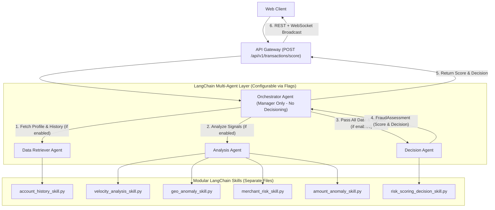

# Implementation Plan: Create Agents and Skills (PRD-009)

## 1. Objective & Scope

Per [docs/prds/09-Create-Agents-and-Skills.md](file:///Users/abhishekbiswas/AppDevelppment/TransactionFraudScorerAgenticAI/docs/prds/09-Create-Agents-and-Skills.md) and [docs/architecture.md](file:///Users/abhishekbiswas/AppDevelppment/TransactionFraudScorerAgenticAI/docs/architecture.md), this plan decomposes the transaction fraud scoring workflow into **four modular LangChain Agents** (each in its own file) and **five modular LangChain Skills** (each in its own file), controlled by feature flags that can be turned on and off:

1. **Agents (each in a separate file under `src/fraud_scorer/agents/`)**:
   - **Orchestrator Agent** (`src/fraud_scorer/agents/orchestrator_agent.py`): Pure manager/coordinator agent. Does **not** make any scoring or approval decisions itself. Coordinates the `DataRetrieverAgent` and `AnalysisAgent`, aggregates their outputs, and passes all relevant data to the `DecisionAgent`, returning the resulting `FraudAssessment` to the API Gateway (`src/api_gateway/app.py`) to send back to the WebClient.
   - **Data Retriever Agent** (`src/fraud_scorer/agents/data_retriever_agent.py`): Uses LangChain and the Account History Skill (`account_history_skill.py`) to retrieve customer profile, account age, historical spend, prior disputes, and trust tier from SQLite RDBMS / MCP tools.
   - **Analysis Agent** (`src/fraud_scorer/agents/analysis_agent.py`): Uses LangChain and analytical skills (`velocity_analysis_skill.py`, `geo_anomaly_skill.py`, `merchant_risk_skill.py`, `amount_anomaly_skill.py`) to evaluate multi-vector fraud signals and synthesize `RiskFactor` evidence.
   - **Decision Agent** (`src/fraud_scorer/agents/decision_agent.py`): Receives all relevant data (`Transaction`, retrieved account profile context, tool outputs, and `RiskFactor` evidence) from the Orchestrator Agent, invokes the Risk Scoring & Decision Skill (`risk_scoring_decision_skill.py`) and optional LangChain `ChatOllama` synthesis to compute the final composite risk score (`0.0–100.0`) and disposition (`APPROVE`, `REVIEW`, `DECLINE`), and returns the `FraudAssessment` for the API Gateway and WebClient.

2. **Skills (each in a separate file under `src/fraud_scorer/skills/`)**:
   - `src/fraud_scorer/skills/account_history_skill.py` (`AccountHistorySkill`)
   - `src/fraud_scorer/skills/velocity_analysis_skill.py` (`VelocityAnalysisSkill`)
   - `src/fraud_scorer/skills/geo_anomaly_skill.py` (`GeoAnomalySkill`)
   - `src/fraud_scorer/skills/merchant_risk_skill.py` (`MerchantRiskSkill`)
   - `src/fraud_scorer/skills/amount_anomaly_skill.py` (`AmountAnomalySkill`)
   - `src/fraud_scorer/skills/risk_scoring_decision_skill.py` (`RiskScoringDecisionSkill`)

3. **Configurable Agent Feature Flags**:
   - Configurable in `src/fraud_scorer/config.py` (`Settings` & `AgentFeatureFlags`):
     - `enable_orchestrator_agent: bool = True`
     - `enable_data_retriever_agent: bool = True`
     - `enable_analysis_agent: bool = True`
     - `enable_decision_agent: bool = True`

4. **Out-of-Scope (per PRD-009)**:
   - Communication Service
   - Observability Agent
   - Governance Agent
   - RAG Layer

---

## 2. Architecture & Execution Flow

---

## 3. Proposed File Changes

### A. Configuration & Agent Feature Flags (`src/fraud_scorer/config.py`)
- Add `AgentFeatureFlags` Pydantic model and boolean settings to [`Settings`](file:///Users/abhishekbiswas/AppDevelppment/TransactionFraudScorerAgenticAI/src/fraud_scorer/config.py#L8-L43):
  - `enable_orchestrator_agent: bool = True`
  - `enable_data_retriever_agent: bool = True`
  - `enable_analysis_agent: bool = True`
  - `enable_decision_agent: bool = True`

### B. Modular Skills (`src/fraud_scorer/skills/`)
Create `src/fraud_scorer/skills/` with each skill in its own file:
1. **`src/fraud_scorer/skills/account_history_skill.py`**:
   - Wraps `lookup_account_history_tool` (LangChain `@tool`) and produces structured account profile intelligence (`account_age_days`, `prior_disputes`, `avg_transaction_amount`, `trust_tier`, and risk factor evaluation for `ACCOUNT_HISTORY`).
2. **`src/fraud_scorer/skills/velocity_analysis_skill.py`**:
   - Wraps `check_velocity_tool` (LangChain `@tool`) and evaluates burst activity (`is_burst`, `tx_count_in_window`, `velocity_risk_score`) to produce a `VELOCITY` `RiskFactor` when triggered.
3. **`src/fraud_scorer/skills/geo_anomaly_skill.py`**:
   - Wraps `check_geo_anomaly_tool` (LangChain `@tool`) and evaluates haversine distance and travel speed (`is_impossible_travel`, `distance_km`, `implied_speed_kmh`, `geo_risk_score`) to produce a `GEO_ANOMALY` `RiskFactor` when triggered.
4. **`src/fraud_scorer/skills/merchant_risk_skill.py`**:
   - Wraps `check_merchant_risk_tool` (LangChain `@tool`) and evaluates MCC risk and merchant reputation (`is_high_risk_mcc`, `merchant_risk_score`, `risk_tier`) to produce a `MERCHANT_RISK` `RiskFactor` when triggered.
5. **`src/fraud_scorer/skills/amount_anomaly_skill.py`**:
   - Evaluates the transaction amount relative to the user's historical `avg_transaction_amount` (from the Data Retriever Agent) and card-not-present indicators to produce an `AMOUNT_ANOMALY` `RiskFactor` when triggered.
6. **`src/fraud_scorer/skills/risk_scoring_decision_skill.py`**:
   - Aggregates all `RiskFactor` contributions and retrieved account trust context into a normalized `overall_risk_score` (`0.0–100.0`), maps it to `APPROVE` (`< 30.0`), `REVIEW` (`30.0–69.9`), or `DECLINE` (`>= 70.0`), and formats an auditable `reasoning_summary`.
7. **`src/fraud_scorer/skills/__init__.py`**:
   - Exports all skill classes and LangChain `@tool` bindings.

### C. Modular LangChain Agents (`src/fraud_scorer/agents/`)
Create `src/fraud_scorer/agents/` with each agent in its own file:
1. **`src/fraud_scorer/agents/data_retriever_agent.py` (`DataRetrieverAgent`)**:
   - Built with LangChain (`ChatOllama` tool-calling runnable with `lookup_account_history_tool` + deterministic fallback via `AccountHistorySkill`).
   - Returns `DataRetrievalResult` containing `account_history`, `account_risk_factors`, and `tools_invoked`.
2. **`src/fraud_scorer/agents/analysis_agent.py` (`AnalysisAgent`)**:
   - Built with LangChain (`ChatOllama` tool-calling runnable bound to `check_velocity_tool`, `check_geo_anomaly_tool`, `check_merchant_risk_tool` + deterministic skill execution via `VelocityAnalysisSkill`, `GeoAnomalySkill`, `MerchantRiskSkill`, and `AmountAnomalySkill`).
   - Returns `AnalysisResult` containing `velocity_data`, `geo_data`, `merchant_data`, `risk_factors`, `llm_analysis_notes`, and `tools_invoked`.
3. **`src/fraud_scorer/agents/decision_agent.py` (`DecisionAgent`)**:
   - Built with LangChain (`ChatOllama` prompt chain + `RiskScoringDecisionSkill`).
   - Receives `Transaction`, `DataRetrievalResult`, and `AnalysisResult` from the Orchestrator Agent.
   - Computes the final composite score (`0.0–100.0`), decision (`APPROVE` / `REVIEW` / `DECLINE`), and `reasoning_summary`, returning a validated `FraudAssessment`.
4. **`src/fraud_scorer/agents/orchestrator_agent.py` (`OrchestratorAgent`)**:
   - Pure manager agent; performs **zero** scoring or decisioning logic.
   - Checks `AgentFeatureFlags`:
     - If `enable_data_retriever_agent` is `True`, runs `DataRetrieverAgent`.
     - If `enable_analysis_agent` is `True`, runs `AnalysisAgent` (passing retrieved account baseline).
     - If `enable_decision_agent` is `True`, passes all gathered data to `DecisionAgent` and returns its `FraudAssessment`.
     - If `enable_orchestrator_agent` or `enable_decision_agent` is `False`, returns a safe pass-through `FraudAssessment` noting the disabled agent flag(s).
5. **`src/fraud_scorer/agent/orchestrator.py`**:
   - Update `FraudScorerOrchestrator` to delegate directly to `OrchestratorAgent` while preserving full backward compatibility (constructor arguments and `agent_flags`).

### D. API Gateway Integration (`src/api_gateway/app.py`)
- Update `POST /api/v1/transactions/score` (`ingest_and_score_transaction` in [`src/api_gateway/app.py`](file:///Users/abhishekbiswas/AppDevelppment/TransactionFraudScorerAgenticAI/src/api_gateway/app.py#L117-L211)) so that it calls `await fraud_orchestrator.evaluate_transaction(domain_tx)`.
- The Orchestrator coordinates the enabled sub-agents and passes all relevant data to the Decision Agent, which returns the `FraudAssessment` (score and decision) back to the API Gateway.
- The API Gateway persists the transaction and score to SQLite (`src/sqllite/fraud_scorer.db`), broadcasts the `WebSocketTransactionEvent` to connected WebClients (`/ws/transactions/events`), and returns `TransactionScoreResponse`.

### E. Colab Notebook & Documentation (`notebooks/colab_setup_and_run.ipynb` & `docs/architecture.md`)
- Update [`notebooks/colab_setup_and_run.ipynb`](file:///Users/abhishekbiswas/AppDevelppment/TransactionFraudScorerAgenticAI/notebooks/colab_setup_and_run.ipynb) to add a dedicated step demonstrating:
  - Inspecting and toggling `AgentFeatureFlags` (`enable_orchestrator_agent`, `enable_data_retriever_agent`, `enable_analysis_agent`, `enable_decision_agent`).
  - Running individual Skills and Agents (`DataRetrieverAgent`, `AnalysisAgent`, `DecisionAgent`, `OrchestratorAgent`).
  - End-to-end scoring through `POST /api/v1/transactions/score` where the Decision Agent's score and decision flow back through the API Gateway and WebSocket stream.
- Update [`docs/architecture.md`](file:///Users/abhishekbiswas/AppDevelppment/TransactionFraudScorerAgenticAI/docs/architecture.md) to document the new `src/fraud_scorer/agents/` and `src/fraud_scorer/skills/` module structure and agent feature flags.

---

## 4. Verification & Testing Plan

1. **Unit & Integration Tests (`tests/test_agents_and_skills.py`)**:
   - Test each of the 6 skill modules independently (`AccountHistorySkill`, `VelocityAnalysisSkill`, `GeoAnomalySkill`, `MerchantRiskSkill`, `AmountAnomalySkill`, `RiskScoringDecisionSkill`).
   - Test each of the 4 agent modules independently (`DataRetrieverAgent`, `AnalysisAgent`, `DecisionAgent`, `OrchestratorAgent`).
   - Verify that `OrchestratorAgent` does not perform decisioning itself and delegates to `DecisionAgent`.
   - Test toggling each feature flag (`enable_orchestrator_agent`, `enable_data_retriever_agent`, `enable_analysis_agent`, `enable_decision_agent`) on and off.
2. **Existing Test Suite (`tests/test_orchestrator.py`, `tests/test_api_gateway.py`, `tests/test_mcp_tools.py`, `tests/test_sqlite.py`)**:
   - Update `tests/test_api_gateway.py` assertions for `/api/v1/transactions/score` to verify real multi-agent Decision Agent scoring and WebSocket event streaming.
   - Run `uv run pytest -v`, `uv run ruff check src/ tests/`, and `uv run mypy src/` with zero errors.
