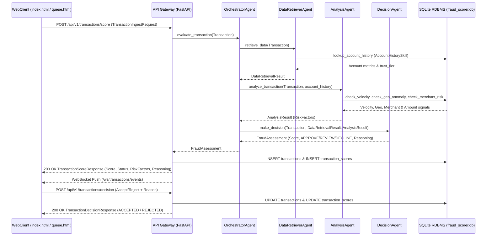

# Implementation Plan: Connect API Gateway with Fraud Scorer (PRD-010)

## 1. Objective & Scope

Per [docs/prds/10-Connect-APIGateway-Fraudscorer.md](file:///Users/abhishekbiswas/AppDevelppment/TransactionFraudScorerAgenticAI/docs/prds/10-Connect-APIGateway-Fraudscorer.md), this plan completes the end-to-end integration between the **API Gateway** (`src/api_gateway/`), the **Fraud Scorer Multi-Agent System** (`src/fraud_scorer/agents/` & `src/fraud_scorer/skills/`), the **SQLite RDBMS** (`src/sqllite/`), and the **WebClient** (`src/web_client/`) for real-time transaction scoring and analyst feedback:

1. **Connect Fraud Scorer Ingestion from API Gateway**:
   - Route `POST /api/v1/transactions/score` payloads (`TransactionIngestRequest`) through `to_domain_transaction()` into the `OrchestratorAgent` (`src/fraud_scorer/agents/orchestrator_agent.py`).
   - Propagate the API Gateway's active SQLite `db_path` into `OrchestratorAgent` -> `DataRetrieverAgent` & `AnalysisAgent` -> Skills -> MCP Tools so that every ingested transaction is evaluated against the live RDBMS state (`user_profiles`, `transactions`, `transaction_scores`).
2. **Orchestrator Agent Request Processing**:
   - `OrchestratorAgent` receives the domain `Transaction` from the API Gateway, coordinates `DataRetrieverAgent` and `AnalysisAgent` (according to `AgentFeatureFlags`), passes all gathered evidence to `DecisionAgent`, and returns the completed `FraudAssessment` (`overall_risk_score`, `decision`, `risk_factors`, `reasoning_summary`, `tools_invoked`) to the API Gateway.
3. **Return Full Score & Assessment Details to WebClient for Feedback**:
   - Enrich `TransactionScoreResponse` (in `src/api_gateway/schemas.py` and `docs/openapi-spec/openapi.yaml`) with `assessment_id`, `reasoning_summary`, `risk_factors`, and `tools_invoked` alongside `transaction_id`, `score`, `status`, and `evaluated_at`.
   - Persist the scored transaction and assessment to SQLite (`transactions` and `transaction_scores`) and broadcast the `WebSocketTransactionEvent` over `GET /ws/transactions/events` to connected WebClient instances.
   - Enhance the WebClient (`src/web_client/static/index.html` and `src/web_client/static/app.js`) with inline Analyst Feedback controls (`Accept` / `Reject` with `reason` via `POST /api/v1/transactions/decision`) and seeded persona presets (`good_persona_01` / `bad_persona_01`) so users can submit a transaction, inspect the Fraud Scorer's multi-agent assessment, and submit feedback directly.
4. **Update Google Colab Notebook (`notebooks/colab_setup_and_run.ipynb`)**:
   - Update Step 4 and add an end-to-end execution step demonstrating API Gateway -> `OrchestratorAgent` -> `DecisionAgent` scoring, WebSocket event streaming, and WebClient Analyst Feedback (`POST /api/v1/transactions/decision`) persisted in SQLite.

---

## 2. End-to-End Architecture Flow



---

## 3. Proposed Changes

### A. Fraud Scorer Agents, Skills & Tools (`db_path` Propagation)
- #### [MODIFY] [tools.py](file:///Users/abhishekbiswas/AppDevelppment/TransactionFraudScorerAgenticAI/src/fraud_scorer/agents/tools.py)
  Allow optional `db_path: str | None = None` on `check_velocity_tool`, `check_geo_anomaly_tool`, `check_merchant_risk_tool`, and `lookup_account_history_tool` so the API Gateway's active SQLite database path is queried during evaluation.
- #### [MODIFY] Skills in `src/fraud_scorer/skills/` & Agents in `src/fraud_scorer/agents/`
  Accept optional `db_path: str | Path | None = None` in `OrchestratorAgent`, `DataRetrieverAgent`, `AnalysisAgent`, and the 4 MCP-backed skills so `create_app(db_path=...)` in `src/api_gateway/app.py` connects the `OrchestratorAgent` directly to `resolved_db_path`.

---

### B. API Gateway & OpenAPI v3 Specification
- #### [MODIFY] [schemas.py](file:///Users/abhishekbiswas/AppDevelppment/TransactionFraudScorerAgenticAI/src/api_gateway/schemas.py)
  Include `assessment_id`, `reasoning_summary`, `risk_factors`, and `tools_invoked` in `TransactionScoreResponse` so the WebClient receives the full Fraud Scorer explanation immediately in the REST response as well as over the WebSocket stream.
- #### [MODIFY] [app.py](file:///Users/abhishekbiswas/AppDevelppment/TransactionFraudScorerAgenticAI/src/api_gateway/app.py)
  - Bind `fraud_orchestrator` to `resolved_db_path`.
  - In `POST /api/v1/transactions/score`, pass the ingested `Transaction` to `await fraud_orchestrator.evaluate_transaction(domain_tx)`, persist both the transaction and score to SQLite, broadcast `WebSocketTransactionEvent`, and return the enriched `TransactionScoreResponse`.
- #### [MODIFY] [openapi.yaml](file:///Users/abhishekbiswas/AppDevelppment/TransactionFraudScorerAgenticAI/docs/openapi-spec/openapi.yaml)
  Sync `TransactionScoreResponse` schema with the enriched assessment fields (`assessment_id`, `reasoning_summary`, `risk_factors`, `tools_invoked`).

---

### C. WebClient Feedback Integration (`src/web_client/`)
- #### [MODIFY] [index.html](file:///Users/abhishekbiswas/AppDevelppment/TransactionFraudScorerAgenticAI/src/web_client/static/index.html) & [app.js](file:///Users/abhishekbiswas/AppDevelppment/TransactionFraudScorerAgenticAI/src/web_client/static/app.js)
  - Add inline **Analyst Feedback (`Accept` / `Reject` with Reason)** controls on Page 1 (`index.html`) that populate automatically when `POST /api/v1/transactions/score` returns the Fraud Scorer's result, calling `POST /api/v1/transactions/decision`.

---

### D. Colab Notebook (`notebooks/colab_setup_and_run.ipynb`)
- #### [MODIFY] [colab_setup_and_run.ipynb](file:///Users/abhishekbiswas/AppDevelppment/TransactionFraudScorerAgenticAI/notebooks/colab_setup_and_run.ipynb)
  - Update Step 4 to demonstrate real end-to-end scoring through `POST /api/v1/transactions/score` (evaluating both a normal transaction and a high-risk transaction via `OrchestratorAgent` -> `DecisionAgent`), receiving the real-time WebSocket event on `/ws/transactions/events`, and submitting WebClient Analyst Feedback via `POST /api/v1/transactions/decision`.

---

## 4. Verification Plan

### Automated Tests
```bash
uv run pytest -v
uv run ruff check src/ tests/
uv run mypy src/
```
- Verify in `tests/test_api_gateway.py` that:
  1. `POST /api/v1/transactions/score` invokes `OrchestratorAgent.evaluate_transaction()` against the API Gateway's SQLite database (`db_path`), returning `score`, `status`, `assessment_id`, `reasoning_summary`, `risk_factors`, and `tools_invoked`.
  2. Sequential transactions for the same user through `POST /api/v1/transactions/score` dynamically update SQLite velocity and geo-location metrics for subsequent Fraud Scorer evaluations.
  3. WebClient feedback via `POST /api/v1/transactions/decision` updates both in-memory store and SQLite RDBMS (`transactions.status` and `transaction_scores.decision_accepted` / `decision_reason`).
