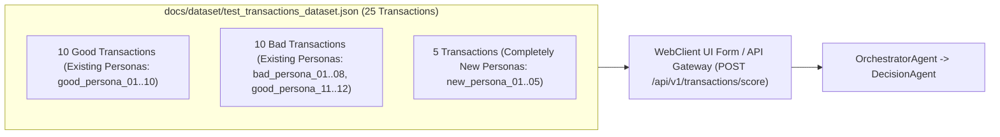

# Implementation Plan: Create Test Datasets (PRD-011)

## 1. Objective & Scope

Per [docs/prds/11-Create-Test-datasets.md](file:///Users/abhishekbiswas/AppDevelppment/TransactionFraudScorerAgenticAI/docs/prds/11-Create-Test-datasets.md), this plan creates a deterministic **25-transaction UI & API test dataset** stored in `docs/dataset/test_transactions_dataset.json` (with a companion human-readable guide in `docs/dataset/README.md`) and updates `notebooks/colab_setup_and_run.ipynb` to execute and verify the test dataset against the API Gateway and Fraud Scorer Orchestrator.

### Requirements Breakdown
1. **20 Transactions with a Mix of Good and Bad from Existing Personas**:
   - **10 Good Transactions** across existing seeded personas (`good_persona_01`..`good_persona_10` and `bad_persona_01`..`bad_persona_02`) matching their home city coordinates, normal spend baselines (`$18.50–$145.00`), and low-risk MCCs (`5411`, `5814`, `5541`, `5912`, `5311`, `4900`, `5812`, `5942`) across both `CARD` and `ACH` rails.
   - **10 Bad / Suspicious Transactions** across existing seeded personas (`bad_persona_01`..`bad_persona_08`, `good_persona_11`..`good_persona_12`) exhibiting impossible travel (e.g., Tokyo, London, Lagos, Frankfurt shortly after US activity), high-risk MCCs (`7995` Gambling, `6051` Crypto/Quasi-Cash, `4829` Wire Transfer, `5967` Telemarketing), card-not-present flags, and abnormal spend spikes (`$1,850.00–$6,500.00`).
2. **5 Transactions with Completely New Personas**:
   - **5 Transactions** from brand-new personas not in `user_profiles.json` (`new_persona_01`..`new_persona_05`), spanning both normal first-time purchases and high-risk onboarding transactions (`CARD` and `ACH`).
3. **Storage & Naming**:
   - Stored in `docs/dataset/test_transactions_dataset.json` (25 records conforming to `TransactionIngestRequest` in [docs/openapi-spec/openapi.yaml](file:///Users/abhishekbiswas/AppDevelppment/TransactionFraudScorerAgenticAI/docs/openapi-spec/openapi.yaml) and [src/fraud_scorer/models/transaction.py](file:///Users/abhishekbiswas/AppDevelppment/TransactionFraudScorerAgenticAI/src/fraud_scorer/models/transaction.py)).
4. **Update `notebooks/colab_setup_and_run.ipynb`**:
   - Add a step in `notebooks/colab_setup_and_run.ipynb` that loads `docs/dataset/test_transactions_dataset.json`, runs the 25 test transactions through the API Gateway / Fraud Scorer Orchestrator, and displays a summary table of scores and decisions (`APPROVE`, `REVIEW`, `DECLINE`).
5. **Out-of-Scope**:
   - WebClient changes (`src/web_client/` will not be modified).

---

## 2. Dataset Structure (`docs/dataset/test_transactions_dataset.json`)



Each entry in `docs/dataset/test_transactions_dataset.json` includes:
- `scenario_id`: `"test_tx_01"` .. `"test_tx_25"`
- `persona_Category`: `"existing_persona"` (20 items) or `"new_persona"` (5 items)
- `transaction_profile`: `"good"` or `"bad"`
- `description`: Human-readable summary of the test case for UI testing
- Standard `TransactionIngestRequest` fields:
  - `username`
  - `datetime`
  - `ip`
  - `device_id`
  - `location` (`latitude`, `longitude`, `city`, `state`, `country`, `postal_code`)
  - `transaction_details` (`transaction_id`, `transaction_type`, `amount`, `currency`, `merchant`, and `card_details` or `ach_details`)

---

## 3. Proposed Changes

### A. Dataset Generator & File (`src/sqllite/seed.py` & `docs/dataset/`)
- #### [MODIFY] [seed.py](file:///Users/abhishekbiswas/AppDevelppment/TransactionFraudScorerAgenticAI/src/sqllite/seed.py) & [`__init__.py`](file:///Users/abhishekbiswas/AppDevelppment/TransactionFraudScorerAgenticAI/src/sqllite/__init__.py)
  Add `generate_test_transactions_dataset()` and `write_test_transactions_dataset()` to deterministically generate the 25 test transactions (20 from existing personas with a mix of good and bad, plus 5 from completely new personas) and write `docs/dataset/test_transactions_dataset.json`.
- #### [NEW] [test_transactions_dataset.json](file:///Users/abhishekbiswas/AppDevelppment/TransactionFraudScorerAgenticAI/docs/dataset/test_transactions_dataset.json)
  Generated JSON file containing the 25 test transactions ready for UI testing and API ingestion.
- #### [MODIFY] [README.md](file:///Users/abhishekbiswas/AppDevelppment/TransactionFraudScorerAgenticAI/docs/dataset/README.md)
  Document `test_transactions_dataset.json` with a table of all 25 test cases so a user can quickly reference values when testing through the WebClient UI.

---

### B. Colab Notebook (`notebooks/colab_setup_and_run.ipynb`)
- #### [MODIFY] [colab_setup_and_run.ipynb](file:///Users/abhishekbiswas/AppDevelppment/TransactionFraudScorerAgenticAI/notebooks/colab_setup_and_run.ipynb)
  Add Step 4.6 ("Load & Execute `docs/dataset/test_transactions_dataset.json` (20 Existing Persona Mix + 5 New Personas)") to run the test dataset against `POST /api/v1/transactions/score` and print the resulting scores and dispositions.

---

### C. Automated Tests (`tests/test_sqllite.py`)
- #### [MODIFY] [test_sqllite.py](file:///Users/abhishekbiswas/AppDevelppment/TransactionFraudScorerAgenticAI/tests/test_sqllite.py)
  Add `test_test_transactions_dataset_structure_and_scoring` verifying:
  1. `docs/dataset/test_transactions_dataset.json` exists and contains exactly 25 transactions.
  2. Exactly 20 transactions use existing personas (`good_persona_*` / `bad_persona_*`) with a mix of good (`APPROVE`) and bad (`REVIEW` / `DECLINE`) transactions.
  3. Exactly 5 transactions use completely new personas (`new_persona_01`..`new_persona_05`) not present in `user_profiles.json`.
  4. All 25 records validate against `TransactionIngestRequest` and convert cleanly to domain `Transaction` models (`to_domain_transaction`).

---

## 4. Verification Plan

### Automated Tests
```bash
uv run pytest -v
uv run ruff check src/ tests/
uv run mypy src/
```
