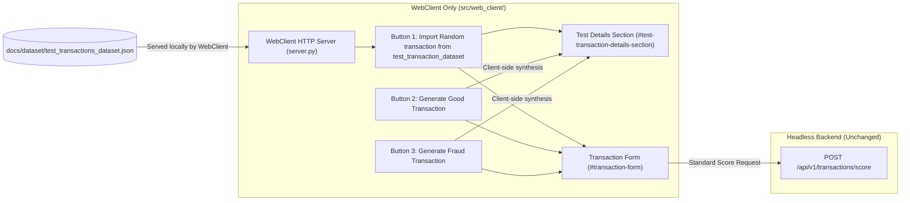

# Implementation Plan: PRD-012 — Load Datasets in WebClient for Manual Testing

## Goal Description

Update the WebClient Transaction Submission page ([`index.html`](file:///Users/abhishekbiswas/AppDevelppment/TransactionFraudScorerAgenticAI/src/web_client/static/index.html)) so that users can prefill the transaction form with test transactions for manual testing, while keeping the backend (`src/api_gateway/` and downstream services) completely headless and unaware of test datasets:

1. **Three New Test Action Buttons on [`index.html`](file:///Users/abhishekbiswas/AppDevelppment/TransactionFraudScorerAgenticAI/src/web_client/static/index.html)**:
   - **First Button (`#btn-import-random-test`)**: *"Import Random transaction from test_transaction_dataset"* — The WebClient directly loads [`docs/dataset/test_transactions_dataset.json`](file:///Users/abhishekbiswas/AppDevelppment/TransactionFraudScorerAgenticAI/docs/dataset/test_transactions_dataset.json) (served locally by the WebClient server [`src/web_client/server.py`](file:///Users/abhishekbiswas/AppDevelppment/TransactionFraudScorerAgenticAI/src/web_client/server.py) with an in-memory fallback in [`src/web_client/static/app.js`](file:///Users/abhishekbiswas/AppDevelppment/TransactionFraudScorerAgenticAI/src/web_client/static/app.js)), selects a random transaction from the 25 predetermined test scenarios, and populates `#transaction-form`.
   - **Second Button (`#btn-generate-good-tx`)**: *"Generate Good Transaction"* — Client-side generator in [`app.js`](file:///Users/abhishekbiswas/AppDevelppment/TransactionFraudScorerAgenticAI/src/web_client/static/app.js) that synthesizes a completely new low-risk transaction (random `good_persona_01`..`good_persona_35` in their home US city, everyday merchant MCC `5411`/`5812`/`5912`/`5541`/`4111`, normal spend `$12.00–$145.00`, verified `CARD` or `PPD`/`WEB` `ACH`) and populates `#transaction-form`.
   - **Third Button (`#btn-generate-fraud-tx`)**: *"Generate Fraud Transaction"* — Client-side generator in [`app.js`](file:///Users/abhishekbiswas/AppDevelppment/TransactionFraudScorerAgenticAI/src/web_client/static/app.js) that synthesizes a completely new bad/fraudulent transaction (impossible-travel foreign coordinates e.g. Lagos `NG`, Bucharest `RO`, Moscow `RU`, or Macau `MO`, high-risk MCC `7995`/`6051`/`4829`/`5967`, large spend spike `$3,200.00–$9,850.00`, unverified `CARD` with `cvv_verified: false` / `avs_result: "N"` or suspicious `ACH` `TEL`/`WEB` debit) and populates `#transaction-form`.
2. **Test Transaction Details Section on [`index.html`](file:///Users/abhishekbiswas/AppDevelppment/TransactionFraudScorerAgenticAI/src/web_client/static/index.html)**:
   - Add a dedicated section (`#test-transaction-details-section`) that displays the details of the currently loaded or generated test transaction (Scenario ID, Source, Persona Group, Expected Profile badge `GOOD` vs `BAD`, Description, and full JSON preview).
3. **Out-of-Scope Enforcement**:
   - **API Gateway (`src/api_gateway/`) and `docs/openapi-spec/openapi.yaml` are strictly out-of-scope and will NOT be modified.** The API Gateway only receives standard `POST /api/v1/transactions/score` requests when the user submits the form.

---

## Architecture & Data Flow



---

## Proposed Changes

### WebClient Server & Static UI (`src/web_client/`)

#### [MODIFY] [`server.py`](file:///Users/abhishekbiswas/AppDevelppment/TransactionFraudScorerAgenticAI/src/web_client/server.py)
- Add a custom request handler subclassing `SimpleHTTPRequestHandler` (`WebClientRequestHandler`) so the WebClient server can serve `/dataset/test_transactions_dataset.json` directly from [`docs/dataset/test_transactions_dataset.json`](file:///Users/abhishekbiswas/AppDevelppment/TransactionFraudScorerAgenticAI/docs/dataset/test_transactions_dataset.json) while serving all static assets from `src/web_client/static/`.

#### [MODIFY] [`index.html`](file:///Users/abhishekbiswas/AppDevelppment/TransactionFraudScorerAgenticAI/src/web_client/static/index.html)
- Add the 3 new buttons with `type="button"` inside the transaction form panel header/toolbar:
  ```html
  <div class="test-dataset-actions" role="group" aria-label="Test Transaction Generators">
    <button type="button" id="btn-import-random-test" class="btn btn-sm btn-secondary">
      Import Random transaction from test_transaction_dataset
    </button>
    <button type="button" id="btn-generate-good-tx" class="btn btn-sm btn-success">
      Generate Good Transaction
    </button>
    <button type="button" id="btn-generate-fraud-tx" class="btn btn-sm btn-danger">
      Generate Fraud Transaction
    </button>
  </div>
  ```
- Add the **Test Transaction Details** section (`#test-transaction-details-section`) to display the active test details:
  ```html
  <section id="test-transaction-details-section" class="test-details-card" aria-labelledby="test-details-heading">
    <div class="test-details-header">
      <h3 id="test-details-heading">Test Transaction Details</h3>
      <span id="test-detail-profile" class="badge badge-neutral">NONE LOADED</span>
    </div>
    <dl class="test-details-grid">
      <div class="test-detail-item">
        <dt>Scenario ID</dt>
        <dd id="test-detail-scenario-id">-</dd>
      </div>
      <div class="test-detail-item">
        <dt>Test Source</dt>
        <dd id="test-detail-source">-</dd>
      </div>
      <div class="test-detail-item">
        <dt>Persona Group</dt>
        <dd id="test-detail-persona">-</dd>
      </div>
      <div class="test-detail-item">
        <dt>Username</dt>
        <dd id="test-detail-username">-</dd>
      </div>
    </dl>
    <p id="test-detail-description" class="test-detail-description">
      Click one of the 3 test buttons above to import a random transaction from test_transactions_dataset.json or generate a new Good / Fraud transaction.
    </p>
    <details class="test-detail-json-details">
      <summary>View Loaded Test Scenario JSON</summary>
      <pre id="test-detail-json" class="code-output">No test transaction loaded yet.</pre>
    </details>
  </section>
  ```
- Add `autocorrect="off" autocapitalize="off" spellcheck="false"` on identifier inputs (`#tx-username`, `#tx-ip`, `#tx-device-id`, `#merch-id`).

#### [MODIFY] [`app.js`](file:///Users/abhishekbiswas/AppDevelppment/TransactionFraudScorerAgenticAI/src/web_client/static/app.js)
- Add WebClient-only dataset loader & transaction generators:
  1. `loadTestDatasetFromWebClient()`: Loads `/dataset/test_transactions_dataset.json` from the WebClient's own server (relative URL, cached after first load). Never calls the API Gateway. *(Implementation note: the originally planned embedded 25-scenario fallback was dropped to avoid duplicating the dataset in `app.js`; if the file cannot be loaded, the Test Details section shows an error explaining to start `uv run fraud-web-client`.)*
  2. `importRandomTestTransaction()`: Picks a random entry from the 25-transaction dataset (avoiding the immediately previous scenario index when possible), calls `populateFormFromTransaction(entry)` and `renderTestDetails(entry, "test_transactions_dataset.json")`.
  3. `generateGoodTransaction()`: Generates a brand-new randomized good transaction (random persona from `good_persona_01`..`good_persona_35` with matching home city coordinates or a new domestic customer, low-risk MCC `5411`/`5812`/`5912`/`5541`/`4111`, normal amount `$12.00–$145.00`, `CARD` with `cvv_verified: true`, `avs_result: "Y"` or `ACH` `PPD`/`WEB`), populates `#transaction-form`, and updates `#test-transaction-details-section`.
  4. `generateFraudTransaction()`: Generates a brand-new randomized fraudulent transaction (high-risk foreign coordinates e.g. Lagos `NG`, Bucharest `RO`, Moscow `RU`, or Macau `MO`, high-risk MCC `7995`/`6051`/`4829`/`5967`, large spend spike `$3,200.00–$9,850.00`, `CARD` with `is_card_present: false`, `cvv_verified: false`, `avs_result: "N"` or suspicious `ACH` `TEL`/`WEB` debit), populates `#transaction-form`, and updates `#test-transaction-details-section`.
  5. `populateFormFromTransaction(entry)`: Populates all form fields (`#tx-username`, `#tx-datetime`, `#tx-ip`, `#tx-device-id`, `#loc-latitude`, `#loc-longitude`, `#loc-city`, `#loc-state`, `#loc-country`, `#loc-postal`, `#tx-type`, `#tx-amount`, `#tx-currency`, `#merch-id`, `#merch-name`, `#merch-mcc`, plus `#card-*` or `#ach-*`), calls `syncPaymentRailVisibility()`, and resets any stale validation classes/attributes.

#### [MODIFY] [`styles.css`](file:///Users/abhishekbiswas/AppDevelppment/TransactionFraudScorerAgenticAI/src/web_client/static/styles.css)
- Add styles for `.test-dataset-actions`, `.test-details-card`, `.test-details-header`, `.test-details-grid`, `.test-detail-item`, `.test-detail-description`, and `.test-detail-json-details`.

---

### Colab Notebook & Documentation

#### [MODIFY] [`colab_setup_and_run.ipynb`](file:///Users/abhishekbiswas/AppDevelppment/TransactionFraudScorerAgenticAI/notebooks/colab_setup_and_run.ipynb)
- Update the notebook with instructions and verification steps for starting the WebClient (`fraud-web-client`) and using the 3 manual test buttons on `index.html` (*Import Random transaction from test_transaction_dataset*, *Generate Good Transaction*, and *Generate Fraud Transaction*) to prefill and score transactions against the headless API Gateway.

#### [MODIFY] [`architecture.md`](file:///Users/abhishekbiswas/AppDevelppment/TransactionFraudScorerAgenticAI/docs/architecture.md)
- Document the client-side Test Transaction Loader & Generators in the WebClient section (`src/web_client/`), noting that the API Gateway remains headless.

---

### Automated Tests (`tests/`)

#### [MODIFY] [`test_web_client.py`](file:///Users/abhishekbiswas/AppDevelppment/TransactionFraudScorerAgenticAI/tests/test_web_client.py)
- Add unit tests verifying:
  - `index.html` contains `#btn-import-random-test` (*"Import Random transaction from test_transaction_dataset"*), `#btn-generate-good-tx` (*"Generate Good Transaction"*), and `#btn-generate-fraud-tx` (*"Generate Fraud Transaction"*).
  - `index.html` contains the Test Details section (`#test-transaction-details-section`, `#test-detail-scenario-id`, `#test-detail-source`, `#test-detail-persona`, `#test-detail-profile`, `#test-detail-description`, `#test-detail-json`).
  - `WebClientRequestHandler` in `src/web_client/server.py` serves `/dataset/test_transactions_dataset.json` with all 25 test transactions.
  - `app.js` wires up all 3 buttons and does not call any API Gateway endpoint to load test transactions.

---

## Verification Plan

### Automated Tests
```bash
uv run pytest -v
uv run ruff check src/ tests/
uv run mypy src/
```

### Manual Verification
1. Start the WebClient (`uv run fraud-web-client --port 3000`) and open `http://127.0.0.1:3000/index.html`.
2. Click **Import Random transaction from test_transaction_dataset**, **Generate Good Transaction**, and **Generate Fraud Transaction** and verify that the form fields and the **Test Transaction Details** section update immediately without making any network requests to the API Gateway until **Submit Transaction for Fraud Scoring** is clicked.
