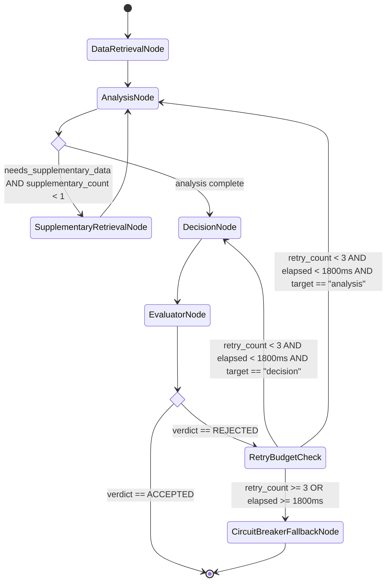

# Implementation Plan: Update Agents to Hybrid Supervisor-Critic Architecture (PRD-017)

## Goal Description
Refactor the **Transaction Fraud Scorer** multi-agent system in `src/fraud_scorer/` to adhere to the **Hybrid Supervisor with Actor-Critic Feedback** specification in [`docs/agentic-architecture-pattern.md`](file:///Users/abhishekbiswas/AppDevelppment/TransactionFraudScorerAgenticAI/docs/agentic-architecture-pattern.md), powered by **LangGraph**, **ChromaDB** (RAG policy grounding), and **SQLite** (relational history and velocity/geo/merchant telemetry).

Per **PRD-017 Section 3 (Out-of-scope)**, this plan makes **zero changes** to the WebClient (`src/web_client/`), API Gateway (`src/api_gateway/`), SQLite package (`src/sqllite/`), or ChromaDB package (`src/chromadb/`), and excludes the `Observability Agent` and `Governance Agent`.

---

## Architectural Critique, Contradictions & Performance Suggestions

Per PRD-017 Section 1 (*"Let me know if you see any contradictions or performance issues. Provide me suggestions if any so that I can take decisions if that should be implemented"*), here are our findings from auditing the current codebase against `docs/agentic-architecture-pattern.md`:

> [!IMPORTANT]
> ### 1. Model Tiering Selection (`qwen3.8:27b` for Tier 3) vs. Local / Colab VRAM Constraints
> - **Model Tiering Decision**: Per your planning decision, Tier 1 uses `llama3.2:3b`, Tier 2 uses `llama3.1:8b`, and Tier 3 (`DecisionAgent` & `EvaluatorAgent`) uses **`qwen3.8:27b`**.
> - **Runtime Fallback Resolution**: Implement `AgentModelConfig` with `decision_model: str = "qwen3.8:27b"` and `evaluator_model: str = "qwen3.8:27b"`, alongside a lightweight runtime model resolution helper (`resolve_ollama_model()`) that queries Ollama's `/api/tags` endpoint (cached) and gracefully falls back to `settings.ollama_model` (`llama3.2:3b`) when `qwen3.8:27b` or `llama3.1:8b` is not yet pulled in the local/Colab Ollama instance.

> [!TIP]
> ### 2. Sequential Skill Execution Bottleneck in `AnalysisAgent` & `DataRetrieverAgent`
> - **Performance Issue**: Currently, [`AnalysisAgent.analyze_transaction()`](file:///Users/abhishekbiswas/AppDevelppment/TransactionFraudScorerAgenticAI/src/fraud_scorer/agents/analysis_agent.py#L109-L128) awaits `velocity_skill`, `geo_skill`, and `merchant_skill` sequentially rather than concurrently.
> - **Recommended Optimization**: Use `asyncio.gather()` in both `DataRetrieverAgent` (running SQLite `AccountHistorySkill` and ChromaDB `PolicyRetrievalSkill` in parallel) and `AnalysisAgent` (running `VelocityAnalysisSkill`, `GeoAnomalySkill`, and `MerchantRiskSkill` in parallel), plus an `@lru_cache` on ChromaDB policy retrieval queries as specified in Trade-Off 6 of `docs/agentic-architecture-pattern.md`.

> [!NOTE]
> ### 3. Controlled Sub-Delegation (`AnalysisAgent` -> `DataRetrieverAgent`) & SLA Circuit Breaker
> - **Potential Pitfall**: Unbounded loops between `AnalysisAgent` requesting supplementary data or `EvaluatorAgent` rejecting `DecisionAgent` assessments can breach checkout latency SLAs.
> - **Recommended Safeguard**: Enforce hard loop guards in the LangGraph `StateGraph`:
>   1. **Supplementary Retrieval Cap**: Maximum **1** supplementary retrieval turn (`supplementary_count < 1`) routed via the Supervisor state graph (`AnalysisNode -> SupplementaryRetrievalNode -> AnalysisNode`).
>   2. **Evaluator Retry & Wall-Clock Circuit Breaker**: Maximum **3** retries (`retry_count < 3`) AND wall-clock budget `MAX_EVALUATION_TIMEOUT_MS = 1800ms`. If exceeded, route to `CircuitBreakerFallbackNode` which sets `is_fallback = True` and guarantees a safe deterministic assessment.

---

## Proposed Architecture & LangGraph Workflow



---

## Proposed Changes

### 1. Project Dependencies (`pyproject.toml`)

#### [MODIFY] [pyproject.toml](file:///Users/abhishekbiswas/AppDevelppment/TransactionFraudScorerAgenticAI/pyproject.toml)
- Add `"langgraph>=0.2.0"` to `dependencies` so the LangGraph `StateGraph` engine is explicitly declared and installed.

---

### 2. Configuration & Heterogeneous Model Tiering (`src/fraud_scorer/config.py`)

#### [MODIFY] [config.py](file:///Users/abhishekbiswas/AppDevelppment/TransactionFraudScorerAgenticAI/src/fraud_scorer/config.py)
- Add `AgentModelConfig(BaseModel)` mapping distinct model tiers to agent roles:
  - `data_retrieval_model: str = "llama3.2:3b"` (Tier 1 Fast SLM)
  - `analysis_model: str = "llama3.1:8b"` (Tier 2 Balanced Analytical)
  - `decision_model: str = "qwen3.8:27b"` (Tier 3 Deep Reasoning — Qwen 3.8 27B)
  - `evaluator_model: str = "qwen3.8:27b"` (Tier 3+ Critical Auditor — Qwen 3.8 27B)
- Update `AgentFeatureFlags(BaseModel)` to include:
  - `enable_evaluator_agent: bool = True`
  - `enable_rag_policy_retrieval: bool = True`
- Add `default_policy_year: str = "2026"` and `max_evaluation_retries: int = 3` and `max_evaluation_timeout_ms: float = 1800.0` to `Settings`.

---

### 3. ChromaDB Policy Retrieval Skill (`src/fraud_scorer/skills/`)

#### [NEW] [policy_retrieval_skill.py](file:///Users/abhishekbiswas/AppDevelppment/TransactionFraudScorerAgenticAI/src/fraud_scorer/skills/policy_retrieval_skill.py)
- Create `PolicyRetrievalSkill` wrapping `src/chromadb/query_policies.py` (loaded cleanly via `importlib` so it never collides with the `chromadb` PyPI package).
- Provides:
  - `query_fraud_policies_tool`: LangChain `@tool` for semantic policy retrieval from ChromaDB with `policy_year`, `category`, and `n_results` filters.
  - LRU caching on `(query_text, policy_year, category, n_results)` for sub-millisecond repeated lookups.
  - `execute(transaction, policy_year="2026", n_results=3, category=None, custom_query=None)` returning `(policies: list[dict[str, Any]], tool_name: str)` executed via `asyncio.to_thread()` so it can run concurrently alongside SQLite queries in `asyncio.gather()`.

#### [MODIFY] [__init__.py](file:///Users/abhishekbiswas/AppDevelppment/TransactionFraudScorerAgenticAI/src/fraud_scorer/skills/__init__.py)
- Export `PolicyRetrievalSkill`.

#### [MODIFY] [risk_scoring_decision_skill.py](file:///Users/abhishekbiswas/AppDevelppment/TransactionFraudScorerAgenticAI/src/fraud_scorer/skills/risk_scoring_decision_skill.py)
- Enhance `RiskScoringDecisionSkill.execute()` to accept optional `rag_policies: list[dict[str, Any]] | None = None` and `evaluator_feedback: str | None = None`:
  - Evaluates retrieved ChromaDB policy clauses (e.g., 2025 vs 2026 MCC thresholds such as `POL-2026-MCC-6051` or `POL-2026-GEO-01`) and cites matched policy clause IDs (`[POL-...]`) in `reasoning_summary`.

---

### 4. Updated & New Agents (`src/fraud_scorer/agents/`)

#### [MODIFY] [data_retriever_agent.py](file:///Users/abhishekbiswas/AppDevelppment/TransactionFraudScorerAgenticAI/src/fraud_scorer/agents/data_retriever_agent.py)
- Update `DataRetrievalResult` to include:
  - `rag_policies: list[dict[str, Any]] = Field(default_factory=list)`
  - `supplementary_data: list[dict[str, Any]] = Field(default_factory=list)`
  - `degraded_mode: bool = False`
  - `model_used: str | None = None`
- Update `DataRetrieverAgent`:
  - Uses Tier 1 model (`AgentModelConfig.data_retrieval_model`, resolved against available Ollama models).
  - Binds both `lookup_account_history_tool` (SQLite) and `query_fraud_policies_tool` (ChromaDB).
  - Executes SQLite `AccountHistorySkill` and ChromaDB `PolicyRetrievalSkill` **concurrently via `asyncio.gather()`**.
  - Adds `retrieve_supplementary_data(transaction, supplementary_query, policy_year="2026", db_path=None)` to handle on-demand secondary queries from `AnalysisAgent` (routed via the Orchestrator StateGraph).

#### [MODIFY] [analysis_agent.py](file:///Users/abhishekbiswas/AppDevelppment/TransactionFraudScorerAgenticAI/src/fraud_scorer/agents/analysis_agent.py)
- Update `AnalysisResult` to include:
  - `needs_supplementary_data: bool = False`
  - `supplementary_query: str | None = None`
  - `model_used: str | None = None`
- Update `AnalysisAgent`:
  - Uses Tier 2 model (`AgentModelConfig.analysis_model`, resolved against available Ollama models).
  - Executes `velocity_skill`, `geo_skill`, and `merchant_skill` **concurrently via `asyncio.gather()`**, followed by `amount_skill`.
  - Adds `request_supplementary_data_tool` to the bound tools so the LLM (or deterministic rule check when a high-risk signal lacks specific category policy context) can flag `needs_supplementary_data = True` with a targeted `supplementary_query` for the Supervisor to route to `DataRetrieverAgent`.

#### [MODIFY] [decision_agent.py](file:///Users/abhishekbiswas/AppDevelppment/TransactionFraudScorerAgenticAI/src/fraud_scorer/agents/decision_agent.py)
- Update `DecisionAgent`:
  - Uses Tier 3 model (`AgentModelConfig.decision_model`, resolved against available Ollama models).
  - Accepts `data_result`, `analysis_result`, `evaluator_feedback: str | None = None`, and `retry_count: int = 0`.
  - Incorporates ChromaDB `rag_policies` and `supplementary_data` into both the LLM prompt and `RiskScoringDecisionSkill`.
  - When `evaluator_feedback` is provided on a retry pass, reconciles score/disposition/reasoning against the Evaluator's remediation instruction.

#### [NEW] [evaluator_agent.py](file:///Users/abhishekbiswas/AppDevelppment/TransactionFraudScorerAgenticAI/src/fraud_scorer/agents/evaluator_agent.py)
- Implement `EvaluatorVerdict(BaseModel)` and `EvaluatorAgent` (Actor-Critic Auditor, Tier 3+ model):
  - `verdict`: `Literal["ACCEPTED", "REJECTED"]`
  - `rejection_category`: `Literal["ARITHMETIC_ERROR", "UNGROUNDED_ASSERTION", "POLICY_CONTRADICTION", "INSUFFICIENT_EVIDENCE"] | None`
  - `target_agent`: `Literal["decision", "analysis"] | None`
  - `remediation_instruction`: `str | None`
  - `audit_notes`: `str`
- Performs three structured checks on the draft `FraudAssessment`:
  1. **Mathematical Consistency Check**: Verifies `overall_risk_score` matches the sum of `risk_factors` (capped at 100.0) within `±5.0` points (unless overridden by an explicit policy rule).
  2. **Policy Compliance Check**: Verifies that `decision` (`APPROVE`, `REVIEW`, `DECLINE`) matches taxonomy thresholds (`<30.0` `APPROVE`, `30.0–69.9` `REVIEW`, `>=70.0` `DECLINE`) and critical risk rules (e.g., `CRITICAL` `GEO_ANOMALY` / impossible travel cannot be `APPROVE`).
  3. **Explainability & Grounding Check**: Ensures `reasoning_summary` is non-empty and references the triggered risk factors.

---

### 5. LangGraph State Machine & Supervisor Orchestrator (`src/fraud_scorer/agents/`)

#### [NEW] [workflow.py](file:///Users/abhishekbiswas/AppDevelppment/TransactionFraudScorerAgenticAI/src/fraud_scorer/agents/workflow.py)
- Define `FraudEvaluationState(BaseModel)` as specified in Section 5 of `docs/agentic-architecture-pattern.md`:
  - Ingress fields (`transaction_id`, `transaction`, `policy_year`, `db_path`, `use_llm`)
  - Enrichment fields (`retrieval_data`, `supplementary_retrievals`, `supplementary_count`)
  - Analysis fields (`analysis_data`, `risk_factors`, `analysis_completed`, `needs_supplementary_data`, `supplementary_query`)
  - Decision fields (`draft_assessment`, `draft_score`, `draft_disposition`, `draft_reasoning`)
  - Evaluator fields (`evaluator_verdict`, `evaluator_feedback`, `rejection_category`, `remediation_target`)
  - Loop & SLA controls (`retry_count`, `max_retries=3`, `max_timeout_ms=1800.0`, `is_fallback=False`, `execution_start_time`)
- Build the compiled LangGraph `StateGraph(FraudEvaluationState)` with nodes:
  - `data_retrieval_node`
  - `analysis_node`
  - `supplementary_retrieval_node`
  - `decision_node`
  - `evaluator_node`
  - `circuit_breaker_fallback_node`
- Wire conditional edges for:
  - **On-Demand Deep Query**: `analysis_node` -> `supplementary_retrieval_node` (if `needs_supplementary_data` and `supplementary_count < 1`) -> `analysis_node`, else `decision_node`.
  - **Actor-Critic Feedback Loop**: `evaluator_node` -> `END` (if `ACCEPTED`), or targeted retry to `decision_node` / `analysis_node` (if `REJECTED` and `retry_count < 3` and elapsed `< 1800ms`), or `circuit_breaker_fallback_node` (if retries or SLA exceeded).

#### [MODIFY] [orchestrator_agent.py](file:///Users/abhishekbiswas/AppDevelppment/TransactionFraudScorerAgenticAI/src/fraud_scorer/agents/orchestrator_agent.py)
- Refactor `OrchestratorAgent` to compile and execute the LangGraph `StateGraph` workflow from `workflow.py`.
- Accept `evaluator_agent: EvaluatorAgent | None = None`, `model_config: AgentModelConfig | None = None`, and `policy_year: str = "2026"`.
- Maintain 100% backward compatibility with `coordinate_evaluation()`, `evaluate_transaction()`, `AgentFeatureFlags`, and `FraudScorerOrchestrator` so `src/api_gateway/app.py` works seamlessly without any changes.

#### [MODIFY] [__init__.py](file:///Users/abhishekbiswas/AppDevelppment/TransactionFraudScorerAgenticAI/src/fraud_scorer/agents/__init__.py)
- Export `EvaluatorAgent`, `EvaluatorVerdict`, `FraudEvaluationState`, `AgentModelConfig`, and `build_fraud_evaluation_graph`.

---

### 6. Google Colab Notebook (`notebooks/colab_setup_and_run.ipynb`)

#### [MODIFY] [colab_setup_and_run.ipynb](file:///Users/abhishekbiswas/AppDevelppment/TransactionFraudScorerAgenticAI/notebooks/colab_setup_and_run.ipynb)
- Update **Step 4** (`pip install`) to include `"langgraph>=0.2.0"`.
- Update **Step 7 & Step 8** to demonstrate:
  1. Initializing `OrchestratorAgent` with `AgentModelConfig` (Heterogeneous Model Tiering) and LangGraph `StateGraph`.
  2. Running end-to-end transaction evaluation through the LangGraph pipeline (`DataRetrieverAgent` [SQLite + ChromaDB concurrent I/O] -> `AnalysisAgent` [with supplementary retrieval capability] -> `DecisionAgent` [Actor] -> `EvaluatorAgent` [Critic]).
  3. Demonstrating the **Actor-Critic Evaluator Feedback Loop** (showing how a flawed draft assessment is rejected by `EvaluatorAgent` and self-corrected on retry).

---

## Verification Plan

### Automated Tests
We will update [`tests/test_agents_and_skills.py`](file:///Users/abhishekbiswas/AppDevelppment/TransactionFraudScorerAgenticAI/tests/test_agents_and_skills.py) and [`tests/test_orchestrator.py`](file:///Users/abhishekbiswas/AppDevelppment/TransactionFraudScorerAgenticAI/tests/test_orchestrator.py) to test:
1. `PolicyRetrievalSkill` querying ChromaDB (2025 vs 2026 policy clauses) and LRU caching.
2. `DataRetrieverAgent` concurrent execution of SQLite (`AccountHistorySkill`) + ChromaDB (`PolicyRetrievalSkill`) and `retrieve_supplementary_data()`.
3. `AnalysisAgent` concurrent execution of velocity, geo, and merchant skills + triggering `needs_supplementary_data`.
4. `EvaluatorAgent` accepting valid assessments and rejecting flawed assessments (`ARITHMETIC_ERROR`, `POLICY_CONTRADICTION`, `UNGROUNDED_ASSERTION`) with targeted remediation instructions.
5. LangGraph `OrchestratorAgent` full workflow, including:
   - Normal & fraudulent transactions
   - Supplementary data retrieval loop (`AnalysisNode -> SupplementaryRetrievalNode -> AnalysisNode`)
   - Actor-Critic retry loop (`EvaluatorNode -> DecisionNode -> EvaluatorNode`) up to 3 retries
   - Circuit breaker fallback when `retry_count >= 3` or timeout exceeded
   - All `AgentFeatureFlags` combinations

Command to run the full test suite:
```bash
PYTHONPATH=src .venv/bin/python3 -m pytest tests/ -v
```
