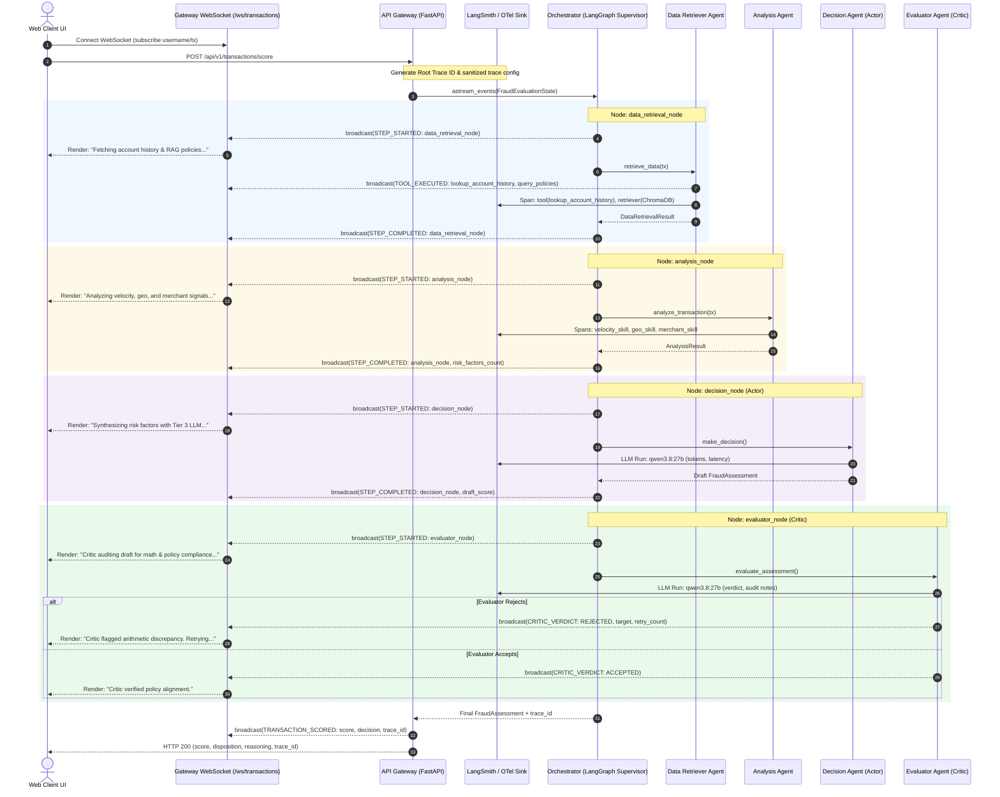

# PRD-018: Implement End-to-End Traceability & Real-Time Agent Streaming (Dual-Plane Observability)

## Status
- **Status**: Draft | Approved for Implementation
- **Author**: Abhishek Biswas & Agentic AI Assistant
- **Created**: 2026-11-09
- **Target Release**: v0.2.0
- **Related PRDs & Documents**:
  - [PRD-013: Architect Agentic Pattern](file:///Users/abhishekbiswas/AppDevelppment/TransactionFraudScorerAgenticAI/docs/prds/13-Architect-Agentic-pattern.md)
  - [PRD-017: Update Agents to Hybrid Supervisor-Critic](file:///Users/abhishekbiswas/AppDevelppment/TransactionFraudScorerAgenticAI/docs/prds/17-Update-Agents.md)
  - [Agentic Architecture Pattern](file:///Users/abhishekbiswas/AppDevelppment/TransactionFraudScorerAgenticAI/docs/agentic-architecture-pattern.md)
  - [Architecture Overview](file:///Users/abhishekbiswas/AppDevelppment/TransactionFraudScorerAgenticAI/docs/architecture.md)

---

## 1. Executive Summary & Objective

The **Transaction Fraud Scorer Agentic AI** employs a multi-tiered, asynchronous agent topology governed by a LangGraph State Machine (`FraudEvaluationState`). This comprises:
- An **Orchestrator Supervisor** coordinating sub-agents.
- A **Data Retriever Agent** (Tier 1: `llama3.2:3b`) querying SQLite account histories and ChromaDB RAG vector embeddings concurrently.
- An **Analysis Agent** (Tier 2: `llama3.1:8b`) evaluating multi-vector risk signals (velocity, haversine geo-distance, merchant MCC reputation, amount deviation) and requesting dynamic supplementary data.
- An **Actor-Critic Pair**: `DecisionAgent` (Actor — Tier 3: `qwen3.8:27b`) proposing fraud assessments and `EvaluatorAgent` (Critic — Tier 3+: `qwen3.8:27b`) enforcing mathematical consistency and policy compliance with up to 3 retries and an SLA circuit breaker (`1800ms`).

The objective of **PRD-018** is to operationalize the **Omnipresent Observability Plane** via a **Dual-Plane Observability Architecture**:
1. **Plane 1: Real-Time UI Streaming Fast Path (< 1ms latency)**: Directly streaming granular agent reasoning steps, tool calls, and critic critiques from LangGraph through FastAPI's [`ConnectionManager`](file:///Users/abhishekbiswas/AppDevelppment/TransactionFraudScorerAgenticAI/src/api_gateway/websocket_manager.py) to the Web Client over WebSockets.
2. **Plane 2: Deep Distributed Tracing & Telemetry (Asynchronous / Out-of-Band)**: Emitting PII-scrubbed distributed traces, token economics, RAG retrieval relevance, and latency metrics to **LangSmith** and standard **OpenTelemetry (OTel) Collectors**.

---

## 2. Architectural Critique: OTel Collector Loop vs. Dual-Plane Streaming

### The Architectural Question
*Can an OpenTelemetry (OTel) Collector capture backend agent traces and relay them back through the API Gateway WebSocket to the Web Client?*

### The Architectural Evaluation & Verdict: **REJECTED AS AN ANTI-PATTERN**
Routing live UI events through an external OTel Collector middleman creates severe operational liabilities:
1. **Reverse Ingestion Loop & State Disconnect**: The trace originates inside Python. Exporting spans over gRPC/OTLP to an external OTel Collector daemon, only to have the collector push them back into FastAPI via an ad-hoc webhook to find the in-memory WebSocket client connection ([`ConnectionManager._connections`](file:///Users/abhishekbiswas/AppDevelppment/TransactionFraudScorerAgenticAI/src/api_gateway/websocket_manager.py#L25)), creates unnecessary coupling and failure modes.
2. **Batching Latency & Jitter**: OTel collectors and exporters buffer spans (typically 500ms to 5,000ms or 512-span chunks) to optimize network throughput. For a real-time UI designed to show step-by-step progress (*"Retrieving data... Analyzing velocity... Evaluator verifying..."*), batching destroys the interactive user experience.
3. **Payload Bloat**: OTLP protobuf/JSON spans are heavily nested and verbose with telemetry resource descriptors, trace flags, and hex IDs. The browser UI needs concise domain events, not raw OTLP spans.
4. **Unnecessary Infrastructure**: Demands deploying and monitoring a separate OTel Collector daemon purely to feed browser events.

### Adopted Pattern: Dual-Plane Architecture
- **In-Process Event Streaming (Fast Path)**: LangGraph state transitions and tool executions yield lightweight `AgentStepEvent` payloads directly to the local WebSocket `ConnectionManager` with **zero network hops (< 1ms)**.
- **Out-of-Band Deep Observability (Telemetry Path)**: Background threads export comprehensive, PII-sanitized traces to **LangSmith** and/or an OTel Collector for compliance auditing, model debugging, and token accounting.
- **Trace Correlation Link**: Every WebSocket event carries the `trace_id` / `langsmith_run_id`, allowing the Web Client to render a live step timeline *and* provide a one-click badge: `[🔍 View Full Trace in LangSmith]`.

---

## 3. End-to-End System & Trace Flow



---

## 4. Key Architectural Capabilities

### A. Real-Time WebSocket Event Schemas
Add structured agent execution events to [`src/api_gateway/schemas.py`](file:///Users/abhishekbiswas/AppDevelppment/TransactionFraudScorerAgenticAI/src/api_gateway/schemas.py):

```python
class AgentStepEventType(str, Enum):
    STEP_STARTED = "STEP_STARTED"
    TOOL_EXECUTED = "TOOL_EXECUTED"
    CRITIC_VERDICT = "CRITIC_VERDICT"
    STEP_COMPLETED = "STEP_COMPLETED"
    CIRCUIT_BREAKER_TRIGGERED = "CIRCUIT_BREAKER_TRIGGERED"
    TRANSACTION_SCORED = "TRANSACTION_SCORED"

class AgentStepEvent(BaseModel):
    """Real-time event streamed over WebSocket as agents progress through evaluation."""
    event_type: AgentStepEventType
    transaction_id: str
    trace_id: str | None = None
    node_name: str  # e.g., "data_retrieval_node", "analysis_node", "decision_node", "evaluator_node"
    status: Literal["RUNNING", "COMPLETED", "RETRYING", "FALLBACK", "FAILED"]
    elapsed_ms: float
    retry_count: int = 0
    message: str
    details: dict[str, Any] = Field(default_factory=dict)
```

### B. Pre-Trace PII & PCI-DSS Masking (Client-Side)
- Implement `src/fraud_scorer/observability/sanitizer.py`.
- **Zero PII Leakage**: Scrubs PAN (card numbers masked to `****-****-****-1234`), CVV, and customer billing address before attaching to LangSmith or OTel spans.
- Preserves analytical fields (`amount`, `currency`, `mcc`, `haversine_km`, `velocity_count`).

### C. Granular Tool & RAG Retrieval Attribution
- **ChromaDB Spans**: Wrap `query_policies` with `@safe_traceable(run_type="retriever")` capturing query narrative, clause IDs, and cosine similarity distance.
- **SQLite / MCP Spans**: Wrap `lookup_account_history` and `check_velocity` with `@safe_traceable(run_type="tool")` capturing execution latencies and returned factor metrics.

### D. Actor-Critic Retry & SLA Circuit Breaker Telemetry
- Annotate runs with `retry_count`, `rejection_category`, and `remediation_instruction`.
- If wall-clock elapsed time exceeds `1800ms` or retries exceed 3, tag the run with:
  - `is_fallback = True`
  - `fallback_reason = "SLA_TIMEOUT" | "MAX_RETRIES_EXCEEDED"`
  - `elapsed_wall_clock_ms`

### E. Heterogeneous Model Economics & OTel Exporter
- Capture tokens (prompt, completion, total) and TTFT across tiers:
  - Tier 1: `llama3.2:3b`
  - Tier 2: `llama3.1:8b`
  - Tier 3: `qwen3.8:27b`
- Support optional OpenTelemetry OTLP exporter to send trace spans to enterprise collectors (Jaeger, Tempo) in parallel with LangSmith.

### F. Human-in-the-Loop Feedback & CI/CD Datasets
- Store `trace_id` / `langsmith_run_id` in SQLite `transaction_scores`.
- On `POST /api/v1/transactions/decision`, dispatch analyst feedback to LangSmith (`client.create_feedback()`).
- Ingest `docs/dataset/test_transactions_dataset.json` as an evaluation benchmark to test regression in CI.

---

## 5. Configuration & Environment Variables

Add to [`src/fraud_scorer/config.py`](file:///Users/abhishekbiswas/AppDevelppment/TransactionFraudScorerAgenticAI/src/fraud_scorer/config.py):

| Variable | Type | Default | Description |
|---|---|---|---|
| `LANGSMITH_TRACING` | `bool` | `false` | Global toggle for LangSmith tracing |
| `LANGSMITH_ENDPOINT` | `str` | `"https://api.smith.langchain.com"` | LangSmith API service endpoint |
| `LANGSMITH_API_KEY` | `str | None` | `None` | LangSmith API Key |
| `LANGSMITH_PROJECT` | `str` | `"fraud-scorer-agentic-ai"` | Target LangSmith project workspace |
| `LANGSMITH_MASK_PII` | `bool` | `true` | Enforce client-side PII scrubbing |
| `OTEL_EXPORTER_OTLP_ENDPOINT` | `str | None` | `None` | Optional OTel Collector endpoint (e.g. `http://localhost:4317`) |
| `ENABLE_WEBSOCKET_TRACE_STREAMING` | `bool` | `true` | Stream live agent reasoning events over WebSocket |

---

## 6. Acceptance Criteria

- [ ] **Dual-Plane Independence**: Disabling LangSmith or OTel Collector does not affect real-time WebSocket streaming to the Web Client.
- [ ] **Sub-Millisecond Streaming**: Node start/finish and tool execution events broadcast to connected WebSockets with < 1ms fast-path delay.
- [ ] **PII Masking Verification**: Automated unit tests prove PAN/card numbers and billing addresses never appear unmasked in LangSmith spans or WebSocket payloads.
- [ ] **Actor-Critic Visibility**: Critic rejection, feedback message, and subsequent retry appear in real-time in the Web Client UI and as child runs in LangSmith.
- [ ] **SLA Circuit Breaker Tagging**: Forced timeouts produce `is_fallback: true` tags in LangSmith and broadcast `CIRCUIT_BREAKER_TRIGGERED` over WebSocket.
- [ ] **Analyst Feedback Dispatch**: `POST /api/v1/transactions/decision` successfully attaches feedback scores to the matching `langsmith_run_id`.
- [ ] **Test Coverage**: Comprehensive unit tests covering `sanitizer.py`, `tracer.py`, and WebSocket event emission with >85% code coverage.
