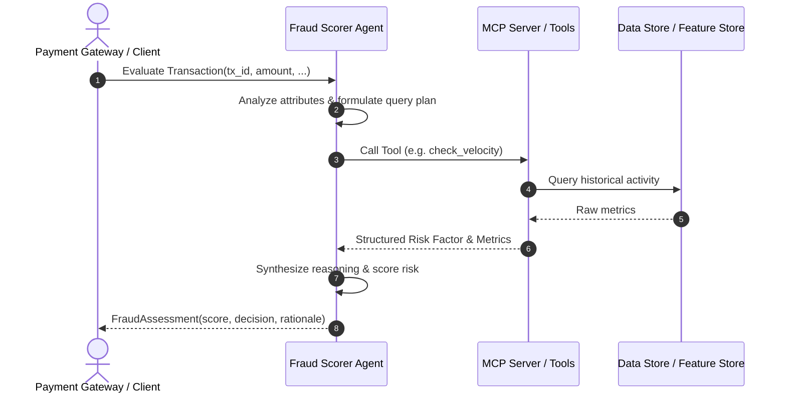

# PRD-000: [Feature Title]

## Status
- **Status**: Draft | In Review | Approved | Implemented | Deprecated
- **Author**: [Author Name]
- **Created**: YYYY-MM-DD
- **Target Release**: vX.Y.Z

---

## 1. Executive Summary & Objective
Briefly describe the fraud detection capability or feature to be implemented. What specific fraud typology (e.g., account takeover, card-not-present fraud, velocity abuse, synthetic identity) does this address?

---

## 2. Background & Problem Statement
- **Current Limitations**: How are transactions currently evaluated without this feature?
- **Business Impact**: Estimated chargeback rate reduction, fraud loss mitigation, or false positive reduction target.

---

## 3. User & System Flow
Describe the end-to-end journey when a transaction enters the system:
1. Transaction payload arrives at the Fraud Scorer Agent.
2. Agent inspects transaction attributes and determines which risk signals to investigate.
3. Agent invokes relevant MCP tool(s).
4. Tool returns structured metrics or evidence.
5. Agent combines signals into an overall risk score and disposition (`APPROVE`, `REVIEW`, `DECLINE`).



---

## 4. MCP Tools & Interfaces Required
Define any new or updated MCP tools required to support this PRD.

### Tool: `tool_name`
- **Description**: What the tool computes or queries.
- **Input Parameters**:
  | Parameter | Type | Required | Description |
  |---|---|---|---|
  | `account_id` | `str` | Yes | Target customer account ID |
  | `window_minutes` | `int` | No | Evaluation time window (default 60) |
- **Output Schema**:
  ```json
  {
    "risk_score_impact": 0.0,
    "anomalies_detected": [],
    "metrics": {}
  }
  ```
- **Performance & Latency SLA**: Max latency under load (e.g., < 50ms).
- **Error Handling**: Graceful fallback behavior if data source is unreachable.

---

## 5. Fraud Detection Heuristics & Scoring Criteria
- **Thresholds & Rules**:
  - Low Risk (0 - 29): Normal transaction pattern.
  - Medium Risk (30 - 69): Manual review recommended.
  - High Risk (70 - 100): High fraud probability; immediate decline or step-up authentication.
- **Edge Cases**:
  - High-volume merchant sale days (e.g., Black Friday).
  - Cross-border transactions with legitimate roaming travel.
  - New accounts with no prior transaction history.

---

## 6. Acceptance Criteria
- [ ] Tool registered with MCP server and verified via MCP inspector or unit tests.
- [ ] Agent system prompt updated to recognize when to trigger this tool.
- [ ] Pydantic domain models updated and strictly validated.
- [ ] Automated unit and integration tests passing with >85% code coverage.
- [ ] False positive rate verified against baseline test datasets.

---

## 7. Telemetry, Auditability & Compliance
- **Audit Trail**: Every score must output human-readable reasoning explaining why a decision was reached.
- **Privacy & PII**: How sensitive payment data (PAN, CVV, PII) is masked or protected before passing to LLM context.
- **Metrics**: Key metrics to emit (latency, tool call count, token usage, decision distribution).
