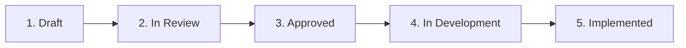

# Product Requirement Documents (PRDs)

This directory contains the Product Requirement Documents specifying features, detection models, heuristics, and MCP tools for the **Transaction Fraud Scorer Agentic AI**.

## PRD Lifecycle

1. **Draft**: Authoring initial feature requirements using [`PRD_TEMPLATE.md`](./PRD_TEMPLATE.md).
2. **In Review**: Shared with stakeholders for architecture, security, and risk model review.
3. **Approved**: Finalized scope and acceptance criteria ready for execution.
4. **In Development**: Code, MCP tools, agent prompts, and tests are actively being written.
5. **Implemented**: Shipped and verified with automated test suites in CI.

---

## PRD Registry

| PRD ID | Title | Status | Primary Author | Target Milestone |
|---|---|---|---|---|
| [PRD-000](./PRD_TEMPLATE.md) | Standard Feature PRD Template | Active | System | Core |
| *PRD-001* | *Velocity & Rapid Multi-Swipe Checks (Upcoming)* | Planned | - | v0.2.0 |
| *PRD-002* | *Geolocation Anomaly & Impossible Travel (Upcoming)* | Planned | - | v0.2.0 |
| *PRD-003* | *Merchant Category & High-Risk MCC Scoring (Upcoming)* | Planned | - | v0.3.0 |
| *PRD-004* | *Historical Account Behavioral Profiling (Upcoming)* | Planned | - | v0.3.0 |

---

## Authoring Guidelines
- Copy [`PRD_TEMPLATE.md`](./PRD_TEMPLATE.md) to a new file named `PRD-XXX-<short-name>.md`.
- Detail the exact MCP tool signatures, input/output schemas, and latency SLAs.
- Define explicit risk contribution scoring heuristics (0-100 scale).
- Ensure privacy requirements (no plaintext credit card numbers or unmasked PII).
