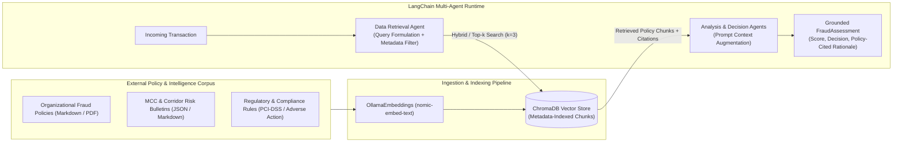

# RAG (Retrieval-Augmented Generation) Design Specification: Policy & Fraud Intelligence Grounding

Based on the system architecture defined in [`docs/architecture.md`](./architecture.md), the **Transaction Fraud Scorer Agentic AI** combines deterministic, structured operational metrics (via the **MCP Tool Server**) with unstructured, dynamic domain knowledge (via the **RAG Knowledge Layer**). While MCP tools (`check_velocity`, `check_geo_anomaly`, `check_merchant_risk`, `lookup_account_history`) compute real-time telemetry, **RAG** injects current organizational risk policies, regulatory rules, and emerging fraud typologies directly into the multi-agent reasoning workflow without requiring model retraining or hardcoded rule redeployments.

---

## 1. Semantic Retrieval Integration with an External Data Source

### A. External Data Source & Vector Store Architecture
To keep the agent aligned with rapidly evolving fraud policies and compliance mandates, external policy documents (Markdown/PDF underwriting playbooks, MCC restriction bulletins, regional step-up authentication mandates, and historical chargeback advisories) are ingested into a local/managed **ChromaDB** vector store accessed via **LangChain's `VectorStoreRetriever`**.



### B. End-to-End Integration in the LangChain Orchestrator
1. **Embedding Pipeline**:
   - Policy documents are embedded using `OllamaEmbeddings(model="nomic-embed-text")` (via `langchain-ollama`), maintaining the local-first, zero-data-exfiltration posture alongside `ChatOllama` in [`FraudScorerOrchestrator`](../src/fraud_scorer/agent/orchestrator.py).
2. **Semantic Query Construction (`Data Retrieval Agent`)**:
   - When `evaluate_transaction(tx: Transaction)` is invoked, the `Data Retrieval Agent` synthesizes a structured semantic query from the incoming [`Transaction`](../src/fraud_scorer/models/transaction.py) attributes and initial MCP tool signals:
     ```text
     "Applicable fraud policy and step-up authentication rules for MCC {tx.merchant.mcc} ({tx.merchant.name}), transaction amount ${tx.amount} {tx.currency}, payment method {tx.payment_method.payment_type} (card_present={tx.payment_method.is_card_present}), originating from {tx.location.country}."
     ```
3. **Retrieval Execution & Context Injection (`Analysis Agent` & `Decision Agent`)**:
   - Exposed either as a dedicated LangChain `@tool` (`retrieve_fraud_policies_tool`) in [`src/fraud_scorer/agent/tools.py`](../src/fraud_scorer/agent/tools.py) or as a deterministic pre-decision enrichment step in `FraudScorerOrchestrator._evaluate_with_langchain_ollama`, the retriever queries ChromaDB using cosine similarity combined with metadata filtering (e.g., `{"status": "active"}`).
   - The retrieved policy chunks—complete with policy IDs, effective dates, and threshold directives—are injected into the `TRANSACTION_EVALUATION_TEMPLATE` prompt in [`src/fraud_scorer/agent/prompts.py`](../src/fraud_scorer/agent/prompts.py) so the `Decision Agent` grounds its `RiskDecision` (`APPROVE`, `REVIEW`, `DECLINE`) and `reasoning_summary` in authoritative policy text.

---

## 2. How Retrieval Meaningfully Influences Agent Output (Concrete Example)

Semantic retrieval directly alters both **disposition outcomes (`APPROVE` / `REVIEW` / `DECLINE`)** and **audit explainability (`reasoning_summary`)** when quantitative MCP tool scores fall into ambiguous or newly regulated zones.

### Scenario: Cross-Border Digital Goods Purchase During an Active Holiday / Corridor Policy Override
Consider an incoming transaction evaluated by `FraudScorerOrchestrator`:
- **Transaction**: `amount = $1,450.00 USD`, `mcc = "5816"` (Digital Games/Goods), `country = "GB"` (US-based cardholder purchasing from a UK merchant), `is_card_present = False`.
- **Quantitative MCP Tool Outputs**:
  - `lookup_account_history_tool`: Account age 420 days, 0 prior disputes (`account_risk_score = 10.0`).
  - `check_velocity_tool`: 2 transactions in 60 minutes (`velocity_risk_score = 18.0`, below the `> 20.0` burst cutoff).
  - `check_geo_anomaly_tool`: Card-not-present e-commerce transaction (`geo_risk_score = 15.0`).
  - `check_merchant_risk_tool`: MCC `5816` moderate baseline (`merchant_risk_score = 25.0`).

#### 1. Output WITHOUT RAG (Baseline Quantitative Evaluation Only)
Without policy retrieval, the agent relies solely on static tool thresholds and general LLM priors:
- Only `MERCHANT_RISK` (`25.0`) crosses the `> 20.0` filter in `_extract_risk_factors`.
- **Computed Risk Score**: `25.0 / 100.0` (falls inside the `0.0 - 29.9` range).
- **Disposition**: `APPROVE`
- **Reasoning Summary**:
  > *"Approved (Score: 25.0/100). Account has established history (420 days) with no velocity burst or impossible travel detected. Moderate MCC risk noted."*

#### 2. Retrieved Policy Context (Injected via RAG)
When the `Data Retrieval Agent` queries the Vector Store for `MCC 5816 cross-border card-not-present > $1,000`, it retrieves **Policy Bulletin `POL-2026-Q4-089` (Effective Oct 1, 2026)**:
> **`[POL-2026-Q4-089 | Effective: 2026-10-01 | Status: ACTIVE]`**
> ** Policy: Cross-Border Digital Goods & Gift Card Step-Up Mandate (MCC 5815, 5816, 5817)**
> Due to an active credential-stuffing campaign targeting established accounts (>1 year old), any Card-Not-Present (`is_card_present = False`) transaction in MCC `5816` exceeding **$1,000.00 USD** involving a cross-border merchant corridor MUST be assigned at least a `HIGH` risk factor (`contribution_score >= 55.0`) and routed to **`REVIEW`** for mandatory 3DS / step-up verification, regardless of historical account age or low 60-minute swipe velocity.

#### 3. Output WITH RAG (Policy-Grounded Evaluation)
Grounded by the retrieved document `POL-2026-Q4-089`, the `Analysis Agent` and `Decision Agent` adjust the evaluation:
- **Updated Risk Factor**: `MERCHANT_RISK` / `POLICY_OVERRIDE` elevated to `HIGH` (`contribution_score = 55.0`).
- **Computed Risk Score**: `55.0 / 100.0` (moves from `APPROVE` range into `30.0 - 69.9` `REVIEW` range).
- **Disposition**: `REVIEW` (Changed from `APPROVE`)
- **Grounded Reasoning Summary**:
  > *"Decision: REVIEW (Score: 55.0/100). Although account history (420 days, 0 disputes) and 60-minute velocity (2 txns) are within normal baselines, this transaction matches active policy **POL-2026-Q4-089 (Cross-Border Digital Goods Step-Up Mandate)**: Card-Not-Present purchase of $1,450.00 USD (> $1,000 threshold) in MCC 5816 across a cross-border corridor. Escalated to REVIEW for mandatory 3DS step-up authentication."*

**Impact Summary**: Retrieval prevents a false-negative approval against an active attack vector and grounds the explanation in an auditable policy citation (`POL-2026-Q4-089`) rather than generic LLM commentary.

---

## 3. Key Retrieval Design Choices

| Design Dimension | Selection | Rationale |
|---|---|---|
| **1. Data Source Selection** | Curated Markdown/JSON repository of **Active Fraud Underwriting Policies**, **MCC Risk Bulletins**, and **Compliance Playbooks** indexed into **ChromaDB**. | Fraud policies are structured around explicit rules, MCC codes, dollar thresholds, and effective dates. Using version-controlled Markdown/JSON files with YAML frontmatter ensures clean governance, auditability, and deterministic metadata extraction before vector indexing. |
| **2. Document Segmentation & Chunking** | **Two-stage structure-aware chunking**:<br>1. `MarkdownHeaderTextSplitter` (splitting on `#`, `##`, `###` policy sections)<br>2. `RecursiveCharacterTextSplitter` (`chunk_size = 512` tokens, `chunk_overlap = 64` tokens). | Naive fixed-size chunking often severs a policy's **condition** (e.g., *"For MCC 7995 transactions over $2,000..."*) from its **mandated action** (e.g., *"...decline immediately unless VIP tier"*). Splitting by Markdown headers preserves complete, self-contained policy rules within a single chunk, while the 512-token cap and 64-token overlap keep chunks concise for small local models (`llama3.2:3b`). |
| **3. Enriched Chunk Metadata** | Every chunk carries structured metadata: `policy_id`, `mcc_codes`, `effective_date`, `expiration_date`, `status` (`active` / `deprecated`), and `policy_category`. | Enables **pre-filtering** in ChromaDB (e.g., `where={"status": "active"}`) before semantic similarity calculation, ensuring high precision on exact codes like 4-digit MCCs. |
| **4. Number of Retrieved Results (`top_k`)** | **`k = 3`** chunks per query, paired with a **minimum cosine similarity threshold of `0.72`** (via `similarity_score_threshold`). | A single transaction typically touches at most 1–3 policy domains (e.g., MCC policy + cross-border geo policy + high-value amount policy). Retrieving `k = 3` provides comprehensive policy coverage while keeping prompt token overhead under ~1,500 tokens—preventing context window dilution ("lost in the middle" degradation) and maintaining low scoring latency on local Ollama inference. |

---

## 4. Retrieval Failure Mode & Risk Mitigation Strategy

### Identified Failure Mode: Stale / Superseded Policy Retrieval & Near-Miss Semantic Confusion
In financial fraud scoring, two closely related retrieval failures pose severe operational risk:
1. **Temporal Policy Staleness (Policy Drift)**: The vector store contains both historical/expired policies (e.g., a temporary 2025 holiday travel waiver or an outdated $5,000 review threshold) and newly enacted policies (e.g., a 2026 $1,000 threshold). Because both documents share nearly identical semantic vocabulary, dense vector similarity alone can rank the **superseded policy** higher than the current policy, causing the agent to apply obsolete rules.
2. **Semantic Near-Miss on Exact Identifiers (MCC Confusion)**: Dense embeddings can treat semantically similar categories (e.g., MCC `5815` Digital Media vs. MCC `7995` Online Gambling) as close neighbors, retrieving a strict decline policy meant for a different MCC.

### How the Design Reduces and Manages This Risk
Our architecture implements a **Four-Layer Defense-in-Depth Mitigation**:

1. **Hard Metadata Lifecycle Filtering (Pre-Retrieval Gate)**:
   - Every policy chunk indexed into ChromaDB includes mandatory metadata fields: `status: "active" | "archived"`, `effective_from_epoch`, and `effective_until_epoch`.
   - The `Data Retrieval Agent` enforces a strict metadata filter on every query (`filter={"$and": [{"status": {"$eq": "active"}}, {"effective_from_epoch": {"$lte": current_tx_epoch}}]}`), making it mathematically impossible for archived or future-dated policies to be returned by the retriever.
2. **Hybrid Lexical + Semantic Matching (MCC & Keyword Pinning)**:
   - Prior to ranking purely by dense cosine similarity, retrieval boosts or filters chunks whose metadata `mcc_codes` list contains the exact `tx.merchant.mcc` (or `"ALL"`), preventing policies written for one specific MCC from bleeding into an unrelated MCC evaluation.
3. **Relevance Score Cutoff & Abstention Handling (`score_threshold = 0.72`)**:
   - If no active policy chunk achieves a similarity score `>= 0.72`, the retriever returns an empty context list (`[]`) rather than forcing `k = 3` low-relevance chunks into the prompt. The `SystemMessage` explicitly instructs the agent: *"If no retrieved policy directly matches the transaction's MCC, corridor, or risk profile, rely strictly on the quantitative MCP tool outputs and baseline scoring taxonomy."*
4. **Deterministic Safety Floor (`_resolve_decision` Guardrail)**:
   - As implemented in [`FraudScorerOrchestrator._resolve_decision`](../src/fraud_scorer/agent/orchestrator.py#L306-L313), even if RAG retrieval fails, times out, or retrieves noisy context, hard critical signals from MCP tools (`any(f.severity == "CRITICAL" for f in risk_factors)` such as impossible travel or extreme velocity bursts) deterministically enforce a `DECLINE` disposition. RAG can **elevate** scrutiny or ground ambiguous cases, but cannot override a critical deterministic security block.
