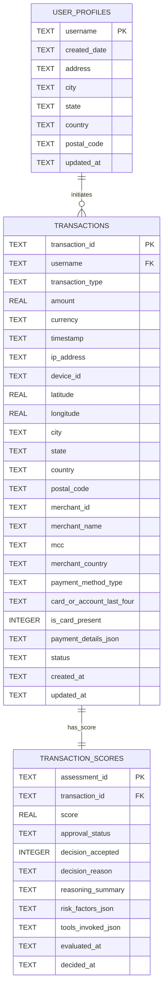

# Relational Database Model Schema (SQLite)

This directory contains the relational database schema (`schema.sql`) for the **Transaction Fraud Scorer Agentic AI** persistence layer (`src/sqllite`).

---

## Entity-Relationship Diagram

---

## Table Specifications

### 1. `user_profiles` (`UserProfile` Table)
Stores core customer account identity, registration date, and mailing address.
- **`username`** (`TEXT PRIMARY KEY`): Unique customer account username (`account_id`).
- **`created_date`** (`TEXT NOT NULL`): ISO-8601 timestamp when the user profile was created.
- **`address`** (`TEXT`): Street/mailing address.
- **`city`**, **`state`**, **`country`**, **`postal_code`** (`TEXT`): Optional address components.
- **`updated_at`** (`TEXT`): Last profile update timestamp.

> [!NOTE]
> Derived risk metrics (`trust_tier`, `prior_disputes`, `avg_transaction_amount`) are intentionally **not** stored on `user_profiles`. They are calculated dynamically in the MCP tool (`lookup_account_history`) from `user_profiles.created_date`, `transactions`, and `transaction_scores`.

### 2. `transactions` (`Transaction` Table with `status`)
Stores historical and ongoing `CARD` and `ACH` transactions aligned with `docs/openapi-spec/openapi.yaml` and `src/fraud_scorer/models/transaction.py`.
- **`transaction_id`** (`TEXT PRIMARY KEY`): Unique transaction ID (`tx_...`).
- **`username`** (`TEXT NOT NULL REFERENCES user_profiles(username)`): Originating user.
- **`transaction_type`** (`TEXT NOT NULL`): `'CARD'` or `'ACH'`.
- **`amount`** (`REAL NOT NULL`): Transaction amount (`> 0`).
- **`currency`** (`TEXT NOT NULL`): 3-letter ISO currency code (`'USD'`).
- **`timestamp`** (`TEXT NOT NULL`): ISO-8601 transaction timestamp.
- **`ip_address`**, **`device_id`** (`TEXT`): Session context.
- **`latitude`**, **`longitude`**, **`city`**, **`state`**, **`country`**, **`postal_code`**: Geolocation metadata.
- **`merchant_id`**, **`merchant_name`**, **`mcc`**, **`merchant_country`**: Merchant details.
- **`payment_method_type`**, **`card_or_account_last_four`**, **`is_card_present`**, **`payment_details_json`**: Payment rail metadata.
- **`status`** (`TEXT NOT NULL`): `'PENDING'`, `'APPROVE'`, `'REVIEW'`, `'DECLINE'`, `'ACCEPTED'`, or `'REJECTED'`.

### 3. `transaction_scores` (Scores & Approval Status Mapped to `transaction_id`)
Stores fraud evaluation scores, reasoning, risk factors, and manual analyst Accept/Reject dispositions mapped 1:1 to `transactions(transaction_id)`.
- **`assessment_id`** (`TEXT PRIMARY KEY`): Unique assessment ID (`assess_...`).
- **`transaction_id`** (`TEXT NOT NULL UNIQUE REFERENCES transactions(transaction_id)`): Mapped transaction ID.
- **`score`** (`REAL NOT NULL`): Fraud score (`0.0` to `100.0`).
- **`approval_status`** (`TEXT NOT NULL`): `'APPROVE'`, `'REVIEW'`, `'DECLINE'`, `'ACCEPTED'`, or `'REJECTED'`.
- **`decision_accepted`** (`INTEGER`): `1` (Accepted), `0` (Rejected), or `NULL` (awaiting manual decision).
- **`decision_reason`** (`TEXT`): Analyst audit reason for Accept/Reject.
- **`reasoning_summary`** (`TEXT NOT NULL`): Explainable AI rationale.
- **`risk_factors_json`** (`TEXT NOT NULL`): JSON array of triggered `RiskFactor` objects.
- **`tools_invoked_json`** (`TEXT NOT NULL`): JSON array of invoked MCP tool names.
- **`evaluated_at`**, **`decided_at`** (`TEXT`): Evaluation and manual decision timestamps.
