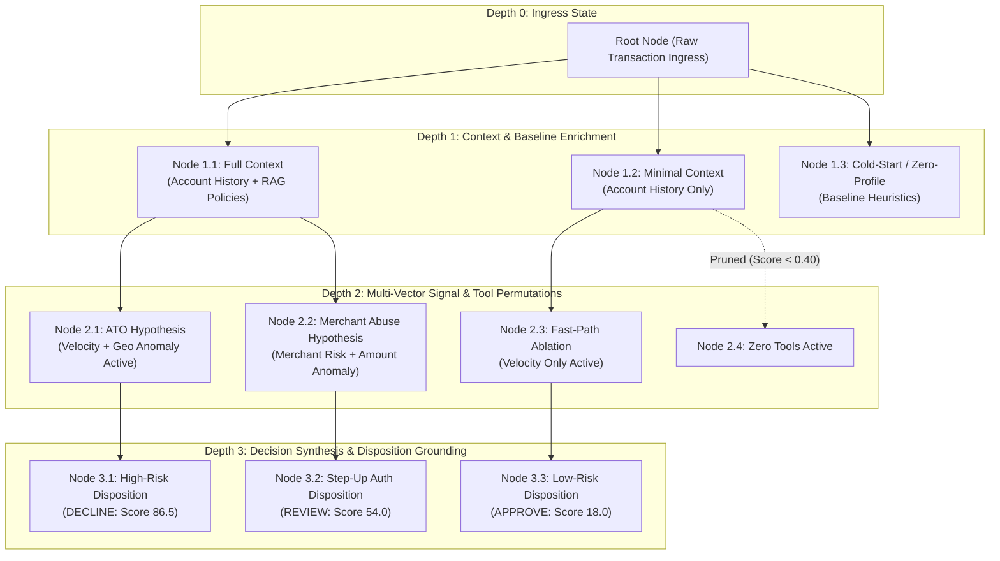
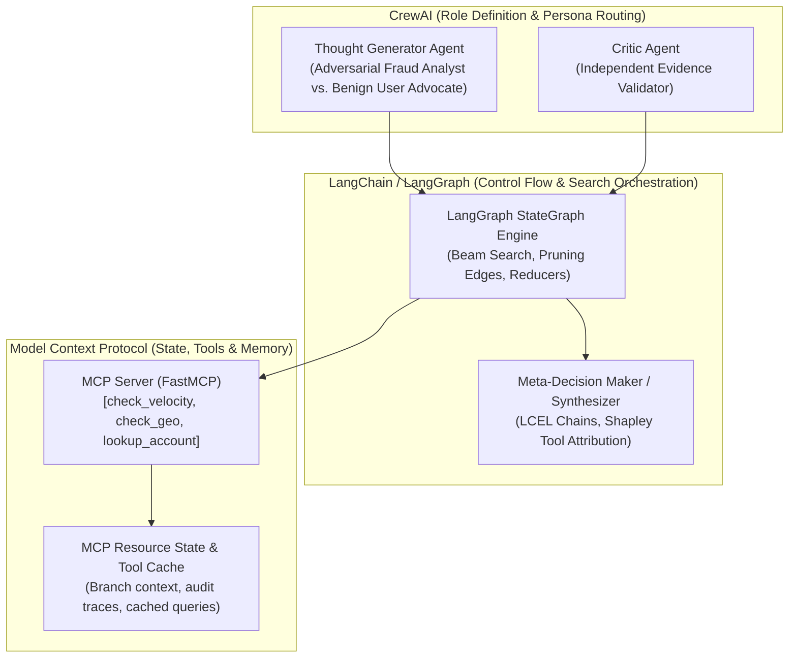

# Tree-of-Thoughts (ToT) Formal Specification: Transaction Fraud Scorer

This document specifies the formal **Tree-of-Thoughts (ToT)** architecture for the **Transaction Fraud Scorer Agentic AI**, detailing reasoning representations, search and evaluation mechanics, tool mapping across LangChain, CrewAI, and MCP, and risk mitigation strategies.

---

## 1. ToT Structure & Tree Representation

### A. What a "Thought" Represents
In this system, a **Thought** represents a **discrete, testable intermediate fraud assessment state**. Each thought encapsulates:
1. An **investigative hypothesis** (e.g., *"Account Takeover via rapid geolocation hopping"*, *"Card-testing micro-authorization burst"*, or *"Benign travel outlier with established customer tenure"*).
2. An **execution configuration** specifying a selective subset of active agents (`DataRetrieverAgent`, `AnalysisAgent`, `DecisionAgent`) and active MCP risk tools (`check_velocity`, `check_geo_anomaly`, `check_merchant_risk`, `lookup_account_history`, RAG policy retrieval) enabled to validate or refute that hypothesis.

### B. Node, Branch, and Depth Definitions

- **Node**: An immutable evaluation snapshot containing:
  - `node_id` and `parent_id`.
  - Active `BranchPlan` (enabled tools and agents).
  - Accumulated contextual evidence (account profile, tool call outputs, extracted `RiskFactor` items).
  - Node evaluation metrics (intermediate confidence score, execution latency in milliseconds, token usage).
- **Branch**: A directed transition representing an exploratory decision:
  - Activating or suppressing specific analytical tools.
  - Switching between competing investigative hypotheses.
- **Depth ($d$)**: Directly corresponds to the sequential phases of fraud evaluation:
  - **Depth 0 (Root)**: Ingress payload validation (`Transaction` model).
  - **Depth 1 (Context & Baseline Enrichment)**: Profile retrieval via MCP `lookup_account_history` and RAG policy lookup.
  - **Depth 2 (Multi-Vector Signal Exploration)**: Parallel execution of active analytical tools (`check_velocity`, `check_geo_anomaly`, `check_merchant_risk`, `amount_anomaly`) under the assigned hypothesis.
  - **Depth 3 (Decision Synthesis & Disposition Grounding)**: Leaf-node scoring producing a normalized risk score ($0.0 - 100.0$) and disposition (`APPROVE`, `REVIEW`, `DECLINE`).

### C. Branching Factor and Depth Limit
- **Branching Factor ($b$)**: **$3$ to $4$ candidate branches** per expansion step.
- **Depth Limit ($d$)**: **$3$ levels** (Root $\to$ Context $\to$ Signal Analysis $\to$ Decision Synthesis).
- **Theoretical Tree Size**: $1 + 4 + (4 \times 3) + (12 \times 3) = 53$ nodes maximum before pruning. With beam search ($k = 3$), the active tree is capped at $\leq 10$ nodes per transaction.

### D. Termination and Final Output Selection
The system terminates when:
1. **Normal Termination**: All surviving unpruned branches reach **Depth 3** (Terminal Leaf Nodes).
2. **Fast-Path Short-Circuit**: A branch detects a critical, deterministic rule violation (e.g., confirmed impossible travel $> 1,200\text{ km/h}$ combined with velocity burst $> 5\text{ tx/min}$); such a branch immediately triggers a high-confidence `DECLINE` short-circuit.
3. **Selection Policy**: The **Meta-Decision Synthesizer** selects the winning path using the highest calibrated confidence score, constructs the final `ToTFraudAssessment`, and generates a **Tool Marginal Contribution Matrix** isolating the delta risk score attributed to each active tool.

---

## 2. Search and Evaluation Strategy

### A. Primary Search Strategy: **Beam Search ($k = 3$)**

**Why Beam Search fits our use case:**
- **Strict SLA Bounds**: Payment gateways require transaction scoring within bounded latency windows ($< 1,500\text{ ms}$).
- **Comparison to Alternatives**:
  - *BFS*: Suffers exponential branch explosion ($O(b^d)$), causing excessive tool invocations and latency violations.
  - *DFS*: Vulnerable to deep backtracking traps down unpromising hypotheses while delaying exploration of obvious attack patterns.
  - *Monte Carlo Tree Search (MCTS)*: Introduces high stochastic variance, non-deterministic reasoning paths, and unbounded rollouts unsuitable for regulatory financial audits.
- **Beam Search Advantage**: Maintains a fixed beam width ($k = 3$), tracking the top 3 most promising hypotheses and tool permutations at each depth level. This guarantees deterministic polynomial bounds:
  $$\text{Max Evaluated Nodes} = 1 + k \times d = 1 + (3 \times 3) = 10 \text{ nodes}$$

### B. Candidate Branch Assessment & Scoring Rubric

Each candidate branch is evaluated using a normalized composite quality score $Q \in [0.0, 1.0]$:

$$Q = 0.40 \cdot C_{\text{consistency}} + 0.35 \cdot S_{\text{signal}} + 0.25 \cdot E_{\text{efficiency}}$$

| Evaluation Criterion | Weight | Scoring Metric & Rubric |
|---|---|---|
| **Evidence Consistency ($C_{\text{consistency}}$)** | **40%** | Measures whether collected evidence supports the branch hypothesis without internal contradiction (e.g., verifying if high spend is supported or contradicted by account tenure). |
| **Signal Strength ($S_{\text{signal}}$)** | **35%** | Measures entropy reduction and severity of identified `RiskFactor` items. High-severity signals (velocity burst, impossible travel) yield higher scores. |
| **Cost & Latency Efficiency ($E_{\text{efficiency}}$)** | **25%** | Penalizes branches making redundant tool calls or incurring disproportionate latency without adding new risk factors. |

### C. Who Performs the Evaluation (Hybrid Critic)
The evaluation is performed by a **two-tier Hybrid Critic**:
1. **Deterministic Heuristic Layer (Fast Pass)**: Evaluates objective numeric outputs from MCP tools (e.g., velocity count $> 3$, haversine travel speed $> 800\text{ km/h}$, MCC risk level). Operates in $< 5\text{ ms}$.
2. **Critic Agent (LangChain LLM / Rule Chain)**: Evaluates qualitative coherence and resolves conflicting signals (e.g., high velocity during Black Friday shopping on a 5-year-old VIP account).

### D. Pruning Thresholds and Failure Conditions
- **Pruning Threshold**: Any branch with intermediate composite score **$Q < 0.40$** is pruned immediately.
- **Failure Condition**: If all candidate branches fall below the $0.40$ threshold (e.g., due to downstream tool failures or low signal), the controller activates a **Deterministic Fallback Branch** using the core `RiskScoringDecisionSkill` with baseline profile defaults to ensure the transaction is never left hung.

### E. Tie Resolution
When two branches score within $\pm 0.02$ of each other:
1. **Pareto Latency Reranking**: The branch with lower wall-clock latency and fewer tool invocations is prioritized.
2. **Conservative Risk Policy**: If latency is identical, the system prioritizes the branch with higher risk factor coverage (biasing toward `REVIEW` over `APPROVE` to protect against financial fraud).

### F. Resource & Compute Constraints
- **Branch Timeout**: Hard execution timeout of $600\text{ ms}$ per node.
- **Idempotent Tool Caching**: MCP tool outputs (e.g., `lookup_account_history`, `check_velocity`) are cached by `(account_id, timestamp)` so sibling branches never duplicate identical database or remote tool calls.

---

## 3. Mapping ToT Roles to Implementation Tools

The ToT system delegates responsibilities across **LangChain**, **CrewAI**, and **MCP** according to their architectural strengths:

| ToT Role | Primary Tool | Why This Tool is Selected |
|---|---|---|
| **1. Thought Generator** | **CrewAI** | **Agent Personas & Task Specialization**: CrewAI excels at defining specialized agent roles with clear backstories and objectives. We use CrewAI to instantiate two contrasting personas: an *Adversarial Fraud Hunter* (generates high-risk attack hypotheses like ATO and card cracking) and a *Customer Advocacy Analyst* (generates benign explanations like travel or gift purchases). |
| **2. Critic / Evaluator** | **LangChain** (LCEL + Runnables) | **Structured Evaluation Chains**: LangChain provides precise prompt engineering abstractions, structured output parsing (`PydanticOutputParser`), and deterministic condition checks to compute our quantitative scoring rubric ($Q$) without hallucination. |
| **3. Decision Maker / Controller** | **LangChain** (LangGraph `StateGraph`) | **Cyclic Control Flow & Search Pruning**: LangGraph is purpose-built for branching state machines, conditional edges, parallel branch fan-out/fan-in reducers, and checkpointed state traversal necessary for Beam Search. |
| **4. Memory & State Manager** | **MCP (Model Context Protocol)** | **Tool Isolation & Cross-Branch Context Passing**: MCP standardizes tool contracts (`tools/call`), securely scopes database access, and provides a unified context interface. It enables parallel branches to query shared account baselines while isolating branch-specific hypothesis traces without cross-contamination. |

---

## 4. Key Risk and Mitigation Strategy

### Identified Risk: **Weak Evaluation Signals Leading to False-Negative Branch Pruning**
- **Risk Manifestation**: In multi-step investigations, initial signals at Depth 1 or 2 may appear deceptively normal (e.g., a fraudster mimicking regular login velocity). A purely greedy evaluator might score this hypothesis below the $0.40$ threshold and prune the branch before it reaches Depth 2, where critical evidence (such as impossible geolocation or high-risk MCC) would have surfaced. Pruning the winning fraud branch results in an undetected fraudulent transaction being erroneously approved.

### Applied Mitigation Strategy: **Diversity-Guaranteed Beam Reservation & Deferred Pruning**
1. **Guaranteed Diverse Branch Slot**:
   - In our Beam Search ($k = 3$), the top 2 slots are selected strictly by highest confidence score.
   - **The 3rd slot is strictly reserved for the most orthogonal/contrasting hypothesis** (e.g., the primary adversarial hypothesis), ensuring it cannot be eliminated early by temporary low confidence.
2. **Deferred Pruning on High-Entropy Inputs**:
   - For transactions exhibiting high initial entropy (e.g., transaction amount $> 3\times$ customer average), pruning is deferred until Depth 2 has completed all MCP analytical tool calls. This guarantees that branches are evaluated against concrete empirical evidence rather than incomplete early impressions.
