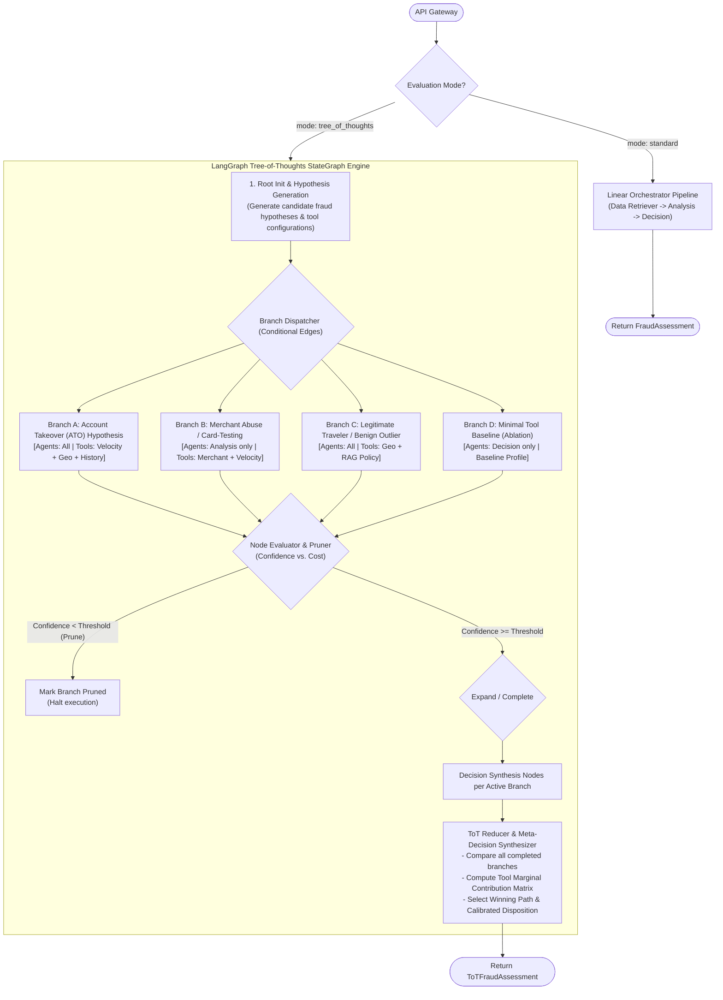

# Tree-of-Thoughts (ToT) Architecture: Multi-Path Agent & Tool Evaluation

## 1. Feasibility Assessment & Design Decisions

**Verdict: Fully Feasible and Architecturally Aligned.**

Based on the architectural alignment review and project decisions:
- **Operational Mode**: **Hybrid Mode** (Standard linear pipeline by default for sub-second SLA; Tree-of-Thoughts selectable per-request for high-risk, ambiguous transactions, or offline ablation/sensitivity benchmarking).
- **Branching Strategy**: **Dual-Axis Branching** (evaluating both **Tool/Agent Permutations** and **Semantic Hypotheses** such as *Account Takeover*, *Legitimate Traveler Anomaly*, or *Card-Testing Burst*).
- **Orchestration Framework**: **LangGraph `StateGraph`** utilizing immutable state schemas, checkpointing, parallel branch fan-out/fan-in reducers, and conditional pruning edges.

---

## 2. Conceptual Architecture

Standard execution follows a single linear path. In contrast, the **LangGraph Tree-of-Thoughts** workflow models transaction evaluation as an explicit state-space search:



---

## 3. LangGraph StateGraph Architecture

### A. State Schemas (`src/fraud_scorer/tot/state.py`)
LangGraph uses typed state dictionaries with reducers for parallel branch execution:

```python
from typing import Annotated, Any, Literal
from operator import add
from pydantic import BaseModel, Field
from fraud_scorer.models.transaction import FraudAssessment, RiskFactor, Transaction

class BranchPlan(BaseModel):
    branch_id: str
    hypothesis_label: str             # e.g., "Account Takeover", "Benign Travel Outlier"
    enable_data_retriever: bool = True
    enable_analysis: bool = True
    enable_decision: bool = True
    enabled_tools: list[str] = Field(default_factory=list)
    enable_rag: bool = True

class BranchOutcome(BaseModel):
    branch_id: str
    plan: BranchPlan
    risk_score: float
    decision: Literal["APPROVE", "REVIEW", "DECLINE"]
    confidence: float                 # 0.0 to 1.0
    risk_factors: list[RiskFactor] = Field(default_factory=list)
    tools_invoked: list[str] = Field(default_factory=list)
    latency_ms: float = 0.0
    pruned: bool = False
    prune_reason: str | None = None
    reasoning_summary: str = ""

class ToTState(BaseModel):
    transaction: Transaction
    evaluation_mode: str = "tree_of_thoughts"
    max_branches: int = 5
    prune_threshold: float = 0.40      # Minimum confidence required to survive pruning
    
    # Reducer accumulator: Collects outcomes across parallel branches
    branch_outcomes: Annotated[list[BranchOutcome], add] = Field(default_factory=list)
    
    # Final synthesized result
    winning_branch_id: str | None = None
    tool_marginal_contributions: dict[str, float] = Field(default_factory=dict)
    final_assessment: FraudAssessment | None = None
```

### B. Graph Node Definitions & Responsibilities

1. **`generate_hypotheses_node`**:
   - Ingests the `Transaction`.
   - Generates 3-5 distinct candidate branches representing:
     - **Hypothesis 1 (High-Risk/Aggressive)**: Checks velocity, impossible travel, and merchant risk.
     - **Hypothesis 2 (Benign Outlier/Context-Aware)**: Checks account history, customer tenure, and RAG travel policies.
     - **Hypothesis 3 (Ablation/Sensitivity Baseline)**: Selectively disables 1 key tool (e.g., no geo tool) to assess dependency.
2. **`execute_branch_node`**:
   - Reuses existing modular skills (`VelocityAnalysisSkill`, `GeoAnomalySkill`, `MerchantRiskSkill`, `AccountHistorySkill`) filtered strictly by `plan.enabled_tools`.
   - Isolates sub-agent execution so each branch runs without cross-talk.
3. **`evaluate_and_prune_node`**:
   - Assesses the branch's intermediate confidence score:
     $$\text{Confidence} = f(\text{evidence consistency}, \text{data availability}, \text{signal strength})$$
   - If confidence falls below `prune_threshold`, execution is halted early, saving downstream LLM tokens and latency.
4. **`synthesize_and_compare_node` (Reducer)**:
   - Receives all `BranchOutcome` results.
   - Calculates the **Tool Marginal Contribution Matrix**:
     $$\Delta \text{Impact}(t) = \text{Score}_{\text{with } t} - \text{Score}_{\text{without } t}$$
   - Selects the **Winning Path** based on highest calibrated confidence and lowest cost.
   - Constructs the final `ToTFraudAssessment`.

---

## 4. Required Modifications to the Existing Architecture

### 1. `src/fraud_scorer/` Changes
- **New Package `src/fraud_scorer/tot/`**:
  - `state.py`: LangGraph state definitions and branch models.
  - `graph.py`: `StateGraph` definition, nodes, conditional edges, and compiled graph runner.
  - `evaluator.py`: Information-gain and confidence evaluators for branch pruning.
  - `comparator.py`: Shapley-like tool marginal contribution and sensitivity calculator.
- **`src/fraud_scorer/config.py`**:
  - Add ToT configuration parameters:
    - `enable_tree_of_thoughts: bool = True`
    - `tot_default_beam_width: int = 4`
    - `tot_prune_confidence_threshold: float = 0.40`
    - `tot_max_branch_timeout_ms: int = 1500`
- **`src/fraud_scorer/agents/orchestrator_agent.py`**:
  - Add an entrypoint method `evaluate_transaction_tot()` that delegates to the compiled LangGraph workflow when `mode == "tree_of_thoughts"`.

### 2. `src/api_gateway/` Changes
- **`src/api_gateway/schemas.py`**:
  - Add `evaluation_mode: Literal["standard", "tree_of_thoughts", "ablation"] = "standard"` to transaction request schemas.
  - Add `ToTFraudAssessmentResponse` schema with fields for:
    - `comparison_matrix`: List of all branch evaluations.
    - `tool_sensitivities`: Key-value map of marginal impact per tool.
    - `winning_branch_id`: The branch chosen for final settlement.
- **`src/api_gateway/app.py`**:
  - Route the request to either `orchestrator.evaluate_transaction()` (standard) or `orchestrator.evaluate_transaction_tot()` (ToT).

### 3. `src/web_client/` Changes
- **Web UI (`index.html` & `app.js`)**:
  - Add an **Evaluation Mode Switch** on the transaction submission form:
    - `[Standard Linear (Fast)]` vs. `[Tree-of-Thoughts Comparison (Deep)]`.
  - Add a **Tree-of-Thoughts Inspection Dashboard**:
    - Interactive comparison table showing branch hypotheses, tools used, risk scores, and dispositions.
    - Visual bar chart displaying tool marginal contributions (e.g., Velocity: $+35$ pts, Geo: $+20$ pts, Merchant: $+5$ pts).
    - Pruned branches marked in muted gray with prune rationales.

### 4. Database Schema Updates (`docs/rdbms-model-schema/` & `src/sqllite/`)
Add a dedicated table to audit multi-branch evaluations:

```sql
CREATE TABLE IF NOT EXISTS tot_evaluations (
    tot_id VARCHAR(64) PRIMARY KEY,
    transaction_id VARCHAR(64) NOT NULL,
    winning_branch_id VARCHAR(64) NOT NULL,
    branches_explored INTEGER NOT NULL,
    branches_pruned INTEGER NOT NULL,
    comparison_matrix_json TEXT NOT NULL,
    tool_sensitivities_json TEXT NOT NULL,
    total_execution_ms REAL NOT NULL,
    created_at DATETIME DEFAULT CURRENT_TIMESTAMP,
    FOREIGN KEY (transaction_id) REFERENCES transactions(transaction_id)
);
```

---

## 5. Architectural Trade-Off & Performance Matrix

| Metric / Dimension | Standard Linear Pipeline | LangGraph Tree-of-Thoughts Pipeline |
|---|---|---|
| **SLA / Latency** | 50ms - 300ms (skill) / 1.2s (LLM) | 200ms - 600ms (skills parallel) / 2.5s (LLMs) |
| **Tool Explainability** | Holistic risk score | Exact delta contribution isolated per tool |
| **Ablation & QA** | Requires manual offline test scripts | Built-in continuous verification on every request |
| **Failure Tolerance** | Fails or degrades linearly | Automatically falls back to next best surviving branch |
| **Compute / Token Usage** | $1\times$ baseline | $2\times$ to $4\times$ baseline (mitigated by deterministic skills) |

---

## 6. Phased Implementation Roadmap

1. **Step 1: Core LangGraph State & Node Definitions (`src/fraud_scorer/tot/`)**:
   - Define `ToTState`, `BranchPlan`, and `BranchOutcome`.
   - Implement deterministic branch execution wrapping existing skills.
2. **Step 2: StateGraph Assembly & Pruning Logic**:
   - Build `StateGraph(ToTState)` with fan-out branches and conditional pruning edges.
   - Implement `NodeEvaluator` to halt unpromising branches early.
3. **Step 3: Reducer & Path Comparator**:
   - Implement tool marginal attribution calculation and final disposition synthesis.
4. **Step 4: API Gateway & Web Client UI Integration**:
   - Expose `evaluation_mode` in the API and Web UI.
   - Render multi-path comparison tables and sensitivity visualizations.
